# LAPORAN ANALISIS DAN PERANCANGAN SISTEM INFORMASI
## APLIKASI WEB POINT OF SALE & KITCHEN DISPLAY SYSTEM NASI GORENG CAK MOL (VERSI TERBARU)

---

**Identitas Sistem & Dokumen:**
- **Nama Sistem**: Sistem Informasi Point of Sale (POS), Kitchen Display System (KDS), dan Manajemen Keuangan Nasi Goreng Cak Mol (Versi Terbaru)
- **Codebase Acuan**: `warungcakmol-copy`
- **Penyusun**: Tim Pengembang & Analis Rekayasa Perangkat Lunak
- **Teknologi**: PHP Native Modular, MySQL (MariaDB 8 Tabel), HTML5, Vanilla CSS Glassmorphism, JavaScript Asynchronous Fetch API, mPDF v8.2, Web Audio API

---

## DAFTAR ISI
1. [BAB I: ANALISIS SISTEM BERJALAN](#bab-i-analisis-sistem-berjalan)
   - 1.1 Deskripsi Proses Bisnis Berjalan (Sistem Versi Sebelumnya)
   - 1.2 Identifikasi Kelemahan dan Keterbatasan Arsitektur Sebelumnya
   - 1.3 Kebutuhan Pembaruan Sistem (Urgency of Enhancement)
2. [BAB II: ANALISIS SISTEM USULAN](#bab-ii-analisis-sistem-usulan)
   - 2.1 Deskripsi Sistem Usulan (Versi Terbaru)
   - 2.2 Arsitektur Sistem Modular & Keamanan
   - 2.3 Matriks Perbandingan Sistem Sebelumnya vs Sistem Terbaru
3. [BAB III: ANALISIS KEBUTUHAN SISTEM](#bab-iii-analisis-kebutuhan-sistem)
   - 3.1 Identifikasi Aktor dan Hak Akses
   - 3.2 Analisis Kebutuhan Fungsional (Functional Requirements)
   - 3.3 Analisis Kebutuhan Non-Fungsional (Non-Functional Requirements)
4. [BAB IV: PERANCANGAN SISTEM (USE CASE MODELING)](#bab-iv-perancangan-sistem-use-case-modeling)
   - 4.1 Use Case Diagram (PlantUML)
   - 4.2 Definisi dan Deskripsi 21 Use Case
   - 4.3 Skenario Use Case Lengkap (UC-01 s.d. UC-21)
5. [BAB V: PERANCANGAN AKTIVITAS SISTEM (ACTIVITY DIAGRAM)](#bab-v-perancangan-aktivitas-sistem-activity-diagram)
   - Activity Diagram UC-01 s.d. UC-21
6. [BAB VI: PERANCANGAN INTERAKSI SISTEM (SEQUENCE DIAGRAM)](#bab-vi-perancangan-interaksi-sistem-sequence-diagram)
   - Sequence Diagram UC-01 s.d. UC-21 (Sesuai Standar StrictUML)
7. [BAB VII: KESIMPULAN DAN REKOMENDASI PENGEMBANGAN](#bab-vii-kesimpulan-dan-rekomendasi-pengembangan)

---

## BAB I: ANALISIS SISTEM BERJALAN

### 1.1 Deskripsi Proses Bisnis Berjalan (Sistem Versi Sebelumnya)
Pada sistem versi sebelumnya (`warungcakmol-copy-2`), proses bisnis telah terdigitalisasi secara bertahap namun masih memiliki keterbatasan integrasi antarlini:
1. **Pemesanan Pelanggan**: Pelanggan memesan secara mandiri melalui web, namun sistem mengasumsikan meja secara statis (hardcoded meja 1) tanpa fleksibilitas pemilihan meja maupun dukungan pesanan bawa pulang (*Takeaway*).
2. **Ketiadaan Komunikasi Dapur**: Setelah pelanggan menekan tombol konfirmasi pesanan, data langsung berstatus *Pending* dan hanya dipantau oleh kasir. Dapur tidak memiliki layar tampilan terpisah, sehingga koki masih harus bertanya secara lisan ke kasir mengenai apa yang harus dimasak.
3. **Pembayaran Kasir**: Kasir melihat antrean tanpa proteksi login akun. Penyelesaian transaksi hanya mengklik satu tombol tanpa opsi pencatatan metode bayar (tunai/nontunai), tanpa kalkulator kembalian, dan tanpa bukti cetak struk kasir fisik.
4. **Administrasi Terbatas**: Sisi admin hanya difungsikan untuk CRUD menu dan cetak PDF menu. Arus kas (uang masuk dan keluar), grafik omzet mingguan, barang terlaris, dan data profil warung belum tercatat secara digital.

### 1.2 Identifikasi Kelemahan dan Keterbatasan Arsitektur Sebelumnya
Evaluasi komprehensif terhadap codebase lama menemukan poin-poin kritis berikut:
- **Celah Keamanan (Vulnerability)**: 
  - File `user/kasir.php` tidak memiliki sesi verifikasi hak akses, membuka risiko *unauthorized access* dari pelanggan yang membuka URL kasir.
  - Form transaksi belum memiliki proteksi token CSRF (*Cross-Site Request Forgery*).
  - Skrip koneksi database tersebar terpisah-pisah di berbagai subdirektori (`admin/koneksi.php`, `user/koneksi.php`) tanpa konfigurasi terpusat.
- **Ketiadaan Kitchen Display System (KDS)**:
  - Antrean pesanan menumpuk di kasir tanpa pemisahan alur kerja dapur (tahap *Menunggu* -> *Dimasak* -> *Siap Saji*).
- **Skema Basis Data Minimalis**:
  - Tabel `pesanan` belum mencatat nama pemesan, tipe pesanan (Dine In vs Takeaway), metode pembayaran, dan waktu selesai transaksi.
  - Relasi meja kaku, di mana pemesanan takeaway tidak dimungkinkan karena kolom `id_meja` wajib terisi (*NOT NULL*).
  - Belum ada tabel `kategori`, `pengaturan`, `uang_masuk`, dan `uang_keluar`.

### 1.3 Kebutuhan Pembaruan Sistem (Urgency of Enhancement)
Berdasarkan evaluasi di atas, pembaruan menyeluruh pada codebase `warungcakmol-copy` menjadi kebutuhan mendesak melalui:
1. Restrukturisasi arsitektur direktori dengan membuat modul pustaka inti `includes/` (`koneksi.php`, `auth.php`, `helpers.php`).
2. Perluasan basis data dari 4 tabel menjadi 8 tabel relasional yang dinamis dan terstruktur.
3. Pembangunan modul khusus dapur `kitchen/` (*Kitchen Display System*) berbasis real-time polling 5 detik dengan audio synthesizer notification.
4. Peningkatan keamanan kasir (`confirm_kasir_login()`), modal pembayaran dwimetode (Cash & QRIS), kalkulator uang kembalian cepat, dan cetak struk ramah thermal printer 58mm/80mm (`user/cetak_struk.php`).
5. Transformasi dashboard admin menjadi *Single Page Dashboard* komprehensif yang memuat metrik omzet, grafik 7 hari, rangkuman laba/rugi, pencatatan kas keluar/masuk, dan pengelolaan profil warung.

---

## BAB II: ANALISIS SISTEM USULAN

### 2.1 Deskripsi Sistem Usulan (Versi Terbaru)
Sistem usulan pada codebase terbaru (`warungcakmol-copy`) merupakan sistem Point of Sale (POS) dan Kitchen Display System (KDS) terintegrasi penuh yang menghubungkan 4 aktor kunci: **Pelanggan**, **Koki Dapur**, **Kasir**, dan **Admin/Pemilik**.

Sistem ini memiliki keunggulan arsitektural:
1. **Modul Pengguna Mandiri (`user/`)**:
   - `index.php`: Landing page interaktif dengan data kategori dinamis dari tabel `kategori`.
   - `order.php`: Pemesanan Dine In dengan dukungan pemindaian QR Code meja (`?meja=kode-qr`) atau pemilihan dropdown meja interaktif, penulisan nama pelanggan opsional, dan persistensi keranjang via `localStorage`.
   - `takeaway.php`: Pemesanan Bawa Pulang khusus dengan input nama pemesan wajib dan pengalokasian `id_meja = NULL`.
   - `process_order.php`: API transaksi transaksional (ACID) dengan sanitasi input berlapis, validasi harga server-side, dan pencatatan awal status dapur *Menunggu*.
   - `kasir.php`: Monitor kasir terproteksi otentikasi login, deteksi badge status dapur dengan animasi pulse-green jika makanan siap saji, modal popup kalkulator pembayaran (Cash/QRIS), dan pelepasan status meja otomatis kembali menjadi *Kosong*.
   - `cetak_struk.php`: Generator struk belanja thermal printer otomatis trigger window print.
2. **Modul Kitchen Display System (`kitchen/`)**:
   - `index.php`: Antarmuka layar dapur 2 kolom (*Menunggu* dan *Sedang Dimasak*), filter kategori cepat, timer durasi pesanan dinamis, dan bunyi alert lonceng audio synthesizer saat pesanan baru masuk.
   - `poll_kitchen.php`: API penyaji daftar menu pesanan pending berbasis polling 5 detik.
   - `update_status.php`: API pengubah status masakan (*Menunggu* -> *Dimasak* -> *Siap*).
3. **Modul Administrator & Finansial (`admin/`)**:
   - `index.php`: Dashboard analitik (omzet total, pesanan selesai, laba bersih, grafik omzet mingguan Chart.js, menu terlaris, transaksi terbaru), tab Manajemen Menu, tab Keuangan (arus kas masuk, kas operasional keluar, net profit/loss), dan tab Pengaturan Warung.
   - `cetakLaporan.php`: Generator laporan PDF ikhtisar laba/rugi dan rincian transaksi via mPDF.
   - `cetakPDF.php`: Generator katalog menu landscape via mPDF.
4. **Pustaka Inti Terpusat (`includes/`)**:
   - `koneksi.php`: Koneksi MySQLi terpusat dengan charset UTF-8.
   - `auth.php`: Proteksi sesi bertingkat (`confirm_admin_login()`, `confirm_kasir_login()`, `init_user_session()`) dengan regenerasi session ID periodik.
   - `helpers.php`: Generator & validator token CSRF, fungsi sanitasi anti-XSS `htmlspecialchars()`, dan pemformat mata uang Rupiah.

### 2.2 Arsitektur Sistem Modular & Keamanan

```
warungcakmol-copy/
├── includes/              # Pustaka Keamanan & Helper Terpusat
│   ├── koneksi.php        # MySQLi centralized connection
│   ├── auth.php           # Session guard & role authorization
│   └── helpers.php        # CSRF token, XSS sanitization, format currency
├── admin/                 # Modul Manajemen & Analitik Pemilik
│   ├── index.php          # SPA Dashboard: Metrik, Menu, Keuangan, Pengaturan
│   ├── add.php, edit.php, delete.php # CRUD Operasi Menu
│   ├── cetakPDF.php       # Export Katalog Menu ke PDF
│   ├── cetakLaporan.php   # Export Laporan Keuangan ke PDF
│   ├── login.php, logout.php, registrasi.php # Otentikasi Admin
│   └── fungsi.php         # Handler Query Prepared Statements
├── user/                  # Modul Pelanggan & Kasir
│   ├── index.php          # Landing page publik profil warung
│   ├── order.php          # Order Dine In (Support QR Code meja)
│   ├── takeaway.php       # Order Takeaway (Bawa Pulang)
│   ├── process_order.php  # API ACID Transaksi Pesanan
│   ├── kasir.php          # Dashboard Kasir (Protected Login + Modal Bayar)
│   ├── cetak_struk.php    # Struk Thermal Printer (Auto-print)
│   └── poll_orders.php    # Polling status hash & count kasir
└── kitchen/               # Modul Layar Dapur (KDS)
    ├── index.php          # Kitchen Display System UI 2-Kolom
    ├── poll_kitchen.php   # Polling data masakan dapur (5 detik)
    └── update_status.php  # Update status dapur: Menunggu -> Dimasak -> Siap
```

### 2.3 Matriks Perbandingan Sistem Sebelumnya vs Sistem Terbaru

| Aspek Evaluasi | Sistem Versi Sebelumnya (`copy-2`) | Sistem Versi Terbaru (`warungcakmol-copy`) |
|---|---|---|
| **Jumlah Tabel Database** | 4 Tabel (`meja`, `menu`, `pesanan`, `user`) | 8 Tabel (+ `kategori`, `pengaturan`, `uang_keluar`, `uang_masuk`) |
| **Arsitektur Kode** | Tersebar, duplikasi koneksi | Terpusat di direktori `includes/` (`koneksi`, `auth`, `helpers`) |
| **Keamanan Kasir** | Terbuka publik tanpa login | Wajib terotentikasi akun (`confirm_kasir_login()`) |
| **Keamanan Form** | Tanpa proteksi CSRF | Dilindungi token CSRF di form login, kasir, dan admin |
| **Pemesanan Dine In** | Meja statis (hardcoded meja 1) | Dinamis membaca kode QR meja via URL (`?meja=...`) / dropdown |
| **Pemesanan Takeaway** | Tidak didukung | Didukung penuh via `user/takeaway.php` (`id_meja` bernilai NULL) |
| **Sistem Dapur** | Tidak ada modul dapur | Kitchen Display System (`kitchen/index.php`) real-time 5 detik |
| **Status Pemrosesan** | Langsung selesai di kasir | Bertahap: *Menunggu* -> *Dimasak* -> *Siap* -> *Selesai Kasir* |
| **Pembayaran Kasir** | Hanya tombol selesaikan | Modal popup: Pilihan Cash/QRIS, preset nominal uang, hitung kembalian |
| **Struk Transaksi Kasir**| Tidak ada cetak struk | Struk thermal 58mm/80mm otomatis cetak (`cetak_struk.php`) |
| **Pelepasan Meja** | Status meja tidak diupdate | Status meja otomatis diubah menjadi 'Kosong' saat order selesai |
| **Dashboard Admin** | Hanya tabel menu biasa | Metrik omzet, grafik omzet mingguan, 5 menu terlaris, 5 transaksi baru |
| **Manajemen Finansial** | Tidak ada pencatatan kas | Pencatatan Uang Masuk, Uang Keluar, Neraca Laba/Rugi, PDF Laporan |
| **Pengaturan Warung** | Statis di kode | Dinamis di database (Nama warung, alamat, WhatsApp, running text) |

---

## BAB III: ANALISIS KEBUTUHAN SISTEM

### 3.1 Identifikasi Aktor dan Hak Akses

| ID Aktor | Nama Aktor | Deskripsi Peran | Hak Akses Sistem |
|---|---|---|---|
| **AKT-01** | **Pelanggan** | Pengunjung warung yang mengakses aplikasi melalui smartphone pribadi untuk memesan makan di tempat maupun bawa pulang. | Mengakses landing page (`user/index.php`), memesan Dine In dengan scan QR/dropdown meja (`user/order.php`), memesan Takeaway (`user/takeaway.php`), kustomisasi pedas/catatan, melihat struk digital sementara. Tidak perlu login. |
| **AKT-02** | **Koki / Dapur** | Petugas juru masak yang bertugas menyiapkan makanan di area dapur Cak Mol. | Mengakses monitor Kitchen Display System (`kitchen/index.php`), memantau antrean pesanan masuk, memfilter kategori pesanan, mengubah status masakan dari *Menunggu* menjadi *Dimasak* dan dari *Dimasak* menjadi *Siap*. |
| **AKT-03** | **Kasir** | Staf pelayanan pembayaran yang berjaga di meja kasir warung. | Login akun kasir, memantau antrean pesanan masuk di monitor kasir (`user/kasir.php`), memantau status kesiapan dapur, membuka modal pembayaran, memilih metode pembayaran (Cash/QRIS), menghitung kembalian uang, menyelesaikan transaksi, dan mencetak struk thermal (`user/cetak_struk.php`). |
| **AKT-04** | **Admin / Pemilik** | Pemilik warung (Bagus Ramadhan / Cak Mol) yang mengelola operasional keseluruhan dan strategi bisnis. | Login akun admin, registrasi admin, melihat dashboard statistik & grafik omzet mingguan, mengelola master data menu (CRUD), mencetak menu PDF, mengelola buku kas uang masuk dan uang keluar, mencetak laporan laba/rugi PDF, serta mengatur profil warung. |

### 3.2 Analisis Kebutuhan Fungsional (Functional Requirements)

| ID Kebutuhan | Nama Kebutuhan Fungsional | Deskripsi Kebutuhan | Aktor Terkait |
|---|---|---|---|
| **SKF-01** | Penjelajahan Menu Publik | Sistem menampilkan profil warung, galeri suasana, review, lokasi, dan katalog menu yang dikelompokkan berdasarkan data kategori dinamis dari database. | Pelanggan |
| **SKF-02** | Pemesanan Menu Dine In | Sistem melayani pemesanan makan di tempat dengan mendeteksi parameter kode QR meja di URL atau dropdown seleksi meja, input nama pelanggan, customize pedas/catatan, dan keranjang belanja lokal. | Pelanggan |
| **SKF-03** | Pemesanan Menu Takeaway | Sistem melayani pemesanan bawa pulang mandiri dengan validasi nama pemesan wajib dan pengosongan relasi nomor meja (`meja_id = 0`). | Pelanggan |
| **SKF-04** | Pemrosesan Transaksi Pesanan | Sistem memproses pemesanan via API JSON secara transaksional ACID, menghitung total bayar server-side, mencatat status dapur *Menunggu*, dan mengembalikan ID pesanan. | Pelanggan |
| **SKF-05** | Monitoring Kitchen Display System | Sistem menampilkan layar KDS dua kolom (*Menunggu Masak* dan *Sedang Dimasak*), timer tunggu waktu berjalan, filter kategori, notifikasi audio suara, dan auto-polling setiap 5 detik. | Koki |
| **SKF-06** | Pembaruan Status Dapur | Sistem menyediakan tombol aksi untuk koki memperbarui status masakan dari *Menunggu* ke *Dimasak* dan dari *Dimasak* ke *Siap*. | Koki |
| **SKF-07** | Monitoring Antrean Kasir Terproteksi | Sistem menampilkan daftar pesanan pending terproteksi sesi kasir, menampilkan badge status dapur dengan border hijau berkedip saat masakan siap, serta audio notifikasi saat order baru tiba. | Kasir |
| **SKF-08** | Pemrosesan Pembayaran Transaksi | Sistem menyediakan modal interaktif pembayaran dengan pilihan metode Cash atau QRIS, input nominal uang diterima, tombol preset uang pas/pecahan, kalkulasi kembalian otomatis, dan update status pesanan *Selesai*. | Kasir |
| **SKF-09** | Pelepasan Status Meja Otomatis | Sistem secara otomatis mengubah status meja terkait kembali menjadi 'Kosong' di database saat kasir menyelesaikan pesanan Dine In. | Kasir |
| **SKF-10** | Pencetakan Struk Kasir Thermal | Sistem merender halaman struk belanja ramah cetak ukuran thermal printer 58mm/80mm dan memicu fungsi cetak otomatis peramban (`window.print()`). | Kasir |
| **SKF-11** | Otentikasi & Keamanan Pengguna | Sistem memvalidasi kredensial pengguna menggunakan `password_verify()` bcrypt, mengelola sesi terproteksi, token CSRF, dan cookie remember me. | Admin, Kasir |
| **SKF-12** | Registrasi Akun Administrator | Sistem melayani pendaftaran akun pengelola baru dengan konfirmasi kata sandi dan hashing keamanan. | Admin |
| **SKF-13** | Penayangan Analisis Dashboard | Sistem menyajikan statistik omzet total, pesanan sukses, total menu, grafik pendapatan 7 hari terakhir, 5 menu terlaris (*Best Seller*), dan 5 transaksi kasir terbaru. | Admin |
| **SKF-14** | Manajemen Master Data Menu | Sistem menyediakan antarmuka tabel menu terintegrasi, fitur pencarian multi-kolom, penambahan menu baru dengan upload foto terenkripsi, pengubahan menu, dan penghapusan menu dengan pembersihan berkas fisik. | Admin |
| **SKF-15** | Pencetakan Katalog Menu PDF | Sistem mengekspor seluruh katalog menu ke dokumen PDF berorientasi landscape menggunakan library mPDF. | Admin |
| **SKF-16** | Pencatatan Uang Masuk | Sistem menyediakan modal input pencatatan uang masuk tambahan (non-pesanan) ke tabel `uang_masuk` beserta nominal, tanggal, dan keterangan. | Admin |
| **SKF-17** | Pencatatan Uang Keluar | Sistem menyediakan modal input pengeluaran belanja operasional warung ke tabel `uang_keluar` beserta jenis belanja, nominal, tanggal, dan keterangan. | Admin |
| **SKF-18** | Rekapitulasi Laba / Rugi | Sistem menghitung selisih total pemasukan (pesanan selesai + uang masuk) dikurangi total pengeluaran belanja secara otomatis di dashboard keuangan. | Admin |
| **SKF-19** | Pencetakan Laporan Keuangan PDF | Sistem menghasilkan dokumen PDF resmi laporan laba rugi, ikhtisar arus kas, rincian pemasukan, dan rincian belanja operasional via mPDF portrait. | Admin |
| **SKF-20** | Pengelolaan Pengaturan Warung | Sistem memperbarui konfigurasi data profil warung (nama warung, alamat fisik, nomor WhatsApp, running text promosi) di tabel `pengaturan`. | Admin |
| **SKF-21** | Terminasi Sesi (Logout) | Sistem menghancurkan session server dan cookie client secara aman. | Admin, Kasir |

### 3.3 Analisis Kebutuhan Non-Fungsional (Non-Functional Requirements)

| ID NFR | Parameter | Kebutuhan & Spesifikasi Teknis |
|---|---|---|
| **NFR-01** | **Usability & UX** | Antarmuka kasir dan pelanggan menggunakan tema modern glassmorphism bernuansa gelap-terang seimbang, animasi CSS mikro (*pulse-green*, *staggered reveal*), serta tata letak responsif untuk smartphone dan layar tablet dapur. |
| **NFR-02** | **Audio Accessibility** | KDS dan kasir dilengkapi Web Audio API synthesizer dan berkas audio notifikasi untuk membunyikan sinyal saat pesanan baru masuk tanpa memerlukan instalasi aplikasi pihak ketiga. |
| **NFR-03** | **Robustness & ACID Transaction** | Eksekusi pesanan di `process_order.php` menerapkan transaksi basis data ketat; jika salah satu item menu gagal dimasukkan, seluruh operasi di-rollback sehingga tidak ada pesanan tanpa item (*integrity guarantee*). |
| **NFR-04** | **Security & CSRF Protection** | Seluruh transaksi sensitif (login, penyelesaian order kasir, simpan pengaturan, uang kas) diverifikasi menggunakan token CSRF unik per sesi (`check_csrf_token()`) dan sanitasi masukan teks (`sanitize()`). |
| **NFR-05** | **Optimized Polling Performance** | Polling antrean kasir (`poll_orders.php`) menghitung kombinasi jumlah pending dan hash status dapur MD5 (`status_hash`), meminimalkan *bandwidth overhead* dengan hanya me-reload halaman ketika terdeteksi perubahan data riil. |

---

## BAB IV: PERANCANGAN SISTEM (USE CASE MODELING)

### 4.1 Use Case Diagram (PlantUML)

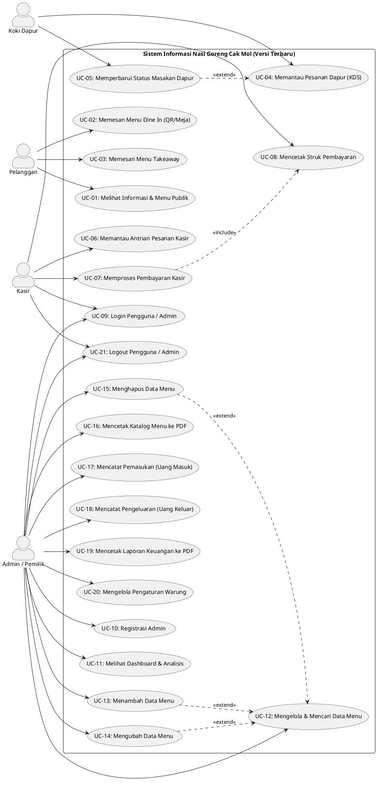

### 4.2 Definisi dan Deskripsi 21 Use Case

| ID Use Case | Nama Use Case | Aktor Utama | Deskripsi Fungsional |
|---|---|---|---|
| **UC-01** | Melihat Informasi & Menu Publik | Pelanggan | Pelanggan mengakses landing page profil, informasi operasional, dan katalog menu terkelompok berdasarkan database kategori. |
| **UC-02** | Memesan Menu Dine In (QR/Meja) | Pelanggan | Pelanggan memesan makanan di tempat dengan pemindaian kode QR meja atau pemilihan nomor meja manual, kustomisasi rasa, dan submit order. |
| **UC-03** | Memesan Menu Takeaway | Pelanggan | Pelanggan memesan makanan untuk dibawa pulang secara mandiri dengan input nama pemesan wajib dan pengalokasian meja non-aktif. |
| **UC-04** | Memantau Pesanan Dapur (KDS) | Koki | Koki memantau antrean pesanan makanan pada layar Kitchen Display System dua kolom secara real-time berbasis auto-polling 5 detik. |
| **UC-05** | Memperbarui Status Masakan Dapur | Koki | Koki mengubah progres masakan secara interaktif dari *Menunggu* menjadi *Dimasak*, lalu menjadi *Siap*. |
| **UC-06** | Memantau Antrian Pesanan Kasir | Kasir | Kasir memantau pesanan masuk berstatus Pending yang terintegrasi dengan indikator kesiapan dapur dan notifikasi audio. |
| **UC-07** | Memproses Pembayaran Kasir | Kasir | Kasir membuka modal tagihan, memilih metode pembayaran (Cash/QRIS), menghitung uang kembalian, dan menutup pesanan menjadi Lunas/Selesai. |
| **UC-08** | Mencetak Struk Pembayaran | Kasir | Sistem merender tampilan struk ukuran printer thermal 58mm/80mm dan memicu jendela dialog print secara otomatis. |
| **UC-09** | Login Pengguna / Admin | Admin, Kasir | Otentikasi pengguna berbasis username dan password dengan proteksi sesi aman dan CSRF. |
| **UC-10** | Registrasi Admin | Admin | Pendaftaran akun admin baru ke dalam basis data dengan enkripsi password. |
| **UC-11** | Melihat Dashboard & Analisis | Admin | Penayangan ringkasan omzet, grafik pendapatan 7 hari, 5 menu terlaris, dan transaksi kasir terbaru. |
| **UC-12** | Mengelola & Mencari Data Menu | Admin | Penayangan tabel seluruh menu dan pencarian langsung multi-kolom kata kunci. |
| **UC-13** | Menambah Data Menu | Admin | Formulir penambahan menu baru dengan upload foto terenkripsi ke direktori penyimpanan. |
| **UC-14** | Mengubah Data Menu | Admin | Formulir pembaruan atribut data menu dan opsi penggantian file foto dengan pembersihan foto lama. |
| **UC-15** | Menghapus Data Menu | Admin | Penghapusan data menu dari database beserta penghapusan berkas gambar fisiknya. |
| **UC-16** | Mencetak Katalog Menu ke PDF | Admin | Pembuatan dokumen katalog menu resmi berformat PDF landscape via mPDF. |
| **UC-17** | Mencatat Pemasukan (Uang Masuk) | Admin | Pencatatan pemasukan dana manual non-kasir ke dalam tabel `uang_masuk`. |
| **UC-18** | Mencatat Pengeluaran (Uang Keluar) | Admin | Pencatatan pengeluaran dana belanja operasional warung ke dalam tabel `uang_keluar`. |
| **UC-19** | Mencetak Laporan Keuangan ke PDF | Admin | Pembuatan laporan resmi ikhtisar laba rugi, rincian pemasukan, dan pengeluaran format PDF via mPDF. |
| **UC-20** | Mengelola Pengaturan Warung | Admin | Pengubahan informasi nama warung, alamat, WhatsApp, dan teks berjalan (*running text*) di database. |
| **UC-21** | Logout Pengguna / Admin | Admin, Kasir | Penutupan dan penghancuran sesi kerja aktif pengguna pada peramban. |

---

### 4.3 Skenario Use Case Lengkap

#### UC-01: Melihat Informasi & Menu Publik
- **Aktor**: Pelanggan
- **Pre-kondisi**: Pelanggan memiliki peramban web aktif dan terhubung ke jaringan internet.
- **Post-kondisi**: Informasi warung dan katalog produk tersaji secara interaktif di layar.

| Skenario Normal | |
|---|---|
| **Aktivitas sebelum use case** | Pelanggan membuka peramban web dan mengakses URL `user/index.php`. |
| **Aksi Aktor** | **Reaksi Sistem** |
| 1. Membuka alamat `user/index.php`. | 2. Mengambil data menu dari tabel `menu` dan data tab kategori dinamis dari tabel `kategori`. |
| | 3. Merender komponen hero, rating GoFood/Maps, cerita Cak Mol, galeri bento, review, jam buka, dan peta lokasi. |
| 4. Mengklik tombol tab kategori (cth: "Mie & Noodle"). | 5. Menjalankan fungsi JavaScript `switchTab()` untuk menampilkan kartu menu kategori terpilih dengan animasi transisi halus. |
| 6. Mengklik tombol CTA "Pesan Dine In". | 7. Mengarahkan halaman browser menuju `user/order.php`. |
| **Aktivitas sesudah use case** | Pelanggan beralih ke halaman pemesanan makanan. |

- **Kondisi Alternatif / Eksepsi**:
  - Jika server database tidak dapat dijangkau, sistem memunculkan galat koneksi basis data.

---

#### UC-02: Memesan Menu Dine In (QR/Meja)
- **Aktor**: Pelanggan
- **Pre-kondisi**: Pelanggan membuka `user/order.php` (baik melalui scan QR meja `?meja=meja-1` maupun akses langsung).
- **Post-kondisi**: Pesanan tersimpan di basis data dengan status_dapur *Menunggu*, status_pesanan *Pending*, dan meja teridentifikasi.

| Skenario Normal | |
|---|---|
| **Aktivitas sebelum use case** | Pelanggan duduk di meja makan warung dan mengakses `user/order.php`. |
| **Aksi Aktor** | **Reaksi Sistem** |
| 1. Mengakses halaman pemesanan Dine In. | 2. Memeriksa parameter URL `?meja=...`. Jika ada kode QR valid, meja otomatis terpilih. Jika tidak ada, merender dropdown pilihan nomor meja (`#meja-select`). |
| 3. Memilih nomor meja (jika belum terpilih dari QR). | 4. Memperbarui atribut `tableId` pada state JavaScript. |
| 5. Memilih menu dan menekan tombol "+ Tambah". | 6. Membuka modal kustomisasi: opsi pedas (level 0 s.d 4) dan textarea catatan khusus. |
| 7. Mengisi preferensi dan menekan "Tambahkan". | 8. Menambahkan objek item ke array `cart`, menyimpan ke `localStorage`, dan membuka drawer keranjang. |
| 9. Mengisi input nama pelanggan (opsional) di drawer keranjang dan menekan "Konfirmasi Pesanan". | 10. Mengirimkan payload JSON via fetch POST ke `user/process_order.php` dengan data: `items`, `total_bayar`, `meja_id`, `nama_pelanggan`, dan `tipe_pesanan = 'Dine In'`. |
| | 11. Server memulai database transaction, memvalidasi nomor meja di tabel `meja`, menghitung total bayar server-side, melakukan `INSERT INTO pesanan` (dengan status_dapur 'Menunggu', status_pesanan 'Pending'), lalu `INSERT INTO detail_pesanan` untuk tiap item. |
| | 12. Server mengubah status meja menjadi 'Terisi' (`UPDATE meja SET status_meja = 'Terisi' WHERE id_meja = ?`) dan melakukan `mysqli_commit()`. |
| | 13. Client menampilkan animasi memasak (*Cooking Overlay*) selama 3 detik, mengosongkan keranjang di `localStorage`, dan merender struk digital sementara. |
| **Aktivitas sesudah use case** | Pelanggan menunggu makanan disiapkan oleh koki dan diantar pelayan. |

- **Kondisi Alternatif / Eksepsi**:
  - Pelanggan belum memilih nomor meja: Muncul peringatan "Silakan pilih meja terlebih dahulu!" dan submit dibatalkan.
  - Gagal transaksi database: Server menjalankan `mysqli_rollback()` dan mengembalikan JSON status error.

---

#### UC-03: Memesan Menu Takeaway
- **Aktor**: Pelanggan
- **Pre-kondisi**: Pelanggan berada di halaman `user/takeaway.php`.
- **Post-kondisi**: Pesanan tercatat dengan tipe 'Takeaway', `id_meja` bernilai NULL, dan nama pemesan terdata.

| Skenario Normal | |
|---|---|
| **Aktivitas sebelum use case** | Pelanggan ingin memesan untuk dibawa pulang dan membuka `user/takeaway.php`. |
| **Aksi Aktor** | **Reaksi Sistem** |
| 1. Memilih menu yang diinginkan dan mengklik "+ Tambah". | 2. Membuka modal kustomisasi tingkat pedas dan catatan. |
| 3. Menekan tombol "Tambahkan". | 4. Memasukkan item ke array `cart` dan membuka drawer keranjang belanja. |
| 5. Memasukkan Nama Pemesan pada field "Nama Anda (Wajib)". | 6. Menerima input string nama pelanggan. |
| 7. Mengklik tombol "Konfirmasi Pesanan". | 8. Mengirimkan payload JSON ke `process_order.php` dengan parameter `meja_id: 0`, `nama_pelanggan`, dan `tipe_pesanan: 'Takeaway'`. |
| | 9. Server memproses transaksi, menyimpan header pesanan dengan `id_meja = NULL`, mencatat detail item menu, dan mengeksekusi `commit`. |
| | 10. Client menampilkan animasi memasak dan struk digital pemesanan bawa pulang. |
| **Aktivitas sesudah use case** | Pelanggan menunggu panggilan nama pemesan dari kasir/dapur saat pesanan siap. |

- **Kondisi Alternatif / Eksepsi**:
  - Nama pelanggan dikosongkan: Sistem memunculkan alert "Nama Anda wajib diisi untuk pemesanan bawa pulang (Takeaway)!" dan membatalkan pengiriman.

---

#### UC-04: Memantau Pesanan Dapur (KDS)
- **Aktor**: Koki / Dapur
- **Pre-kondisi**: Perangkat tablet/monitor dapur menampilkan halaman `kitchen/index.php`.
- **Post-kondisi**: Daftar antrean masakan tersaji real-time dalam dua kolom terpisah.

| Skenario Normal | |
|---|---|
| **Aktivitas sebelum use case** | Koki membuka browser monitor dapur pada URL `kitchen/index.php`. |
| **Aksi Aktor** | **Reaksi Sistem** |
| 1. Membuka halaman Kitchen Display System. | 2. Mengambil data pesanan berstatus dapur 'Menunggu' dan 'Dimasak' melalui query database terurut waktu pemesanan. |
| | 3. Merender layout KDS dua kolom: Kolom Kiri ("Menunggu Masak") dan Kolom Kanan ("Sedang Dimasak"). |
| | 4. Menampilkan kartu pesanan lengkap dengan ID order, label Meja/Takeaway, nama pemesan, rincian menu snapshot, badge level pedas, catatan, timer durasi tunggu (*elapsed time*), dan tombol aksi. |
| | 5. Menjalankan skrip background polling setiap 5 detik ke `kitchen/poll_kitchen.php`. |
| | 6. Jika terdeteksi adanya order baru, sistem membunyikan lonceng audio synthesizer notifikasi dan merender kartu pesanan baru. |
| **Aktivitas sesudah use case** | Koki membagi tugas memasak hidangan sesuai urutan tiket waktu tunggu. |

- **Kondisi Alternatif / Eksepsi**:
  - Koneksi ke server terputus: Indikator status di pojok kanan atas berubah menjadi warna merah "Offline", sistem terus mencoba rekoneksi otomatis.

---

#### UC-05: Memperbarui Status Masakan Dapur
- **Aktor**: Koki / Dapur
- **Pre-kondisi**: Terdapat kartu antrean pesanan pada monitor KDS.
- **Post-kondisi**: Status dapur pada tabel `pesanan` terupdate di database MySQL.

| Skenario Normal | |
|---|---|
| **Aktivitas sebelum use case** | Koki mulai memasak atau telah menyelesaikan masakan suatu pesanan. |
| **Aksi Aktor** | **Reaksi Sistem** |
| 1. Menekan tombol "Mulai Masak" pada kartu di kolom "Menunggu Masak". | 2. Mengirimkan request AJAX POST ke `kitchen/update_status.php` dengan parameter `id_pesanan` dan `status = 'Dimasak'`. |
| | 3. Server memperbarui status pesanan: `UPDATE pesanan SET status_dapur = 'Dimasak' WHERE id_pesanan = ?`. |
| | 4. Kartu berpindah secara visual dari kolom "Menunggu Masak" ke kolom "Sedang Dimasak". |
| 5. Setelah masakan selesai dibuat, koki menekan tombol "Siap Saji". | 6. Mengirimkan request AJAX POST ke `kitchen/update_status.php` dengan parameter `status = 'Siap'`. |
| | 7. Server mengupdate database: `UPDATE pesanan SET status_dapur = 'Siap' WHERE id_pesanan = ?`. |
| | 8. Kartu pesanan menghilang dari layar KDS (karena statusnya telah 'Siap'). Pada saat yang sama di layar kasir, kartu pesanan tersebut berkedip hijau menandakan siap diantar/dibayar. |
| **Aktivitas sesudah use case** | Pelayan mengantarkan hidangan ke meja pelanggan dan kasir siap menerima pembayaran. |

- **Kondisi Alternatif / Eksepsi**:
  - Gagal koneksi saat update status: Sistem memunculkan alert "Gagal memperbarui status masakan" dan mempertahankan posisi kartu.

---

#### UC-06: Memantau Antrian Pesanan Kasir
- **Aktor**: Kasir
- **Pre-kondisi**: Kasir telah login ke dalam sistem dan berada di `user/kasir.php`.
- **Post-kondisi**: Daftar antrean pesanan pending tersaji di layar kasir.

| Skenario Normal | |
|---|---|
| **Aktivitas sebelum use case** | Kasir membuka halaman `user/kasir.php`. |
| **Aksi Aktor** | **Reaksi Sistem** |
| 1. Mengakses `user/kasir.php`. | 2. Memeriksa sesi via `confirm_kasir_login()`. Jika belum login, redirect ke `admin/login.php`. |
| | 3. Mengambil data pesanan dengan status 'Pending' menggunakan `LEFT JOIN meja` (agar pesanan takeaway tetap terbaca). |
| | 4. Merender kartu antrean pesanan: Nama Meja / Badge Takeaway, waktu pemesanan, nama pelanggan, badge status dapur (*Menunggu*, *Dimasak*, atau *Siap*), rincian item, dan total bayar. |
| | 5. Jika ada pesanan berstatus dapur 'Siap', kartu diberi style border hijau dan efek animasi `pulse-green`. |
| | 6. Menjalankan auto-polling setiap 8 detik ke `user/poll_orders.php` memantau `pending_count` dan `status_hash`. |
| | 7. Jika ada perubahan status pesanan baru atau masakan siap dari dapur, sistem memainkan bunyi beep notifikasi dan merefresh tampilan. |
| **Aktivitas sesudah use case** | Kasir memantau status kesiapan makanan dan bersiap melayani pembayaran. |

- **Kondisi Alternatif / Eksepsi**:
  - Modal pembayaran sedang terbuka oleh kasir: Polling menahan *auto-reload* agar kasir tidak terganggu saat menginputkan uang pembayaran.

---

#### UC-07: Memproses Pembayaran Kasir
- **Aktor**: Kasir
- **Pre-kondisi**: Pelanggan mendatangi meja kasir untuk membayar tagihan pesanan.
- **Post-kondisi**: Pesanan berstatus 'Selesai', metode bayar tersimpan, meja dikosongkan, browser diarahkan ke cetak struk.

| Skenario Normal | |
|---|---|
| **Aktivitas sebelum use case** | Kasir mencocokkan nomor meja/nama pelanggan pada kartu antrean di monitor kasir. |
| **Aksi Aktor** | **Reaksi Sistem** |
| 1. Menekan tombol "Proses Pembayaran" pada kartu pesanan terkait. | 2. Membuka modal popup pembayaran bertema premium: menampilkan nama meja, total tagihan berformat besar, radio button metode pembayaran, input nominal, dan tombol preset pecahan tunai. |
| 3. Memilih metode pembayaran "Cash / Tunai" (default) atau "QRIS Nontunai". | 4. Jika QRIS dipilih: menampilkan gambar kode QRIS statis warung (`assets/qris.jpg`). Jika Cash dipilih: menampilkan field input uang diterima. |
| 5. Menginputkan nominal uang yang diserahkan pelanggan (atau mengklik tombol preset: Uang Pas, 20k, 50k, 100k). | 6. Sistem secara real-time menghitung kembalian uang (`cash-change`). Jika uang kurang, teks berwarna merah "Kurang Rp ...". Jika cukup, teks berwarna hijau "Rp ...". |
| 7. Mengklik tombol "Selesaikan". | 8. Memvalidasi token CSRF form (`csrf_token`). |
| | 9. Mengupdate record pesanan: `status_pesanan = 'Selesai'`, `metode_bayar = ?`, dan `waktu_selesai = NOW()`. |
| | 10. Mengambil `id_meja` dari pesanan. Jika pesanan Dine In (`id_meja > 0`), sistem mengeksekusi `UPDATE meja SET status_meja = 'Kosong' WHERE id_meja = ?`. |
| | 11. Mengarahkan browser kasir secara instan ke `user/cetak_struk.php?id={id_pesanan}`. |
| **Aktivitas sesudah use case** | Transaksi lunas, kasir mencetak struk fisik belanja untuk diserahkan ke pelanggan. |

- **Kondisi Alternatif / Eksepsi**:
  - Nominal tunai yang dimasukkan kasir kurang dari grand total tagihan: Form submit dicegah oleh JavaScript dengan alert peringatan "Uang tunai yang diterima kurang dari total tagihan!".

---

#### UC-08: Mencetak Struk Pembayaran
- **Aktor**: Kasir
- **Pre-kondisi**: Transaksi pesanan telah diselesaikan pada UC-07 dan browser membuka `user/cetak_struk.php?id={id}`.
- **Post-kondisi**: Dokumen struk fisik tercetak melalui thermal printer kasir.

| Skenario Normal | |
|---|---|
| **Aktivitas sebelum use case** | Kasir dialihkan dari penyelesaian pembayaran di `kasir.php`. |
| **Aksi Aktor** | **Reaksi Sistem** |
| 1. Halaman `user/cetak_struk.php` dimuat di browser kasir. | 2. Memeriksa otentikasi login kasir via `confirm_kasir_login()`. |
| | 3. Mengambil data pesanan dan rincian item dari database berdasarkan parameter `id`. |
| | 4. Merender layout struk berukuran 280px (standar lebar printer thermal 58mm/80mm): Kop warung, nomor invoice `#CM-xx`, nomor meja/Takeaway, nama pelanggan, waktu, daftar menu, grand total, metode bayar, dan ucapan terima kasih. |
| | 5. Event listener `DOMContentLoaded` secara otomatis memicu perintah cetak peramban (`window.print()`) setelah jeda 300ms. |
| 6. Kasir mengonfirmasi dialog printer dan mengambil kertas struk fisik. | 7. Printer mencetak struk belanja. |
| 8. Kasir menekan tombol "Kembali ke Kasir" di layar. | 9. Mengarahkan halaman browser kembali ke monitor antrean `user/kasir.php`. |
| **Aktivitas sesudah use case** | Struk fisik diserahkan kepada pelanggan bersama uang kembalian (jika tunai). |

- **Kondisi Alternatif / Eksepsi**:
  - Parameter ID pesanan tidak valid: Sistem memunculkan teks galat "ID Pesanan tidak valid." dan menghentikan rendering.

---

#### UC-09: Login Pengguna / Admin
- **Aktor**: Admin, Kasir
- **Pre-kondisi**: Pengguna berada di halaman `admin/login.php`.
- **Post-kondisi**: Sesi terotentikasi aktif, hak akses diberikan sesuai kredensial.

| Skenario Normal | |
|---|---|
| **Aktivitas sebelum use case** | Pengelola membuka halaman login sistem di `admin/login.php`. |
| **Aksi Aktor** | **Reaksi Sistem** |
| 1. Membuka formulir login. | 2. Memeriksa cookie remember me (`id` dan `key`). Jika valid, set session dan redirect langsung. Jika tidak, merender form login dengan token CSRF. |
| 3. Memasukkan username, password, centang "Ingat saya" (opsional), lalu klik "Masuk". | 4. Memverifikasi token CSRF `check_csrf_token()`. |
| | 5. Mencari user di database menggunakan prepared statement query. |
| | 6. Memverifikasi kata sandi via `password_verify($password, $row['password'])`. |
| | 7. Menginisialisasi sesi aman via `init_user_session()`, meregenerasi ID sesi (`session_regenerate_id(true)`), dan mengeset cookie remember me jika dicentang. |
| | 8. Mengalihkan halaman ke `admin/index.php`. |
| **Aktivitas sesudah use case** | Pengguna memiliki akses ke halaman manajemen dashboard dan kasir monitor. |

- **Kondisi Alternatif / Eksepsi**:
  - Kredensial salah: Sistem memunculkan alert merah "Username atau Password salah!".
  - Token CSRF tidak valid: Sistem menampilkan pesan galat "CSRF Token validation failed.".

---

#### UC-10: Registrasi Admin
- **Aktor**: Admin
- **Pre-kondisi**: Pengguna berada di halaman `admin/registrasi.php`.
- **Post-kondisi**: Akun pengguna baru terdaftar di tabel `user`.

| Skenario Normal | |
|---|---|
| **Aktivitas sebelum use case** | Admin ingin mendaftarkan staf baru melalui `admin/registrasi.php`. |
| **Aksi Aktor** | **Reaksi Sistem** |
| 1. Mengisi formulir pendaftaran: Nama Lengkap, Username, Password, dan Konfirmasi Password. | 2. Menerima data masukan form. |
| 3. Menekan tombol "Daftar Sekarang". | 4. Mengecek keunikan username di database melalui fungsi `registrasi()`. |
| | 5. Memverifikasi kecocokan antara Password dan Konfirmasi Password. |
| | 6. Mengenkripsi password menggunakan `password_hash($password, PASSWORD_DEFAULT)`. |
| | 7. Menyimpan akun baru ke tabel `user` menggunakan prepared statement. |
| | 8. Menampilkan notifikasi "User admin berhasil didaftarkan! Silahkan Login." dan redirect ke `admin/login.php`. |
| **Aktivitas sesudah use case** | Akun baru siap digunakan untuk login ke sistem. |

- **Kondisi Alternatif / Eksepsi**:
  - Username sudah terdaftar: Muncul notifikasi "Username sudah terdaftar!", proses dibatalkan.
  - Password tidak cocok: Muncul notifikasi "Konfirmasi password tidak sesuai!", proses dibatalkan.

---

#### UC-11: Melihat Dashboard & Analisis
- **Aktor**: Admin / Pemilik
- **Pre-kondisi**: Admin telah login dan berada di `admin/index.php?page=dashboard`.
- **Post-kondisi**: Seluruh metrik operasional dan grafik analitik tersaji di antarmuka.

| Skenario Normal | |
|---|---|
| **Aktivitas sebelum use case** | Admin membuka dashboard utama sistem. |
| **Aksi Aktor** | **Reaksi Sistem** |
| 1. Membuka halaman dashboard (`admin/index.php?page=dashboard`). | 2. Memverifikasi hak akses admin via `confirm_admin_login()`. |
| | 3. Menghitung ringkasan metrik: Total Pemasukan dari pesanan selesai (`SUM(total_bayar)`), Total Pesanan Sukses (`COUNT(*)`), Total Menu Aktif, dan Net Laba Bersih. |
| | 4. Mengambil data histori omzet 7 hari terakhir dan mengompilasinya ke format dataset Chart.js untuk menampilkan grafik batang/garis omzet mingguan. |
| | 5. Mengambil 5 Menu Terlaris (*Top 5 Best Seller*) berdasarkan akumulasi `SUM(jumlah)` pada tabel `detail_pesanan`. |
| | 6. Mengambil 5 Transaksi Kasir Terbaru beserta waktu, meja/takeaway, metode bayar, dan total harga. |
| | 7. Merender tampilan dashboard analitik secara responsif. |
| **Aktivitas sesudah use case** | Pemilik warung dapat mengevaluasi performa bisnis dan tren penjualan. |

- **Kondisi Alternatif / Eksepsi**:
  - Belum ada transaksi: Metrik bernilai Rp 0 dan daftar transaksi menampilkan pesan kosong.

---

#### UC-12: Mengelola & Mencari Data Menu
- **Aktor**: Admin
- **Pre-kondisi**: Admin berada di tab Menu (`admin/index.php?page=menu`).
- **Post-kondisi**: Tabel inventaris menu ditampilkan sesuai filter pencarian.

| Skenario Normal | |
|---|---|
| **Aktivitas sebelum use case** | Admin memilih menu navigasi "Manajemen Menu" pada sidebar dashboard. |
| **Aksi Aktor** | **Reaksi Sistem** |
| 1. Membuka tab Manajemen Menu. | 2. Mengambil data seluruh menu dari database (`SELECT * FROM menu ORDER BY id_menu DESC`). |
| | 3. Merender tabel data menu: No, Foto, Nama Menu, Kategori Badge, Harga Satuan, Deskripsi, dan Tombol Opsi (Edit & Hapus). |
| 4. Memasukkan kata kunci pada kotak pencarian dan menekan "Cari Data". | 5. Menjalankan fungsi `search()` menggunakan prepared statement query dengan klausa `LIKE` pada nama, kategori, atau harga menu. |
| | 6. Memperbarui tabel dengan hasil pencarian dan menampilkan tombol Reset. |
| 7. Mengklik tombol Reset. | 8. Mengembalikan tampilan ke seluruh daftar menu. |
| **Aktivitas sesudah use case** | Admin dapat menambah, mengedit, atau menghapus menu terpilih. |

- **Kondisi Alternatif / Eksepsi**:
  - Menu tidak ditemukan: Tabel menampilkan pesan "Tidak ada data menu ditemukan di database.".

---

#### UC-13: Menambah Data Menu
- **Aktor**: Admin
- **Pre-kondisi**: Admin berada di halaman `admin/add.php`.
- **Post-kondisi**: Record menu baru tersimpan di tabel `menu` dan file foto tersimpan di direktori `img/`.

| Skenario Normal | |
|---|---|
| **Aktivitas sebelum use case** | Admin mengklik tombol "+ Tambah Menu" pada tab Menu. |
| **Aksi Aktor** | **Reaksi Sistem** |
| 1. Mengisi form tambah: Nama Menu, Harga Jual, Dropdown Kategori (diambil dari tabel `kategori`), Deskripsi, dan Memilih Berkas Foto. | 2. Menerima data form teks dan data berkas `$_FILES`. |
| 3. Mengklik tombol "Simpan Menu Baru". | 4. Memanggil fungsi `tambah()` yang mengeksekusi validasi fungsi `upload()`. |
| | 5. Memeriksa ekstensi gambar (`jpg`, `jpeg`, `png`) dan ukuran file (maksimal 2MB). |
| | 6. Menghasilkan nama unik berkas dan memindahkannya ke direktori `../img/`. |
| | 7. Mengeksekusi query `INSERT INTO menu` dengan prepared statement yang aman. |
| | 8. Menampilkan notifikasi "Menu berhasil ditambahkan!" dan mengarahkan kembali ke `admin/index.php?page=menu`. |
| **Aktivitas sesudah use case** | Menu baru langsung muncul di katalog pembeli dan antrean pesanan. |

- **Kondisi Alternatif / Eksepsi**:
  - Format berkas tidak diizinkan atau ukuran melebihi 2MB: Muncul alert kegagalan dan penyimpanan dibatalkan.

---

#### UC-14: Mengubah Data Menu
- **Aktor**: Admin
- **Pre-kondisi**: Admin berada di halaman `admin/edit.php?id={id}`.
- **Post-kondisi**: Perubahan menu tersimpan di database dan foto lama terhapus jika diganti.

| Skenario Normal | |
|---|---|
| **Aktivitas sebelum use case** | Admin mengklik tombol "Edit" pada salah satu menu di tabel dashboard. |
| **Aksi Aktor** | **Reaksi Sistem** |
| 1. Membuka formulir edit menu. | 2. Mengambil data lama menu dari basis data dan mengisi nilai awal formulir. |
| 3. Memodifikasi atribut data (nama, harga, kategori, deskripsi) dan/atau memilih foto pengganti. | 4. Menerima input perubahan data. |
| 5. Mengklik tombol "Simpan Perubahan". | 6. Memeriksa apakah user mengunggah foto baru. Jika ya, upload foto baru dan hapus file foto lama di folder `../img/` via `unlink()`. Jika tidak, pertahankan nama file lama. |
| | 7. Mengeksekusi query `UPDATE menu SET ... WHERE id_menu = ?` menggunakan prepared statement. |
| | 8. Menampilkan notifikasi "Menu berhasil diubah!" dan redirect ke `admin/index.php?page=menu`. |
| **Aktivitas sesudah use case** | Data menu terbaru tersimpan dan tampil di seluruh antarmuka sistem. |

- **Kondisi Alternatif / Eksepsi**:
  - Gagal upload foto baru: Update dibatalkan dan sistem memunculkan pesan error.

---

#### UC-15: Menghapus Data Menu
- **Aktor**: Admin
- **Pre-kondisi**: Admin berada di tabel manajemen menu dan memilih menu yang ingin dihapus.
- **Post-kondisi**: Record menu dihapus dari database dan berkas gambarnya dihapus dari server.

| Skenario Normal | |
|---|---|
| **Aktivitas sebelum use case** | Admin menentukan menu yang akan dihentikan penjualannya. |
| **Aksi Aktor** | **Reaksi Sistem** |
| 1. Mengklik tombol "Hapus" pada baris menu terkait. | 2. Menampilkan konfirmasi JavaScript: "Hapus menu ini?". |
| 3. Mengonfirmasi klik "OK". | 4. Mengirimkan request ke `admin/delete.php?id={id_menu}`. |
| | 5. `delete.php` memanggil fungsi `hapus($id)`. |
| | 6. Mengambil nama berkas gambar dari database, menghapus berkas fisik di `../img/` via `unlink()`, lalu mengeksekusi `DELETE FROM menu WHERE id_menu = ?`. |
| | 7. Menampilkan alert dialog "Data berhasil dihapus selamanya!" dan mengalihkan ke `admin/index.php?page=menu`. |
| **Aktivitas sesudah use case** | Menu terhapus dari katalog dan daftar inventaris. |

- **Kondisi Alternatif / Eksepsi**:
  - Admin mengklik "Cancel": Permintaan hapus dibatalkan.

---

#### UC-16: Mencetak Katalog Menu ke PDF
- **Aktor**: Admin
- **Pre-kondisi**: Admin telah login dan berada di tab Menu.
- **Post-kondisi**: Berkas PDF katalog menu ter-generate dan ditampilkan di browser tab baru.

| Skenario Normal | |
|---|---|
| **Aktivitas sebelum use case** | Admin memerlukan dokumen fisik katalog menu. |
| **Aksi Aktor** | **Reaksi Sistem** |
| 1. Mengklik tombol "Cetak Menu" di header halaman manajemen menu. | 2. Membuka tab baru mengarah ke `admin/cetakPDF.php`. |
| | 3. Memverifikasi hak akses admin via `confirm_admin_login()`. |
| | 4. Mengambil seluruh data menu dan mengonstruksi template HTML laporan (Kop Warung Cak Mol, info metadata pencetakan, tabel data menu berfoto, dan kolom tanda tangan pemilik). |
| | 5. Mengompilasi string HTML menjadi PDF via pustaka mPDF berorientasi Landscape (`orientation: L`). |
| | 6. Mengirimkan dokumen binary PDF ke browser kasir/admin (`Laporan-Menu-CakMol.pdf`). |
| **Aktivitas sesudah use case** | Dokumen siap diunduh atau dicetak menggunakan printer dokumen. |

- **Kondisi Alternatif / Eksepsi**:
  - Foto menu tidak ditemukan di direktori: Sistem mencetak label "[No Image]".

---

#### UC-17: Mencatat Pemasukan (Uang Masuk)
- **Aktor**: Admin / Pemilik
- **Pre-kondisi**: Admin berada di tab Keuangan (`admin/index.php?page=keuangan`).
- **Post-kondisi**: Record uang masuk baru tersimpan di tabel `uang_masuk`.

| Skenario Normal | |
|---|---|
| **Aktivitas sebelum use case** | Warung menerima dana masuk tambahan (cth: modal kas awal atau pesanan catering khusus). |
| **Aksi Aktor** | **Reaksi Sistem** |
| 1. Membuka tab Keuangan pada sidebar dashboard. | 2. Merender ikhtisar keuangan: Total Pemasukan, Total Pengeluaran, Net Laba/Rugi, tabel Pemasukan, dan tabel Pengeluaran. |
| 3. Mengklik tombol "+ Catat Uang Masuk". | 4. Membuka modal popup formulir uang masuk. |
| 5. Mengisi field form: Sumber Dana, Jumlah Nominal (Rp), Tanggal, Keterangan, dan menyertakan token CSRF. | 6. Menerima input data transaksi pemasukan. |
| 7. Mengklik tombol "Simpan Uang Masuk". | 8. Memvalidasi token CSRF dan mengeksekusi query `INSERT INTO uang_masuk (sumber, jumlah, tanggal, keterangan) VALUES (?, ?, ?, ?)`. |
| | 9. Menampilkan alert sukses dan merefresh halaman keuangan. Total pemasukan dan laba bersih langsung ter-update secara otomatis. |
| **Aktivitas sesudah use case** | Pemasukan tercatat rapi di pembukuan digital warung. |

- **Kondisi Alternatif / Eksepsi**:
  - Nominal input tidak valid atau bernilai 0: Form submit ditolak dengan pesan peringatan.

---

#### UC-18: Mencatat Pengeluaran (Uang Keluar)
- **Aktor**: Admin / Pemilik
- **Pre-kondisi**: Admin berada di tab Keuangan (`admin/index.php?page=keuangan`).
- **Post-kondisi**: Record uang keluar baru tersimpan di tabel `uang_keluar`.

| Skenario Normal | |
|---|---|
| **Aktivitas sebelum use case** | Warung mengeluarkan biaya belanja bahan baku (beras, telur, ayam, minyak) atau operasional (gas elpiji, listrik). |
| **Aksi Aktor** | **Reaksi Sistem** |
| 1. Mengklik tombol "+ Catat Uang Keluar" di tab Keuangan. | 2. Membuka modal popup formulir pencatatan pengeluaran. |
| 3. Mengisi field: Jenis Pengeluaran (Belanja Bahan/Operasional/Gaji/Lainnya), Jumlah Nominal, Tanggal, dan Keterangan belanja. | 4. Menerima input data transaksi pengeluaran. |
| 5. Mengklik tombol "Simpan Pengeluaran". | 6. Memvalidasi token CSRF dan mengeksekusi query `INSERT INTO uang_keluar (jenis, jumlah, tanggal, keterangan) VALUES (?, ?, ?, ?)`. |
| | 7. Menampilkan alert sukses dan memperbarui tabel rincian pengeluaran serta kalkulasi net laba/rugi di dashboard keuangan. |
| **Aktivitas sesudah use case** | Biaya belanja operasional terdokumentasi secara transparan. |

- **Kondisi Alternatif / Eksepsi**:
  - Validasi CSRF gagal: Sistem menampilkan pesan galat penolakan.

---

#### UC-19: Mencetak Laporan Keuangan ke PDF
- **Aktor**: Admin / Pemilik
- **Pre-kondisi**: Admin berada di tab Keuangan dan mengklik "Cetak Laporan PDF".
- **Post-kondisi**: Dokumen PDF laporan laba rugi ter-generate dan siap dicetak/diunduh.

| Skenario Normal | |
|---|---|
| **Aktivitas sebelum use case** | Pemilik warung membutuhkan laporan fisik pembukuan laba rugi periodik. |
| **Aksi Aktor** | **Reaksi Sistem** |
| 1. Mengklik tombol "Cetak Laporan PDF" di tab Keuangan. | 2. Membuka tab browser baru mengarah ke `admin/cetakLaporan.php`. |
| | 3. Memverifikasi hak akses admin via `confirm_admin_login()`. |
| | 4. Mengambil seluruh data pemasukan (gabungan pesanan selesai dari tabel `pesanan` dan penerimaan manual dari tabel `uang_masuk`) serta seluruh data pengeluaran dari tabel `uang_keluar`. |
| | 5. Menghitung akumulasi total pemasukan, total pengeluaran, dan net laba/rugi. |
| | 6. Mengonstruksi template HTML laporan keuangan: Kop resmi Cak Mol, metadata pencetak, kotak ikhtisar laba rugi, tabel rincian pemasukan, tabel rincian pengeluaran, dan paraf persetujuan. |
| | 7. Mengompilasi dokumen ke binary PDF via mPDF berorientasi Portrait (`orientation: P`). |
| | 8. Mengirimkan output stream dokumen PDF ke browser (`Laporan-Keuangan-{tanggal}.pdf`). |
| **Aktivitas sesudah use case** | Pemilik memiliki arsip laporan keuangan resmi siap cetak. |

- **Kondisi Alternatif / Eksepsi**:
  - Tidak ada data pengeluaran: Tabel pengeluaran menampilkan keterangan "Tidak ada data pengeluaran.".

---

#### UC-20: Mengelola Pengaturan Warung
- **Aktor**: Admin / Pemilik
- **Pre-kondisi**: Admin berada di tab Pengaturan (`admin/index.php?page=pengaturan`).
- **Post-kondisi**: Informasi identitas warung di tabel `pengaturan` terbarui.

| Skenario Normal | |
|---|---|
| **Aktivitas sebelum use case** | Pemilik warung ingin memperbarui nomor telepon WhatsApp, alamat cabang, atau teks pengumuman promosi. |
| **Aksi Aktor** | **Reaksi Sistem** |
| 1. Membuka tab "Pengaturan Warung" pada sidebar dashboard. | 2. Mengambil data konfigurasi saat ini dari tabel `pengaturan` (baris ID 1) dan mengisinya ke formulir. |
| 3. Memodifikasi data: Nama Warung, Alamat Lengkap, Nomor Telepon/WhatsApp, dan Running Text (pengumuman berjalan di banner). | 4. Menerima input data pembaruan identitas. |
| 5. Mengklik tombol "Simpan Pengaturan". | 6. Memvalidasi token CSRF form. |
| | 7. Mengeksekusi query `UPDATE pengaturan SET nama_warung = ?, alamat = ?, no_telepon = ?, running_text = ?, update_at = NOW() WHERE id = 1`. |
| | 8. Menampilkan alert sukses "Pengaturan warung berhasil disimpan!" dan merefresh halaman. Seluruh teks kontak di landing page dan struk kasir otomatis ter-update mengikuti data baru ini. |
| **Aktivitas sesudah use case** | Identitas dan informasi kontak warung selalu mutakhir. |

- **Kondisi Alternatif / Eksepsi**:
  - Token CSRF tidak cocok: Update dibatalkan demi keamanan.

---

#### UC-21: Logout Pengguna / Admin
- **Aktor**: Admin, Kasir
- **Pre-kondisi**: Pengguna memiliki sesi login aktif di sistem.
- **Post-kondisi**: Seluruh sesi dan cookie otentikasi dimusnahkan, pengguna diarahkan ke login page.

| Skenario Normal | |
|---|---|
| **Aktivitas sebelum use case** | Pengelola selesai bertugas dan ingin mengamankan akses sistem. |
| **Aksi Aktor** | **Reaksi Sistem** |
| 1. Mengklik tombol "Logout" pada navigasi bar atas. | 2. Menampilkan konfirmasi JavaScript: "Logout dari sistem?". |
| 3. Mengklik "OK". | 4. Mengirimkan request ke `admin/logout.php`. |
| | 5. Mengosongkan variabel array `$_SESSION = []`, menjalankan `session_unset()`, dan `session_destroy()`. |
| | 6. Menghapus cookie remember me (`id` dan `key`) dengan waktu kedaluwarsa masa lalu. |
| | 7. Mengarahkan browser kembali ke `admin/login.php`. |
| **Aktivitas sesudah use case** | Hak akses administratif dan kasir terkunci hingga login ulang dilakukan. |

- **Kondisi Alternatif / Eksepsi**:
  - Pengguna mengklik "Cancel": Sesi tetap aktif dan pengguna tidak keluar dari sistem.

---

## BAB V: PERANCANGAN AKTIVITAS SISTEM (ACTIVITY DIAGRAM)

Berikut disajikan Activity Diagram menggunakan PlantUML secara terpisah untuk setiap Use Case (UC-01 s.d. UC-21).

### 5.1 Activity Diagram UC-01: Melihat Informasi & Menu Publik
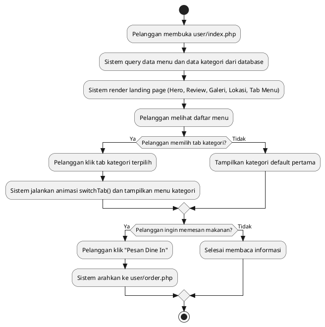

### 5.2 Activity Diagram UC-02: Memesan Menu Dine In (QR/Meja)
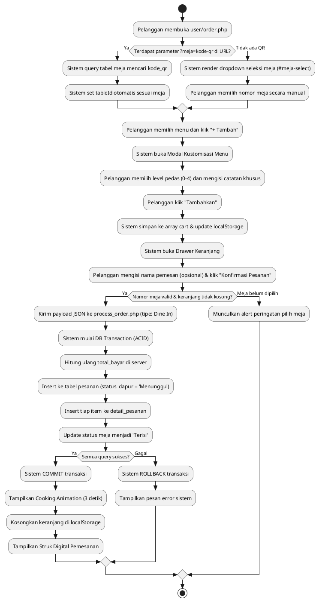

### 5.3 Activity Diagram UC-03: Memesan Menu Takeaway
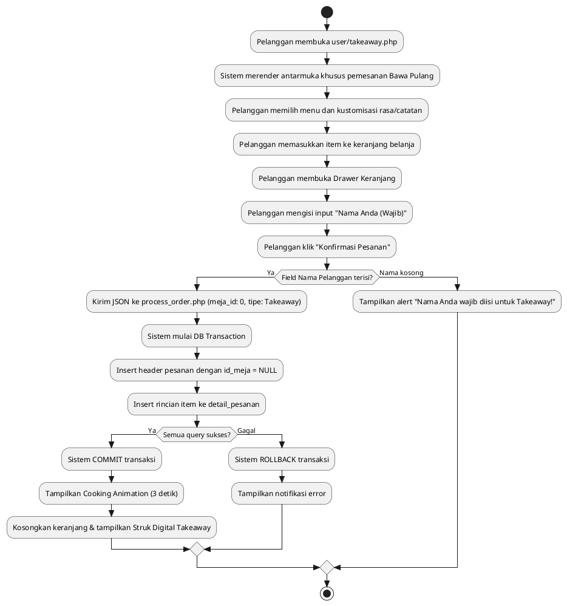

### 5.4 Activity Diagram UC-04: Memantau Pesanan Dapur (KDS)
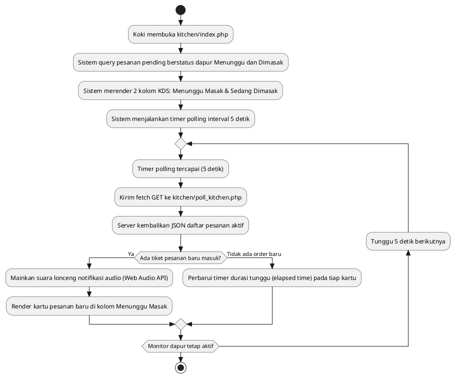

### 5.5 Activity Diagram UC-05: Memperbarui Status Masakan Dapur
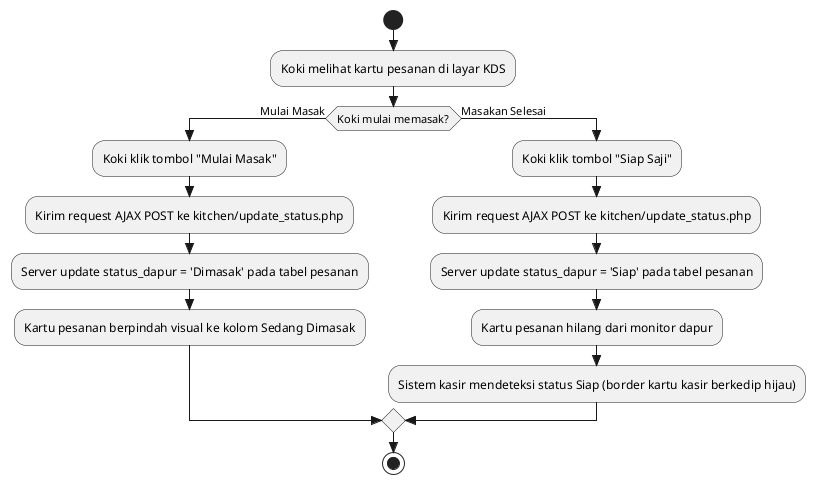

### 5.6 Activity Diagram UC-06: Memantau Antrian Pesanan Kasir
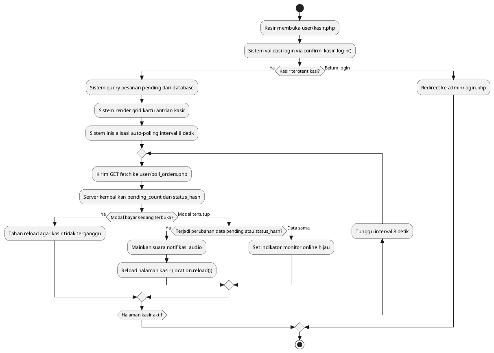

### 5.7 Activity Diagram UC-07: Memproses Pembayaran Kasir
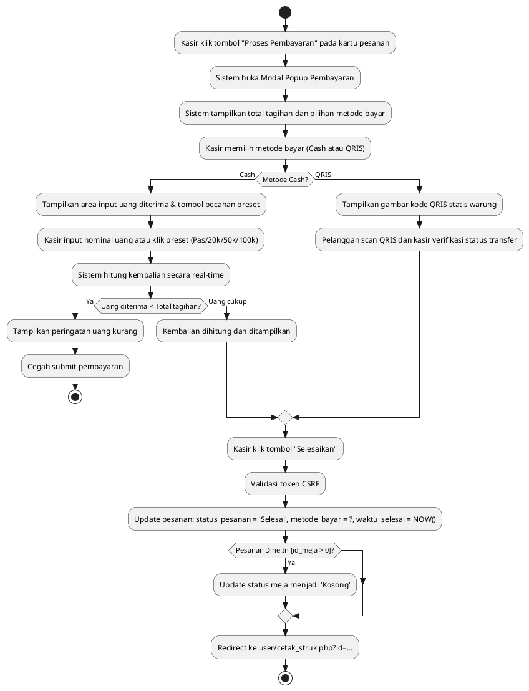

### 5.8 Activity Diagram UC-08: Mencetak Struk Pembayaran
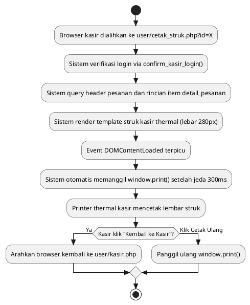

### 5.9 Activity Diagram UC-09: Login Pengguna / Admin
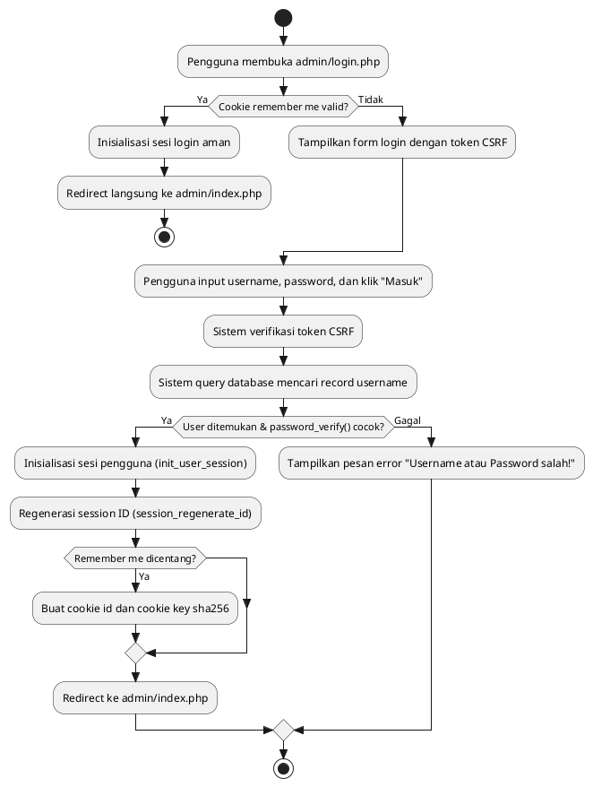

### 5.10 Activity Diagram UC-10: Registrasi Admin
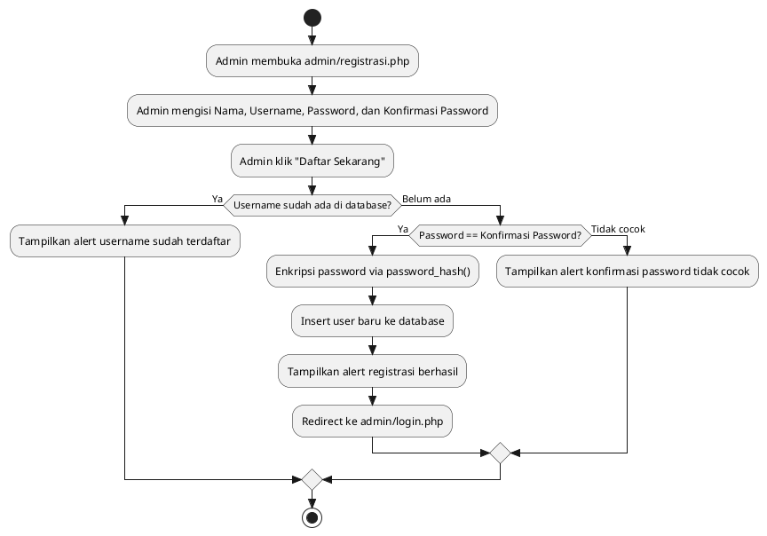

### 5.11 Activity Diagram UC-11: Melihat Dashboard & Analisis
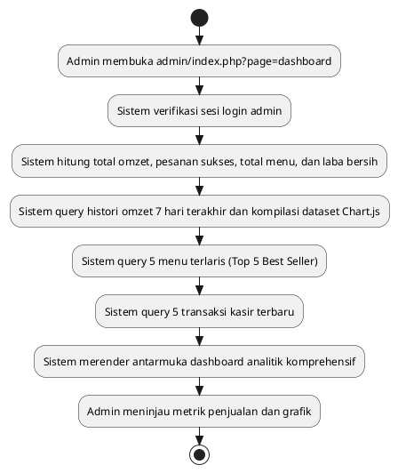

### 5.12 Activity Diagram UC-12: Mengelola & Mencari Data Menu
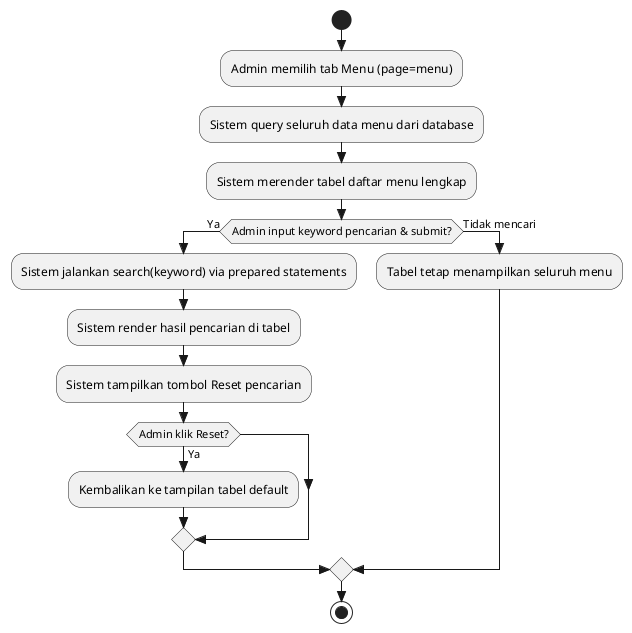

### 5.13 Activity Diagram UC-13: Menambah Data Menu
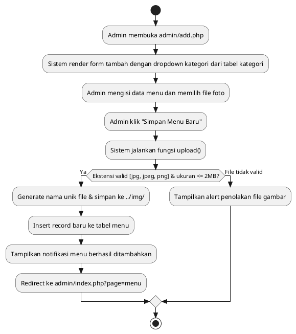

### 5.14 Activity Diagram UC-14: Mengubah Data Menu
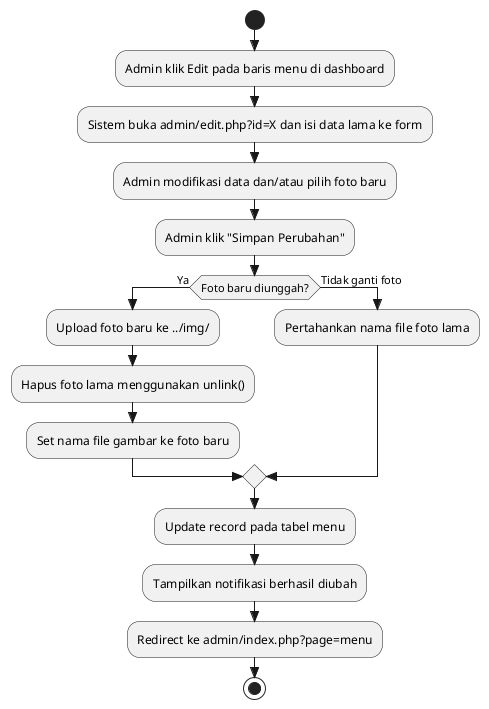

### 5.15 Activity Diagram UC-15: Menghapus Data Menu
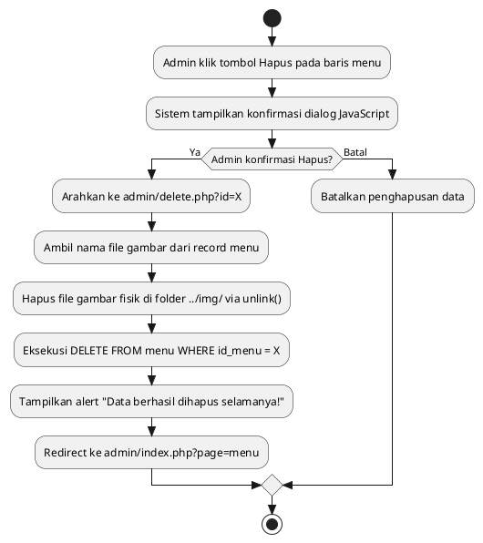

### 5.16 Activity Diagram UC-16: Mencetak Katalog Menu ke PDF
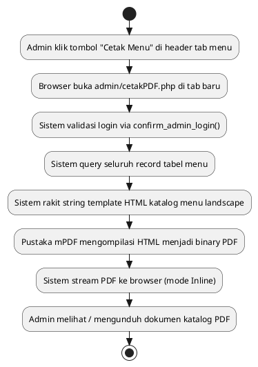

### 5.17 Activity Diagram UC-17: Mencatat Pemasukan (Uang Masuk)
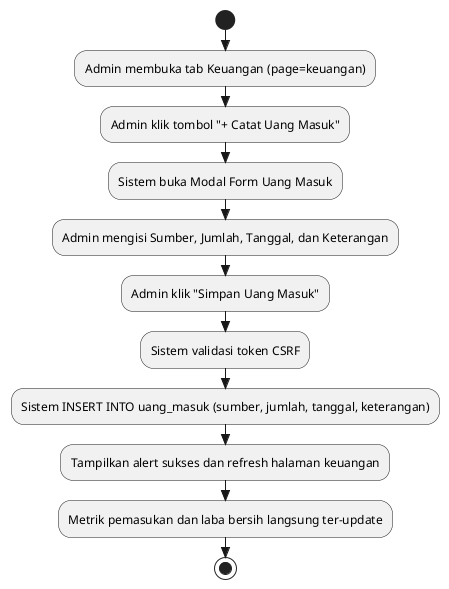

### 5.18 Activity Diagram UC-18: Mencatat Pengeluaran (Uang Keluar)
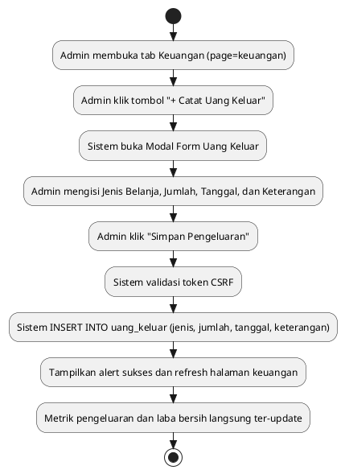

### 5.19 Activity Diagram UC-19: Mencetak Laporan Keuangan ke PDF
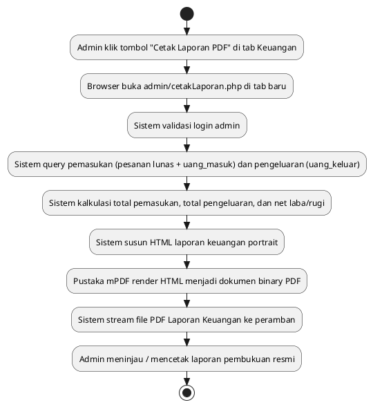

### 5.20 Activity Diagram UC-20: Mengelola Pengaturan Warung
```plantuml
@startuml
skinparam style strictuml
skinparam conditionStyle insidebar
start
:Admin membuka tab Pengaturan (page=pengaturan);
:Sistem query tabel pengaturan baris ID 1 dan isi ke form;
:Admin mengubah Nama Warung, Alamat, WhatsApp, dan Running Text;
:Admin klik "Simpan Pengaturan";
:Sistem validasi token CSRF;
:Sistem UPDATE pengaturan SET ... WHERE id = 1;
:Tampilkan notifikasi "Pengaturan warung berhasil disimpan!";
:Perubahan teks langsung aktif di landing page publik dan struk kasir;
stop
@enduml
```

### 5.21 Activity Diagram UC-21: Logout Pengguna / Admin
```plantuml
@startuml
skinparam style strictuml
skinparam conditionStyle insidebar
start
:Pengguna (Admin/Kasir) klik tombol "Logout";
:Sistem tampilkan konfirmasi JavaScript;
if (Pengguna konfirmasi Logout?) then (Ya)
  :Request ke admin/logout.php;
  :Sistem kosongkan $_SESSION = [];
  :Sistem hancurkan session_destroy();
  :Sistem hapus cookie remember me;
  :Sistem redirect browser ke admin/login.php;
else (Batal)
  :Sesi tetap aktif;
endif
stop
@enduml
```

---

## BAB VI: PERANCANGAN INTERAKSI SISTEM (SEQUENCE DIAGRAM)

Seluruh Sequence Diagram disusun dengan notasi baku PlantUML sesuai pedoman arsitektur sistem (`autonumber`, `skinparam style strictuml`, boundary/control/database terpetakan ke berkas riil).

### 6.1 Sequence Diagram UC-01: Melihat Informasi & Menu Publik
```plantuml
@startuml
autonumber
skinparam style strictuml
skinparam sequenceMessageAlign center

actor "Pelanggan" as Aktor
boundary "Halaman Utama\n(user/index.php)" as Boundary
control "Koneksi & Helper\n(includes/koneksi.php)" as Control
database "Database MySQL\n(menu & kategori)" as DB

Aktor -> Boundary : Akses user/index.php
activate Boundary
Boundary -> Control : Request data menu & kategori
activate Control

Control -> DB : SELECT * FROM menu ORDER BY id_menu ASC
activate DB
DB --> Control : Return recordset menu
deactivate DB

Control -> DB : SELECT * FROM kategori ORDER BY urutan ASC
activate DB
DB --> Control : Return recordset kategori
deactivate DB

Control --> Boundary : Return raw data
deactivate Control

Boundary -> Boundary : Grouping menu per kategori
Boundary --> Aktor : Render landing page, galeri, lokasi, dan tab kategori menu
deactivate Boundary

Aktor -> Boundary : Klik tab kategori menu (misal: "Mie & Noodle Series")
activate Boundary
Boundary -> Boundary : switchTab(index, btnElem)
Boundary --> Aktor : Tampilkan kartu menu sesuai kategori dengan animasi transisi
deactivate Boundary
@enduml
```

### 6.2 Sequence Diagram UC-02: Memesan Menu Dine In (QR/Meja)
```plantuml
@startuml
autonumber
skinparam style strictuml
skinparam sequenceMessageAlign center

actor "Pelanggan" as Aktor
boundary "Form Dine In\n(user/order.php)" as Boundary
control "API Transaksi\n(user/process_order.php)" as Control
database "Database MySQL\n(pesanan, detail, meja)" as DB

Aktor -> Boundary : Buka order.php?meja=meja-1 (atau pilih dropdown meja)
activate Boundary
Boundary -> Boundary : Set tableId = meja_id
Boundary --> Aktor : Tampilkan katalog menu Dine In & status meja
deactivate Boundary

Aktor -> Boundary : Pilih menu, atur level pedas & catatan, klik "Tambahkan"
activate Boundary
Boundary -> Boundary : Push item ke cart & simpan ke localStorage
Boundary --> Aktor : Update badge keranjang & buka drawer
deactivate Boundary

Aktor -> Boundary : Isi nama (opsional) & klik "Konfirmasi Pesanan"
activate Boundary
Boundary -> Control : POST JSON (meja_id, items, total_bayar, nama_pelanggan, tipe='Dine In')
activate Control

Control -> DB : mysqli_begin_transaction()
activate DB
deactivate DB

Control -> Control : Hitung ulang total_bayar di sisi server

Control -> DB : INSERT INTO pesanan (id_meja, nama_pelanggan, tipe_pesanan, total_bayar, status_pesanan, status_dapur) VALUES (?, ?, 'Dine In', ?, 'Pending', 'Menunggu')
activate DB
DB --> Control : Return id_pesanan baru
deactivate DB

loop Setiap item di array items
    Control -> DB : INSERT INTO detail_pesanan (id_pesanan, id_menu, nama_menu_snapshot, harga_snapshot, jumlah, level_pedas, catatan) VALUES (?, ?, ?, ?, ?, ?, ?)
    activate DB
    DB --> Control : Konfirmasi item tersimpan
    deactivate DB
end

Control -> DB : UPDATE meja SET status_meja = 'Terisi' WHERE id_meja = ?
activate DB
DB --> Control : Status meja terupdate
deactivate DB

Control -> DB : mysqli_commit()
activate DB
DB --> Control : Transaksi permanen tersimpan
deactivate DB

Control --> Boundary : Return JSON {status: 'success', order_id: ...}
deactivate Control

Boundary -> Boundary : Tampilkan Cooking Animation (3 detik)
Boundary -> Boundary : Reset localStorage('cart') & render receipt-overlay
Boundary --> Aktor : Tampilkan Struk Digital Sementara
deactivate Boundary
@enduml
```

### 6.3 Sequence Diagram UC-03: Memesan Menu Takeaway
```plantuml
@startuml
autonumber
skinparam style strictuml
skinparam sequenceMessageAlign center

actor "Pelanggan" as Aktor
boundary "Form Takeaway\n(user/takeaway.php)" as Boundary
control "API Transaksi\n(user/process_order.php)" as Control
database "Database MySQL\n(pesanan & detail)" as DB

Aktor -> Boundary : Pilih menu, atur rasa/catatan, tambah ke keranjang
activate Boundary
Boundary -> Boundary : Update cart di localStorage & buka drawer
Boundary --> Aktor : Tampilkan isi keranjang belanja
deactivate Boundary

Aktor -> Boundary : Isi "Nama Anda (Wajib)" & klik "Konfirmasi Pesanan"
activate Boundary

alt Nama pelanggan tidak kosong
    Boundary -> Control : POST JSON (meja_id: 0, nama_pelanggan, items, total_bayar, tipe='Takeaway')
    activate Control
    
    Control -> DB : mysqli_begin_transaction()
    activate DB
    deactivate DB
    
    Control -> DB : INSERT INTO pesanan (id_meja, nama_pelanggan, tipe_pesanan, total_bayar, status_pesanan, status_dapur) VALUES (NULL, ?, 'Takeaway', ?, 'Pending', 'Menunggu')
    activate DB
    DB --> Control : Return id_pesanan baru
    deactivate DB
    
    loop Setiap item dalam items
        Control -> DB : INSERT INTO detail_pesanan VALUES (...)
        activate DB
        DB --> Control : Item tersimpan
        deactivate DB
    end
    
    Control -> DB : mysqli_commit()
    activate DB
    DB --> Control : Transaksi sukses
    deactivate DB
    
    Control --> Boundary : Return JSON {status: 'success', order_id: ...}
    deactivate Control
    
    Boundary -> Boundary : Tampilkan Cooking Overlay & reset keranjang
    Boundary --> Aktor : Tampilkan Struk Digital Takeaway
else Nama kosong
    Boundary --> Aktor : Alert "Nama Anda wajib diisi untuk pemesanan Takeaway!"
end
deactivate Boundary
@enduml
```

### 6.4 Sequence Diagram UC-04: Memantau Pesanan Dapur (KDS)
```plantuml
@startuml
autonumber
skinparam style strictuml
skinparam sequenceMessageAlign center

actor "Koki Dapur" as Aktor
boundary "Monitor KDS\n(kitchen/index.php)" as Boundary
control "API Polling Dapur\n(kitchen/poll_kitchen.php)" as Control
database "Database MySQL\n(pesanan & detail)" as DB

Aktor -> Boundary : Buka antarmuka kitchen/index.php
activate Boundary
Boundary -> DB : Query pesanan pending dengan status_dapur IN ('Menunggu', 'Dimasak')
activate DB
DB --> Boundary : Return antrean awal dapur
deactivate DB
Boundary --> Aktor : Render 2 kolom KDS (Menunggu & Dimasak) dan mulai interval 5s
deactivate Boundary

loop Setiap interval 5000 ms
    Boundary -> Control : GET fetch('poll_kitchen.php')
    activate Control
    Control -> DB : SELECT * FROM pesanan WHERE status_dapur IN ('Menunggu', 'Dimasak') ORDER BY waktu_pesan ASC
    activate DB
    DB --> Control : Return list pesanan & item detail
    deactivate DB
    Control --> Boundary : Return JSON array orders
    deactivate Control
    
    alt Ada pesanan baru masuk
        Boundary -> Boundary : playNotificationSound() (Web Audio API Synthesizer)
        Boundary -> Boundary : Render tiket pesanan baru di kolom Menunggu
        Boundary --> Aktor : Mainkan bunyi lonceng & tampilkan tiket baru
    else Tidak ada order baru
        Boundary -> Boundary : Perbarui elapsed timer waktu tunggu pada kartu
    end
end
@enduml
```

### 6.5 Sequence Diagram UC-05: Memperbarui Status Masakan Dapur
```plantuml
@startuml
autonumber
skinparam style strictuml
skinparam sequenceMessageAlign center

actor "Koki Dapur" as Aktor
boundary "Monitor KDS\n(kitchen/index.php)" as Boundary
control "API Update Dapur\n(kitchen/update_status.php)" as Control
database "Database MySQL\n(tabel: pesanan)" as DB

alt Koki mulai memasak
    Aktor -> Boundary : Klik tombol "Mulai Masak"
    activate Boundary
    Boundary -> Control : POST [order_id, status: 'Dimasak']
    activate Control
    Control -> DB : UPDATE pesanan SET status_dapur = 'Dimasak' WHERE id_pesanan = ?
    activate DB
    DB --> Control : Query sukses dieksekusi
    deactivate DB
    Control --> Boundary : Return JSON {success: true}
    deactivate Control
    Boundary -> Boundary : Pindahkan visual kartu ke kolom "Sedang Dimasak"
    Boundary --> Aktor : Tampilan terbarui di kolom Dimasak
    deactivate Boundary
else Masakan siap saji
    Aktor -> Boundary : Klik tombol "Siap Saji"
    activate Boundary
    Boundary -> Control : POST [order_id, status: 'Siap']
    activate Control
    Control -> DB : UPDATE pesanan SET status_dapur = 'Siap' WHERE id_pesanan = ?
    activate DB
    DB --> Control : Query sukses dieksekusi
    deactivate DB
    Control --> Boundary : Return JSON {success: true}
    deactivate Control
    Boundary -> Boundary : Hapus kartu dari layar KDS
    Boundary --> Aktor : Tiket selesai dan hilang dari layar dapur
    deactivate Boundary
end
@enduml
```

### 6.6 Sequence Diagram UC-06: Memantau Antrian Pesanan Kasir
```plantuml
@startuml
autonumber
skinparam style strictuml
skinparam sequenceMessageAlign center

actor "Kasir" as Aktor
boundary "Monitor Kasir\n(user/kasir.php)" as Boundary
control "Guard Auth\n(includes/auth.php)" as Auth
control "API Polling Kasir\n(user/poll_orders.php)" as Control
database "Database MySQL\n(pesanan & meja)" as DB

Aktor -> Boundary : Akses user/kasir.php
activate Boundary
Boundary -> Auth : confirm_kasir_login()
activate Auth
Auth --> Boundary : Sesi kasir valid
deactivate Auth

Boundary -> DB : SELECT p.*, m.nama_meja FROM pesanan p LEFT JOIN meja m ... WHERE p.status_pesanan = 'Pending'
activate DB
DB --> Boundary : Return recordset pesanan pending
deactivate DB

Boundary --> Aktor : Render kartu antrian kasir & mulai timer polling (8s)
deactivate Boundary

loop Setiap interval 8000 ms
    Boundary -> Control : GET fetch('poll_orders.php')
    activate Control
    Control -> DB : Hitung pending_count & MD5 status_hash
    activate DB
    DB --> Control : Return hasil kueri
    deactivate DB
    Control --> Boundary : Return JSON {pending_count, status_hash}
    deactivate Control
    
    alt Modal bayar tidak terbuka && (count != lastCount || hash != lastHash)
        Boundary -> Boundary : sessionStorage.setItem('play_new_order_sound', 'true')
        Boundary -> Boundary : location.reload()
        Boundary --> Aktor : Muat ulang antrian & mainkan suara beep notifikasi
    else Modal terbuka atau tidak ada perubahan
        Boundary -> Boundary : setStatusOnline() (indikator hijau)
    end
end
@enduml
```

### 6.7 Sequence Diagram UC-07: Memproses Pembayaran Kasir
```plantuml
@startuml
autonumber
skinparam style strictuml
skinparam sequenceMessageAlign center

actor "Kasir" as Aktor
boundary "Monitor Kasir\n(user/kasir.php)" as Boundary
control "Handler Bayar\n(user/kasir.php)" as Control
database "Database MySQL\n(pesanan & meja)" as DB

Aktor -> Boundary : Klik "Proses Pembayaran" pada kartu pesanan
activate Boundary
Boundary -> Boundary : openPaymentModal(orderId, tableName, total)
Boundary --> Aktor : Tampilkan Modal Pembayaran (Cash/QRIS & kalkulator kembalian)
deactivate Boundary

Aktor -> Boundary : Pilih metode bayar, input nominal uang, klik "Selesaikan"
activate Boundary
Boundary -> Control : POST [csrf_token, id_pesanan, metode_bayar, selesaikan_order]
activate Control

Control -> Control : check_csrf_token($_POST["csrf_token"])

Control -> DB : UPDATE pesanan SET status_pesanan = 'Selesai', metode_bayar = ?, waktu_selesai = NOW() WHERE id_pesanan = ?
activate DB
DB --> Control : Pesanan berstatus Selesai
deactivate DB

Control -> DB : SELECT id_meja FROM pesanan WHERE id_pesanan = ?
activate DB
DB --> Control : Return id_meja
deactivate DB

opt Jika pesanan Dine In (id_meja > 0)
    Control -> DB : UPDATE meja SET status_meja = 'Kosong' WHERE id_meja = ?
    activate DB
    DB --> Control : Meja berhasil dikosongkan
    deactivate DB
end

Control --> Boundary : Redirect header("Location: cetak_struk.php?id=" . $id_pesanan)
deactivate Control

Boundary --> Aktor : Alihkan halaman ke cetak_struk.php
deactivate Boundary
@enduml
```

### 6.8 Sequence Diagram UC-08: Mencetak Struk Pembayaran
```plantuml
@startuml
autonumber
skinparam style strictuml
skinparam sequenceMessageAlign center

actor "Kasir" as Aktor
boundary "Struk Thermal\n(user/cetak_struk.php)" as Boundary
control "Guard Auth\n(includes/auth.php)" as Auth
database "Database MySQL\n(pesanan & detail)" as DB

Aktor -> Boundary : Akses cetak_struk.php?id=X (otomatis setelah bayar)
activate Boundary
Boundary -> Auth : confirm_kasir_login()
activate Auth
Auth --> Boundary : Sesi kasir valid
deactivate Auth

Boundary -> DB : SELECT p.*, m.nama_meja FROM pesanan p LEFT JOIN meja m ... WHERE p.id_pesanan = ?
activate DB
DB --> Boundary : Return data pesanan
deactivate DB

Boundary -> DB : SELECT * FROM detail_pesanan WHERE id_pesanan = ?
activate DB
DB --> Boundary : Return rincian item
deactivate DB

Boundary --> Aktor : Render template struk thermal 58mm/80mm
Boundary -> Boundary : setTimeout(window.print, 300)
Boundary --> Aktor : Pemicu pop-up printer cetak thermal otomatis
deactivate Boundary

Aktor -> Boundary : Klik "Kembali ke Kasir"
activate Boundary
Boundary --> Aktor : Alihkan browser kembali ke user/kasir.php
deactivate Boundary
@enduml
```

### 6.9 Sequence Diagram UC-09: Login Pengguna / Admin
```plantuml
@startuml
autonumber
skinparam style strictuml
skinparam sequenceMessageAlign center

actor "Pengguna" as Aktor
boundary "Halaman Login\n(admin/login.php)" as Boundary
control "Pustaka Auth\n(includes/auth.php)" as Auth
control "Helper Token\n(includes/helpers.php)" as Helper
database "Database MySQL\n(tabel: user)" as DB

Aktor -> Boundary : Buka login.php & submit form [username, password, csrf_token, remember]
activate Boundary
Boundary -> Helper : check_csrf_token($_POST["csrf_token"])
activate Helper
Helper --> Boundary : Token CSRF Valid
deactivate Helper

Boundary -> DB : Prepared statement: SELECT * FROM user WHERE username = ?
activate DB
DB --> Boundary : Return record user
deactivate DB

alt User ada && password_verify(password, hash) == true
    Boundary -> Auth : init_user_session($row)
    activate Auth
    Auth -> Auth : session_regenerate_id(true)
    Auth -> Auth : $_SESSION['login']=true; $_SESSION['id']=...; $_SESSION['role']=...
    Auth --> Boundary : Sesi aman terbentuk
    deactivate Auth
    
    opt Remember me dicentang
        Boundary -> Boundary : setcookie('id', id, time()+3600*24*30)
        Boundary -> Boundary : setcookie('key', sha256(username), time()+3600*24*30)
    end
    
    Boundary --> Aktor : Redirect ke admin/index.php
else Kredensial tidak valid
    Boundary --> Aktor : Tampilkan notifikasi "Username atau Password salah!"
end
deactivate Boundary
@enduml
```

### 6.10 Sequence Diagram UC-10: Registrasi Admin
```plantuml
@startuml
autonumber
skinparam style strictuml
skinparam sequenceMessageAlign center

actor "Admin" as Aktor
boundary "Form Registrasi\n(admin/registrasi.php)" as Boundary
control "Fungsi Registrasi\n(admin/fungsi.php)" as Control
database "Database MySQL\n(tabel: user)" as DB

Aktor -> Boundary : Isi Nama, Username, Password, Konfirmasi Password, klik "Daftar"
activate Boundary
Boundary -> Control : registrasi($_POST)
activate Control

Control -> DB : Prepared Statement: SELECT username FROM user WHERE username = ?
activate DB
DB --> Control : Hasil pengecekan
deactivate DB

alt Username belum terdaftar && password === password2
    Control -> Control : password_hash($password, PASSWORD_DEFAULT)
    Control -> DB : INSERT INTO user (fullname, username, password) VALUES (?, ?, ?)
    activate DB
    DB --> Control : Affected rows > 0
    deactivate DB
    Control --> Boundary : Return 1
    Boundary --> Aktor : Alert "User admin berhasil didaftarkan!" & redirect login.php
else Username duplikat atau password tidak cocok
    Control --> Boundary : Return false
    Boundary --> Aktor : Tampilkan peringatan kesalahan validasi
end
deactivate Control
deactivate Boundary
@enduml
```

### 6.11 Sequence Diagram UC-11: Melihat Dashboard & Analisis
```plantuml
@startuml
autonumber
skinparam style strictuml
skinparam sequenceMessageAlign center

actor "Admin" as Aktor
boundary "Dashboard SPA\n(admin/index.php)" as Boundary
control "Guard Auth\n(includes/auth.php)" as Auth
database "Database MySQL\n(pesanan, detail, menu)" as DB

Aktor -> Boundary : Akses index.php?page=dashboard
activate Boundary
Boundary -> Auth : confirm_admin_login()
activate Auth
Auth --> Boundary : Sesi admin terverifikasi
deactivate Auth

Boundary -> DB : SELECT SUM(total_bayar), COUNT(*) FROM pesanan WHERE status_pesanan = 'Selesai'
activate DB
DB --> Boundary : Return total omzet & total transaksi
deactivate DB

Boundary -> DB : Query histori omzet 7 hari terakhir (GROUP BY DATE(waktu_pesan))
activate DB
DB --> Boundary : Return data omzet mingguan
deactivate DB

Boundary -> DB : Query 5 menu terlaris (SUM(jumlah) detail_pesanan)
activate DB
DB --> Boundary : Return Top 5 Best Sellers
deactivate DB

Boundary -> DB : Query 5 transaksi kasir terbaru
activate DB
DB --> Boundary : Return Recent Transactions
deactivate DB

Boundary --> Aktor : Render kartu metrik, grafik Chart.js, best sellers, & transaksi terbaru
deactivate Boundary
@enduml
```

### 6.12 Sequence Diagram UC-12: Mengelola & Mencari Data Menu
```plantuml
@startuml
autonumber
skinparam style strictuml
skinparam sequenceMessageAlign center

actor "Admin" as Aktor
boundary "Tab Manajemen Menu\n(admin/index.php)" as Boundary
control "Fungsi Search\n(admin/fungsi.php)" as Control
database "Database MySQL\n(tabel: menu)" as DB

Aktor -> Boundary : Buka index.php?page=menu
activate Boundary
Boundary -> DB : SELECT * FROM menu ORDER BY id_menu DESC
activate DB
DB --> Boundary : Return all rows menu
deactivate DB
Boundary --> Aktor : Render tabel daftar menu
deactivate Boundary

Aktor -> Boundary : Input keyword di kotak pencarian & klik "Cari Data"
activate Boundary
Boundary -> Control : search($_POST["keyword"])
activate Control
Control -> DB : Prepared statement: SELECT * FROM menu WHERE nama_menu LIKE ? OR harga LIKE ? OR kategori LIKE ?
activate DB
DB --> Control : Return filtered rows
deactivate DB
Control --> Boundary : Return array hasil filter
deactivate Control
Boundary --> Aktor : Tampilkan tabel hasil pencarian & tombol Reset
deactivate Boundary
@enduml
```

### 6.13 Sequence Diagram UC-14: Menambah Data Menu
```plantuml
@startuml
autonumber
skinparam style strictuml
skinparam sequenceMessageAlign center

actor "Admin" as Aktor
boundary "Form Tambah Menu\n(admin/add.php)" as Boundary
control "Fungsi Tambah & Upload\n(admin/fungsi.php)" as Control
database "Database MySQL\n(tabel: menu)" as DB

Aktor -> Boundary : Isi form data menu, pilih foto, klik "Simpan Menu Baru"
activate Boundary
Boundary -> Control : tambah($_POST, $_FILES)
activate Control

Control -> Control : upload() (validasi tipe berkas & ukuran <= 2MB)
Control -> Control : move_uploaded_file() ke ../img/namafile.ext

Control -> DB : Prepared statement: INSERT INTO menu (nama_menu, harga, kategori, deskripsi, gambar, badge, badge_color) VALUES (?, ?, ?, ?, ?, ?, ?)
activate DB
DB --> Control : Affected rows > 0
deactivate DB

Control --> Boundary : Return 1
deactivate Control

Boundary --> Aktor : Alert "Menu berhasil ditambahkan!" & redirect index.php?page=menu
deactivate Boundary
@enduml
```

### 6.14 Sequence Diagram UC-14: Mengubah Data Menu
```plantuml
@startuml
autonumber
skinparam style strictuml
skinparam sequenceMessageAlign center

actor "Admin" as Aktor
boundary "Form Edit Menu\n(admin/edit.php)" as Boundary
control "Fungsi Edit\n(admin/fungsi.php)" as Control
database "Database MySQL\n(tabel: menu)" as DB

Aktor -> Boundary : Akses edit.php?id=X
activate Boundary
Boundary -> DB : SELECT * FROM menu WHERE id_menu = ?
activate DB
DB --> Boundary : Return data lama menu
deactivate DB
Boundary --> Aktor : Tampilkan form edit dengan data terisi
deactivate Boundary

Aktor -> Boundary : Ubah data, pilih foto baru (opsional), klik "Simpan Perubahan"
activate Boundary
Boundary -> Control : edit($_POST, $_FILES)
activate Control

alt Unggah foto baru
    Control -> Control : upload() foto baru ke direktori ../img/
    Control -> Control : unlink('../img/' . $foto_lama)
else Tetap foto lama
    Control -> Control : Gunakan $foto_lama
end

Control -> DB : Prepared statement: UPDATE menu SET nama_menu=?, harga=?, kategori=?, deskripsi=?, gambar=? WHERE id_menu=?
activate DB
DB --> Control : Affected rows >= 0
deactivate DB

Control --> Boundary : Return 1
deactivate Control

Boundary --> Aktor : Alert "Menu berhasil diubah!" & redirect index.php?page=menu
deactivate Boundary
@enduml
```

### 6.15 Sequence Diagram UC-15: Menghapus Data Menu
```plantuml
@startuml
autonumber
skinparam style strictuml
skinparam sequenceMessageAlign center

actor "Admin" as Aktor
boundary "Tab Menu\n(admin/index.php)" as Boundary
control "Script Delete\n(admin/delete.php)" as Control
control "Fungsi Hapus\n(admin/fungsi.php)" as Fn
database "Database MySQL\n(tabel: menu)" as DB

Aktor -> Boundary : Klik tombol "Hapus" pada baris menu
activate Boundary
Boundary -> Boundary : confirm('Hapus menu ini?')
Boundary --> Aktor : Dialog konfirmasi
deactivate Boundary

Aktor -> Boundary : Konfirmasi OK
activate Boundary
Boundary -> Control : GET delete.php?id=X
activate Control

Control -> Fn : hapus($id)
activate Fn

Fn -> DB : SELECT gambar FROM menu WHERE id_menu = ?
activate DB
DB --> Fn : Return nama berkas gambar
deactivate DB

Fn -> Fn : unlink('../img/' . $gambar)

Fn -> DB : DELETE FROM menu WHERE id_menu = ?
activate DB
DB --> Fn : Affected rows > 0
deactivate DB

Fn --> Control : Return 1
deactivate Fn

Control --> Boundary : Alert "Data berhasil dihapus selamanya!" & redirect index.php?page=menu
deactivate Control
Boundary --> Aktor : Tampilkan tabel terbarui tanpa menu yang dihapus
deactivate Boundary
@enduml
```

### 6.16 Sequence Diagram UC-16: Mencetak Katalog Menu ke PDF
```plantuml
@startuml
autonumber
skinparam style strictuml
skinparam sequenceMessageAlign center

actor "Admin" as Aktor
boundary "Katalog PDF\n(admin/cetakPDF.php)" as Boundary
control "Autoload mPDF\n(vendor/autoload.php)" as mPDF
database "Database MySQL\n(tabel: menu)" as DB

Aktor -> Boundary : Klik "Cetak Menu" di header tab menu
activate Boundary
Boundary -> DB : SELECT * FROM menu ORDER BY id_menu ASC
activate DB
DB --> Boundary : Return daftar lengkap menu
deactivate DB

Boundary -> mPDF : new \\Mpdf\\Mpdf(['orientation' => 'L'])
activate mPDF
mPDF --> Boundary : Objek instance $mpdf
deactivate mPDF

Boundary -> Boundary : Susun string HTML kop, metadata cetak, tabel berfoto, dan TTD
Boundary -> mPDF : $mpdf->WriteHTML($html)
activate mPDF
mPDF -> mPDF : Kompilasi HTML/CSS ke Binary PDF
mPDF --> Boundary : Selesai kompilasi
deactivate mPDF

Boundary -> mPDF : $mpdf->Output('Laporan-Menu-CakMol.pdf', 'I')
activate mPDF
mPDF --> Boundary : Stream binary PDF ke peramban
deactivate mPDF

Boundary --> Aktor : Tampilkan berkas PDF di tab browser
deactivate Boundary
@enduml
```

### 6.17 Sequence Diagram UC-17: Mencatat Pemasukan (Uang Masuk)
```plantuml
@startuml
autonumber
skinparam style strictuml
skinparam sequenceMessageAlign center

actor "Admin" as Aktor
boundary "Tab Keuangan\n(admin/index.php)" as Boundary
control "Helper Security\n(includes/helpers.php)" as Helper
database "Database MySQL\n(tabel: uang_masuk)" as DB

Aktor -> Boundary : Klik "+ Catat Uang Masuk"
activate Boundary
Boundary --> Aktor : Buka Modal Form Uang Masuk
deactivate Boundary

Aktor -> Boundary : Isi Sumber, Jumlah, Tanggal, Keterangan, klik "Simpan"
activate Boundary
Boundary -> Helper : check_csrf_token($_POST["csrf_token"])
activate Helper
Helper --> Boundary : Token Valid
deactivate Helper

Boundary -> DB : Prepared statement: INSERT INTO uang_masuk (sumber, jumlah, tanggal, keterangan) VALUES (?, ?, ?, ?)
activate DB
DB --> Boundary : Record uang masuk tersimpan
deactivate DB

Boundary --> Aktor : Alert berhasil & perbarui tampilan arus kas keuangan
deactivate Boundary
@enduml
```

### 6.18 Sequence Diagram UC-18: Mencatat Pengeluaran (Uang Keluar)
```plantuml
@startuml
autonumber
skinparam style strictuml
skinparam sequenceMessageAlign center

actor "Admin" as Aktor
boundary "Tab Keuangan\n(admin/index.php)" as Boundary
control "Helper Security\n(includes/helpers.php)" as Helper
database "Database MySQL\n(tabel: uang_keluar)" as DB

Aktor -> Boundary : Klik "+ Catat Uang Keluar"
activate Boundary
Boundary --> Aktor : Buka Modal Form Uang Keluar
deactivate Boundary

Aktor -> Boundary : Isi Jenis, Jumlah, Tanggal, Keterangan, klik "Simpan"
activate Boundary
Boundary -> Helper : check_csrf_token($_POST["csrf_token"])
activate Helper
Helper --> Boundary : Token Valid
deactivate Helper

Boundary -> DB : Prepared statement: INSERT INTO uang_keluar (jenis, jumlah, tanggal, keterangan) VALUES (?, ?, ?, ?)
activate DB
DB --> Boundary : Record uang keluar tersimpan
deactivate DB

Boundary --> Aktor : Alert berhasil & perbarui total pengeluaran dan net laba/rugi
deactivate Boundary
@enduml
```

### 6.19 Sequence Diagram UC-19: Mencetak Laporan Keuangan ke PDF
```plantuml
@startuml
autonumber
skinparam style strictuml
skinparam sequenceMessageAlign center

actor "Admin" as Aktor
boundary "Laporan Keuangan\n(admin/cetakLaporan.php)" as Boundary
control "Autoload mPDF\n(vendor/autoload.php)" as mPDF
database "Database MySQL\n(pesanan, uang_masuk, uang_keluar)" as DB

Aktor -> Boundary : Klik "Cetak Laporan PDF" di tab Keuangan
activate Boundary
Boundary -> DB : Query pesanan selesai & uang_masuk
activate DB
DB --> Boundary : Return daftar pemasukan
deactivate DB

Boundary -> DB : Query all dari tabel uang_keluar
activate DB
DB --> Boundary : Return daftar pengeluaran
deactivate DB

Boundary -> Boundary : Hitung total pemasukan, pengeluaran, dan net laba/rugi
Boundary -> mPDF : new \\Mpdf\\Mpdf(['orientation' => 'P'])
activate mPDF
mPDF --> Boundary : Objek instance $mpdf
deactivate mPDF

Boundary -> Boundary : Bangun string HTML ikhtisar keuangan, rincian A & B
Boundary -> mPDF : $mpdf->WriteHTML($html)
activate mPDF
mPDF -> mPDF : Render HTML ke Binary PDF
mPDF --> Boundary : Kompilasi dokumen selesai
deactivate mPDF

Boundary -> mPDF : $mpdf->Output('Laporan-Keuangan-{tgl}.pdf', 'I')
activate mPDF
mPDF --> Boundary : Stream PDF ke peramban
deactivate mPDF

Boundary --> Aktor : Tampilkan dokumen PDF Laporan Keuangan
deactivate Boundary
@enduml
```

### 6.20 Sequence Diagram UC-20: Mengelola Pengaturan Warung
```plantuml
@startuml
autonumber
skinparam style strictuml
skinparam sequenceMessageAlign center

actor "Admin" as Aktor
boundary "Tab Pengaturan\n(admin/index.php)" as Boundary
control "Helper Security\n(includes/helpers.php)" as Helper
database "Database MySQL\n(tabel: pengaturan)" as DB

Aktor -> Boundary : Buka tab Pengaturan (page=pengaturan)
activate Boundary
Boundary -> DB : SELECT * FROM pengaturan WHERE id = 1
activate DB
DB --> Boundary : Return data konfigurasi warung
deactivate DB
Boundary --> Aktor : Render form pengaturan dengan nilai terisi
deactivate Boundary

Aktor -> Boundary : Ubah Nama, Alamat, WhatsApp, Running Text, klik "Simpan"
activate Boundary
Boundary -> Helper : check_csrf_token($_POST["csrf_token"])
activate Helper
Helper --> Boundary : Token Valid
deactivate Helper

Boundary -> DB : Prepared statement: UPDATE pengaturan SET nama_warung=?, alamat=?, no_telepon=?, running_text=?, update_at=NOW() WHERE id=1
activate DB
DB --> Boundary : Konfigurasi terupdate
deactivate DB

Boundary --> Aktor : Alert "Pengaturan warung berhasil disimpan!" & refresh halaman
deactivate Boundary
@enduml
```

### 6.21 Sequence Diagram UC-21: Logout Pengguna / Admin
```plantuml
@startuml
autonumber
skinparam style strictuml
skinparam sequenceMessageAlign center

actor "Pengguna" as Aktor
boundary "Navbar Dashboard\n(admin/index.php)" as Boundary
control "Script Logout\n(admin/logout.php)" as Control

Aktor -> Boundary : Klik tombol "Logout"
activate Boundary
Boundary -> Boundary : confirm('Logout dari sistem?')
Boundary --> Aktor : Dialog konfirmasi
deactivate Boundary

Aktor -> Boundary : Konfirmasi OK
activate Boundary
Boundary -> Control : Akses admin/logout.php
activate Control

Control -> Control : session_start()
Control -> Control : $_SESSION = []
Control -> Control : session_unset()
Control -> Control : session_destroy()
Control -> Control : setcookie('id', '', time() - 3600)
Control -> Control : setcookie('key', '', time() - 3600)

Control --> Boundary : Redirect Location: login.php
deactivate Control

Boundary --> Aktor : Tampilkan formulir login (admin/login.php)
deactivate Boundary
@enduml
```

---

## BAB VII: KESIMPULAN DAN REKOMENDASI PENGEMBANGAN

### 7.1 Kesimpulan
Pembaruan menyeluruh pada codebase `warungcakmol-copy` telah berhasil mentransformasi aplikasi warung nasi goreng sederhana menjadi sistem operasional terintegrasi kelas enterprise mini yang memenuhi kaidah Rekayasa Perangkat Lunak:
1. **Peningkatan Keamanan Terstruktur**: Penerapan token CSRF, proteksi akses kasir berbasis otentikasi peran, regenerasi session ID periodik, dan sentralisasi helper sanitasi SQL/XSS mencegah eksploitasi data secara efektif.
2. **Sinkronisasi Multi-Lini Terpadu**: Integrasi antara modul Pelanggan (QR Code Dine In & Takeaway), modul Dapur (Kitchen Display System dengan Web Audio alert), dan modul Kasir (Modal pembayaran dwimetode Cash/QRIS & auto-release status meja) meniadakan ketergantungan pada nota kertas dan komunikasi lisan yang rawan salah.
3. **Pemberdayaan Finansial & Analitik Bisnis**: Pemilik warung kini memiliki visibilitas total terhadap grafik omzet harian, 5 menu terlaris, rekapitulasi laba/rugi, pencatatan kas operasional, dan fasilitas ekspor PDF resmi.

### 7.2 Rekomendasi Pengembangan Mendatang (Future Roadmap)
Untuk pengembangan tahap selanjutnya, sistem dapat diperkaya dengan:
1. **Integrasi Payment Gateway Otomatis**: Menghubungkan QRIS dengan callback Webhook pihak ketiga (seperti Midtrans atau Xendit) untuk verifikasi pembayaran QRIS otomatis tanpa cek manual.
2. **WebSockets Push Notification**: Menggantikan mekanisme AJAX Polling interval dengan protokol WebSocket (misal: Socket.io / Ratchet PHP) guna mereduksi latensi dan meningkatkan efisiensi server.
3. **Penyusutan Bahan Baku Otomatis (*Inventory Stock Deduction*)**: Mengaitkan menu yang terjual dengan pengurangan kuantitas stok bahan mentah (beras, telur, minyak) secara otomatis di gudang.
