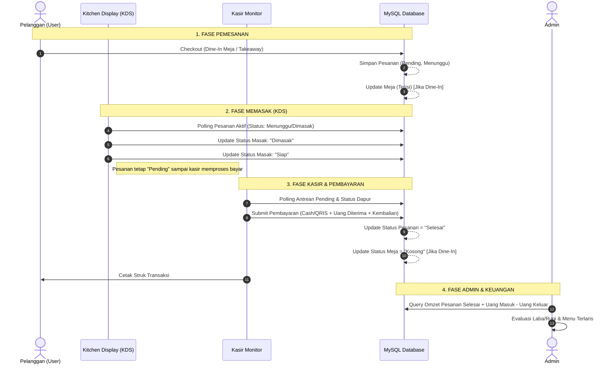

# SPESIFIKASI ALUR BISNIS & INTEGRASI ANTARMODUL
## Sistem ERP Food Commerce Warung Nasi Goreng Cak Mol

---

## 1. Siklus Hidup Transaksi Pesanan (End-to-End Order Lifecycle)

Sistem mengintegrasikan 4 modul dalam satu alur terkoordinasi:



---

## 2. Rincian Alur per Modul

### 2.1 Modul Pelanggan (`user/order.php` & `user/takeaway.php`)

#### Alur Pemesanan Dine-In:
1. **Deteksi Meja**:
   - Pelanggan memindai QR code di meja (URL: `order.php?meja=QR_MEJA_1`).
   - Sistem mencocokkan `kode_qr` ke tabel `meja`. Jika valid, ID meja tersimpan otomatis.
   - Jika pelanggan membuka tanpa QR, terdapat dropdown pemilihan meja di header.
   - **Validasi Ketersediaan Meja**: Jika meja berstatus `'Terisi'`, sistem menampilkan peringatan sopan bahwa meja sedang terisi atau mengarahkan pelanggan untuk konfirmasi ke kasir.
2. **Katalog & Kustomisasi**:
   - Menu dikelompokkan berdasarkan kategori: *Nasi Goreng Series*, *Mie & Noodle Series*, *Capcay (Special)*, *Minuman & Pelengkap*.
   - Saat menambah item, modal kustomisasi muncul:
     - **Pilihan Level Pedas**: Tidak Pedas (Level 0), Sedang (Level 1), Pedas (Level 2), Ekstra Pedas (Level 3), Gila (Level 4).
     - **Catatan Tambahan**: Teks bebas singkat (misal: *"tanpa daun bawang"*, *"telur diceplok setengah matang"*, *"minyak dikit"*).
3. **Keranjang Belanja (*Local Storage*)**:
   - Keranjang disimpan di browser `localStorage` agar tidak hilang jika halaman ter-refresh tidak sengaja.
   - Format item keranjang:
     ```json
     {
       "id_menu": 18,
       "nama_menu": "Nasi Goreng Gila",
       "harga": 20000,
       "jumlah": 2,
       "level_pedas": "Level 4",
       "catatan": "tanpa acar, banyakin kerupuk"
     }
     ```
4. **Checkout & Pengiriman ke Server**:
   - Data dikirim ke `user/process_order.php` via POST JSON.
   - Server menghitung ulang harga dari database (tidak mempercayai harga dari JavaScript).
   - Setelah sukses, keranjang di `localStorage` dikosongkan dan pelanggan diarahkan ke halaman konfirmasi/struk digital pesanan.

#### Alur Pemesanan Takeaway (Bawa Pulang):
- Pelanggan membuka `user/takeaway.php`.
- **Wajib Memasukkan Nama Pelanggan**: Karena tidak terikat dengan nomor meja, nama pelanggan menjadi identitas utama pemanggilan pesanan.
- Nilai `id_meja` disetel menjadi `NULL`.
- Header pesanan tersimpan dengan `tipe_pesanan = 'Takeaway'`.

---

### 2.2 Modul Kitchen Display System (`kitchen/index.php`)

KDS dirancang khusus untuk kenyamanan koki di area dapur:
1. **Polling Pesanan Aktif (`kitchen/poll_kitchen.php`)**:
   - Mengambil seluruh pesanan berstatus `status_pesanan = 'Pending'` dan `status_dapur IN ('Menunggu', 'Dimasak')`.
   - Polling dilakukan setiap 4 detik.
   - **Optimasi Efisiensi**: Jangan me-render ulang seluruh DOM jika tidak ada perubahan data ID atau status pesanan, untuk mencegah layar berkedip (*anti-flicker*).
2. **Audio Alert (Bel Pesanan Baru)**:
   - Ketika ada pesanan baru yang masuk (`status_dapur = 'Menunggu'`), sistem memicu suara bel/ding pendek.
   - Catatan browser: Tombol "Aktifkan Audio" harus disediakan di header KDS karena browser modern memblokir *autoplay audio* sebelum ada interaksi klik pengguna.
3. **Transisi Status Dapur**:
   - `Menunggu` ➔ Tombol aksi: `[ Mulai Masak ]` ➔ Mengirim POST ke `kitchen/update_status.php` ➔ status berubah menjadi `Dimasak`.
   - `Dimasak` ➔ Tombol aksi: `[ Siap Saji ]` ➔ Mengirim POST ke `kitchen/update_status.php` ➔ status berubah menjadi `Siap`.
   - Saat status `Siap`, pesanan otomatis hilang dari layar KDS dan siap diantarkan ke meja atau diserahkan ke kasir untuk takeaway.

---

### 2.3 Modul Kasir Monitor (`user/kasir.php`)

Kasir bertindak sebagai pusat pengendalian transaksi keuangan:
1. **Layar Antrean Pesanan**:
   - Menampilkan semua pesanan dengan `status_pesanan = 'Pending'`.
   - Menampilkan indikator status dapur dari setiap pesanan:
     - `Dapur: Menunggu` (Kuning)
     - `Dapur: Dimasak` (Biru)
     - `Dapur: Siap` (Hijau)
   - Kasir dapat memproses pembayaran kapan saja (bisa sebelum makanan siap atau setelah makanan siap, tergantung SOP warung: bayar di awal vs bayar di akhir).
2. **Modal Pembayaran**:
   - **Metode Pembayaran**:
     - **Cash / Tunai**: Menampilkan field `Uang Diterima (Rp)` dengan tombol pintasan cepat:
       - `[ Uang Pas ]` (otomatis mengisi nominal sama dengan total tagihan)
       - `[ 20k ]`, `[ 50k ]`, `[ 100k ]` (preset uang pecahan umum di Indonesia)
       - Sistem menghitung kembalian secara real-time. Jika uang kurang, tombol "Selesaikan" di-disable dan muncul indikator peringatan.
     - **QRIS Nontunai**: Menampilkan QRIS warung atau instruksi scan statis. Begitu pelanggan sukses scan, kasir langsung menekan tombol konfirmasi bayar.
3. **Penyelesaian Transaksi & Cetak Struk**:
   - Menyimpan `status_pesanan = 'Selesai'`, `metode_bayar`, `uang_diterima`, `kembalian`, dan `waktu_selesai`.
   - Mengosongkan meja (`status_meja = 'Kosong'`).
   - Membuka halaman cetak struk (`user/cetak_struk.php?id=XXX`) yang siap dicetak ke printer thermal 58mm/80mm atau struk browser.

---

### 2.4 Modul Admin & Analisis Keuangan (`admin/index.php`)

1. **Dashboard Metrik Utama**:
   - **Omzet Penjualan**: `SELECT COALESCE(SUM(total_bayar), 0) FROM pesanan WHERE status_pesanan = 'Selesai'`.
   - **Total Transaksi**: `SELECT COUNT(*) FROM pesanan WHERE status_pesanan = 'Selesai'`.
   - **Total Pengeluaran**: `SELECT COALESCE(SUM(jumlah), 0) FROM uang_keluar`.
   - **Saldo Bersih (Net Laba/Rugi)**: `(Omzet Penjualan + Pemasukan Manual) - Total Pengeluaran`.
2. **Manajemen Katalog Menu**:
   - Tambah, Edit, Hapus menu makanan/minuman.
   - Pengaturan Badge: Kosong, `NEW!`, `BEST SELLER`, `PROMO`.
   - Upload gambar menu dengan thumbnail preview.
3. **Manajemen Keuangan**:
   - Catat Pemasukan Lain (modal awal kasir, transfer modal).
   - Catat Pengeluaran (belanja beras, ayam, telur, minyak goreng, gas LPG, operasional listrik/air) lengkap dengan upload foto struk belanja.
4. **Pengaturan Warung**:
   - Profil warung, nomor kontak/WhatsApp, alamat, jam operasional warung, serta parameter PPN.
