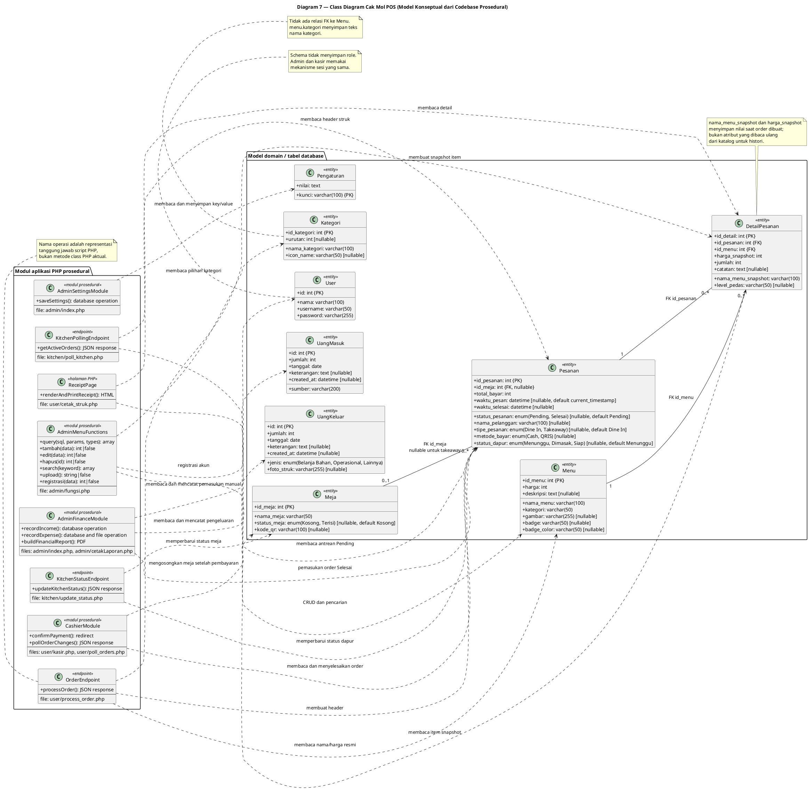
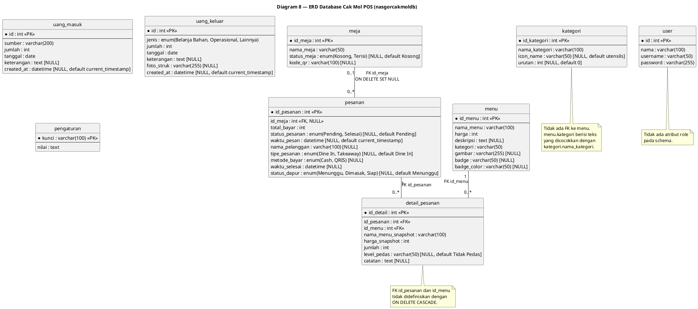

# Diagram Perancangan Sistem Cak Mol POS
## Diagram 7 — Class Diagram dan Diagram 8 — Entity Relationship Diagram (ERD)

**Codebase acuan:** aplikasi aktif di root `warungcakmol-copy`

**Sumber model data:** `nasgorcakmoldb (2).sql`

**Cakupan:** diagram konseptual dan struktur database yang benar-benar digunakan codebase terbaru.
**Batas analisis:** folder `warungcakmol-copy-2/` tidak termasuk.

> **Catatan representasi:** Source aplikasi menggunakan PHP prosedural, bukan class PHP. Karena itu Class Diagram di bawah memodelkan entitas database sebagai kelas domain dan menggambarkan fungsi/endpoint prosedural sebagai modul operasional dengan operasi representatif. Operasi tersebut menunjukkan tanggung jawab yang dijalankan oleh fungsi atau file terkait; diagram ini **tidak** menyatakan bahwa source sudah mendefinisikan kelas PHP atau metode OOP tersebut. ERD, sebaliknya, mengikuti tabel dan foreign key pada dump SQL.

---

# 7. Class Diagram

## 7.1 Ringkasan model

- Kelas domain `Menu`, `Kategori`, `Meja`, `Pesanan`, `DetailPesanan`, `User`, `UangMasuk`, `UangKeluar`, dan `Pengaturan` merepresentasikan tabel pada dump database.
- Atribut kelas mengikuti nama dan tipe kolom database. Primary key serta foreign key ditandai pada atribut.
- Operasi domain tidak dipaksakan sebagai metode entitas. Tanggung jawab aktual ditempatkan pada kelas berstereotip `<<modul prosedural>>` atau `<<endpoint>>`, lalu dipetakan ke fungsi/file source yang menjalankannya.
- Hubungan `Kategori`–`Menu` **tidak** digambar sebagai relasi database: `menu.kategori` menyimpan teks nama kategori dan tidak memiliki foreign key ke `kategori`.
- Status meja/pesanan, tipe pesanan, dan metode pembayaran menggunakan nilai enum yang sama dengan schema.

## 7.2 Diagram PlantUML

## 7.3 Pemetaan operasi ke source

| Operasi representatif | Implementasi yang dipetakan |
|---|---|
| `OrderEndpoint.processOrder()` | Skrip `user/process_order.php`: memvalidasi payload, membaca harga dari `menu`, lalu menyimpan `pesanan` dan `detail_pesanan` dalam transaksi. |
| `KitchenPollingEndpoint.getActiveOrders()` | `kitchen/poll_kitchen.php`: membaca order Pending berstatus dapur Menunggu/Dimasak beserta detail. |
| `KitchenStatusEndpoint.updateKitchenStatus()` | `kitchen/update_status.php`: menerima POST JSON dan mengubah status dapur; saat status Siap, juga mencoba mengubah status meja dine-in. |
| `CashierModule.confirmPayment()` | Handler POST `selesaikan_order` pada `user/kasir.php`: mengubah status pembayaran, metode, waktu selesai, dan status meja. |
| `CashierModule.pollOrderChanges()` | `user/poll_orders.php`: mengirim jumlah order Pending dan hash status untuk polling kasir. |
| `ReceiptPage.renderAndPrintReceipt()` | `user/cetak_struk.php`: mengambil header/detail dan menampilkan struk yang memicu dialog print browser. |
| `AdminMenuFunctions.query/tambah/edit/hapus/search/upload/registrasi` | Fungsi prosedural bernama sama di `admin/fungsi.php`. Signature/return ditampilkan secara ringkas; perilaku tetap milik fungsi PHP yang ada. |
| `AdminFinanceModule.recordIncome()` | Handler POST `tambah_uang_masuk` di `admin/index.php`. |
| `AdminFinanceModule.recordExpense()` | Handler POST `tambah_uang_keluar` di `admin/index.php`, termasuk file bukti opsional. |
| `AdminFinanceModule.buildFinancialReport()` | Perhitungan dan tampilan keuangan di `admin/index.php`, serta PDF di `admin/cetakLaporan.php`. |
| `AdminSettingsModule.saveSettings()` | Handler POST `simpan_pengaturan` di `admin/index.php`, yang melakukan upsert key/value. |

---

# 8. Entity Relationship Diagram (ERD)

## 8.1 Aturan pembacaan

- `PK` menandai primary key; `FK` menandai foreign key yang benar-benar didefinisikan pada dump.
- Atribut bertanda `[nullable]` mengizinkan nilai `NULL` pada definisi kolom. `NOT NULL` tidak diberi tanda nullable.
- Kardinalitas relasi diturunkan dari foreign key database, bukan dari asumsi UI.
- Pesanan dapat memiliki `id_meja = NULL` untuk takeaway; jika terhubung ke meja, satu order merujuk paling banyak satu meja. Satu meja dapat direferensikan banyak order sepanjang histori.
- Setiap baris `detail_pesanan` harus merujuk tepat satu `pesanan` dan satu `menu`; order/menu dapat memiliki nol atau banyak baris detail menurut struktur FK.
- Tidak ada relasi FK antara `menu.kategori` dan `kategori.nama_kategori`, meskipun aplikasi mencocokkan keduanya sebagai teks.
- Tabel `user`, `uang_masuk`, `uang_keluar`, dan `pengaturan` tidak memiliki foreign key dalam dump.

## 8.2 Diagram PlantUML

## 8.3 Ringkasan kardinalitas dan constraint

| Relasi | Kardinalitas | Bukti/aturan database |
|---|---|---|
| `meja` — `pesanan` | Satu meja dapat direferensikan `0..*` pesanan; satu pesanan mereferensikan `0..1` meja. | FK `pesanan.id_meja` nullable ke `meja.id_meja`; `ON DELETE SET NULL`, `ON UPDATE CASCADE`. NULL dipakai untuk takeaway. |
| `pesanan` — `detail_pesanan` | Satu pesanan mempunyai `0..*` detail; setiap detail merujuk tepat `1` pesanan. | FK `detail_pesanan.id_pesanan` NOT NULL ke `pesanan.id_pesanan`; tidak ada `ON DELETE CASCADE`. Batas minimal satu detail berasal dari validasi alur checkout, bukan constraint relasional. |
| `menu` — `detail_pesanan` | Satu menu dapat direferensikan `0..*` detail; setiap detail merujuk tepat `1` menu. | FK `detail_pesanan.id_menu` NOT NULL ke `menu.id_menu`; tidak ada `ON DELETE CASCADE`. |
| `kategori` — `menu` | Tidak dimodelkan sebagai relasi FK. | `menu.kategori` menyimpan `varchar(50)` dan pencocokan ke `kategori.nama_kategori` dilakukan pada aplikasi. |
| `user`, `uang_masuk`, `uang_keluar`, `pengaturan` | Tidak mempunyai relasi FK pada dump. | Masing-masing berdiri sebagai tabel independen; tidak dibuat hubungan yang tidak ada di schema. |

## 8.4 Pemeriksaan diagram

Diagram ditulis sebagai kode PlantUML dan struktur kelas/tabel, atribut, penanda PK/FK serta kardinalitas diperiksa agar selaras dengan definisi pada dump SQL. CLI PlantUML tidak tersedia pada environment saat dokumen dibuat, sehingga diagram belum diklaim berhasil dirender. Untuk validasi visual akhir, salin setiap blok PlantUML ke renderer lokal atau ekstensi PlantUML editor.
