# LAPORAN ANALISIS DAN PERANCANGAN SISTEM
## SISTEM POINT OF SALE DINE-IN DAN TAKEAWAY, KITCHEN DISPLAY SYSTEM, SERTA ADMINISTRASI KEUANGAN
### Studi Kasus: Warung Nasi Goreng Cak Mol Pulomas

**Codebase yang dianalisis:** `warungcakmol-copy` (root workspace)  
**Disusun oleh:** Bagus Ramadhan  
**NIM:** 2491051003  
**Program Studi:** Rekayasa Perangkat Lunak  
**Tahun akademik:** 2025/2026

---

## Ruang Lingkup, Metode, dan Batas Analisis

Laporan ini menganalisis aplikasi yang berada di root workspace `warungcakmol-copy`. Salinan proyek `warungcakmol-copy-2/` tidak menjadi objek analisis dan isi kedua codebase tidak dicampur. Dependency terpasang di `vendor/` diperlakukan sebagai library pihak ketiga, bukan sebagai source aplikasi.

Analisis diturunkan dari halaman dan endpoint PHP aktif di `user/`, `admin/`, `kitchen/`, helper pada `includes/`, stylesheet di `css/`, konfigurasi Composer root, dan dump schema/data `nasgorcakmoldb (2).sql`. Interaksi antarkomponen ditelusuri melalui pemanggilan form, `fetch()`, query dan transisi status yang tampak pada source. Dokumen `Tugas_RPL_Nasgor.md` yang disebut sebagai contoh tidak ditemukan di workspace; karena itu format laporan mengikuti spesifikasi analisis yang diberikan, gaya laporan akademik yang tersedia, dan bukti kode aktual.

Laporan membedakan:

- **Implementasi aktual:** perilaku yang dapat ditunjukkan oleh source atau schema.
- **Keterbatasan teramati:** celah, ketidakselarasan, atau batas yang tampak pada implementasi; bukan klaim bahwa sistem pernah gagal di lingkungan produksi.
- **Rekomendasi/usulan:** pengembangan yang belum boleh dianggap sebagai fitur tersedia.

Path file yang disebut pada laporan adalah path relatif terhadap root proyek ini.

---

# 1. Analisis Sistem Berjalan

## 1.1 Gambaran sistem

Codebase terbaru mengimplementasikan aplikasi web POS untuk katalog menu, pemesanan mandiri pelanggan, antrean dapur, penyelesaian transaksi oleh kasir, struk, serta administrasi menu dan pencatatan arus kas. Aplikasi menggunakan PHP prosedural, MySQL/MariaDB melalui `mysqli`, HTML/CSS dan JavaScript di halaman PHP. Koneksi database bersama berada di `includes/koneksi.php`; tidak ditemukan framework MVC, frontend build pipeline, test runner, atau migration runner.

Fungsi yang ditemukan dikelompokkan sebagai berikut:

| Area | Implementasi yang ditemukan |
|---|---|
| Etalase pelanggan | `user/index.php` mengambil data menu dari database; halaman profil dan sebagian kontennya ditulis statis di markup. |
| Pemesanan | `user/order.php` untuk dine-in dan `user/takeaway.php` untuk takeaway. Keduanya mengelola keranjang dengan `localStorage` dan mengirim JSON ke `user/process_order.php`. |
| Dapur | `kitchen/index.php` menampilkan antrean dua kolom, mengambil data melalui `kitchen/poll_kitchen.php` setiap 4 detik, dan mengirim perubahan melalui `kitchen/update_status.php`. |
| Kasir | `user/kasir.php` menampilkan pesanan Pending, polling `user/poll_orders.php` setiap 8 detik, menerima metode pembayaran, dan mengarahkan ke halaman struk. |
| Struk | `user/cetak_struk.php` mengambil data pesanan dan detail snapshot, lalu memanggil dialog cetak melalui `window.print()`. |
| Admin | `admin/index.php` menampilkan dashboard, katalog, pencatatan keuangan dan pengaturan. CRUD menu berada di `admin/add.php`, `admin/edit.php`, `admin/delete.php`, serta `admin/fungsi.php`. |
| Laporan PDF | `admin/cetakPDF.php` untuk daftar menu dan `admin/cetakLaporan.php` untuk laporan keuangan menggunakan mPDF. |
| Infrastruktur bersama | `includes/koneksi.php`, `includes/auth.php`, `includes/helpers.php`. File `user/koneksi.php` meneruskan ke koneksi bersama. |

Database di dump memuat sembilan tabel utama: `menu`, `kategori`, `meja`, `pesanan`, `detail_pesanan`, `user`, `uang_masuk`, `uang_keluar`, dan `pengaturan`.

## 1.2 Proses bisnis dari awal hingga akhir

### A. Pelanggan dine-in

1. Pelanggan membuka halaman publik dan melihat menu dari database.
2. Pelanggan masuk ke `user/order.php`. Meja dapat diambil dari parameter QR `?meja=<kode_qr>` atau dipilih melalui daftar meja yang dimuat dari database.
3. Pelanggan memilih item dan kustomisasi yang disediakan UI. Keranjang disimpan di browser menggunakan `localStorage`, sehingga dapat bertahan dari pemuatan ulang halaman pada browser yang sama.
4. Saat checkout, browser mengirim `items`, `meja_id`, `nama_pelanggan`, dan `tipe_pesanan` sebagai JSON ke `user/process_order.php`.
5. Endpoint membaca kembali nama dan harga menu dari tabel `menu`, menghitung total di server, memvalidasi kuantitas dan tipe pesanan, kemudian membuat header pesanan dan detailnya di dalam transaksi database.
6. Header dimulai dengan `status_pesanan = Pending`; `status_dapur` menggunakan nilai default schema `Menunggu`. Jika berhasil, browser menampilkan ringkasan pesanan dan menghapus keranjang lokal.

### B. Pelanggan takeaway

1. Pelanggan memilih menu pada `user/takeaway.php` dan mengisi nama pelanggan.
2. Checkout menggunakan endpoint yang sama, dengan `tipe_pesanan = Takeaway` dan `meja_id = 0` dari browser.
3. Backend menyimpan `id_meja = NULL` dan menolak takeaway tanpa nama pelanggan.
4. Pesanan baru mengikuti antrean KDS dan kasir seperti pesanan dine-in.

### C. Dapur dan kasir

1. Halaman KDS meminta daftar pesanan Pending yang status dapurnya `Menunggu` atau `Dimasak`.
2. Koki memulai proses memasak dengan mengubah status ke `Dimasak`, kemudian mengubahnya ke `Siap`.
3. Saat menjadi `Siap`, endpoint dapur mencoba menandai meja dine-in sebagai `Terisi`; takeaway tidak memiliki meja.
4. Halaman kasir mengambil seluruh pesanan dengan `status_pesanan = Pending`. Polling 8 detik mendeteksi perubahan jumlah atau hash status dapur; bila berubah dan modal pembayaran tidak terbuka, halaman dimuat ulang.
5. Kasir memilih `Cash` atau `QRIS`. UI menghitung kembalian secara JavaScript dan mencegah submit tunai yang kurang hanya di browser.
6. Handler pembayaran menandai pesanan `Selesai`, merekam metode dan waktu selesai, lalu menandai meja terkait `Kosong` dan mengarahkan browser ke `user/cetak_struk.php`.
7. Halaman struk mengambil header pesanan dan detail menggunakan snapshot, lalu memicu dialog cetak browser.

### D. Administrasi

- Login admin/kasir memakai halaman `admin/login.php`. Sesi yang sama dipakai oleh halaman admin dan kasir; tidak ada pemisahan role pada tabel atau helper.
- Dashboard menampilkan ringkasan omzet transaksi selesai, jumlah transaksi, pengeluaran, pemasukan manual, saldo, menu terlaris, transaksi terbaru, dan grafik tujuh hari.
- Pengelolaan katalog menyediakan daftar, pencarian, tambah, ubah, hapus, serta ekspor PDF. Gambar menu disimpan di `img/`.
- Modul keuangan menggabungkan pesanan selesai dengan pemasukan manual, menampilkan pengeluaran, serta memungkinkan pencatatan manual uang masuk/keluar. Foto struk pengeluaran opsional disimpan di `img/receipts/`.
- Pengaturan warung disimpan sebagai pasangan `kunci`/`nilai` pada tabel `pengaturan`.
- Laporan menu dan laporan keuangan dibuat dalam PDF melalui mPDF.

## 1.3 Aktor aktual

| Aktor | Interaksi yang ditemukan |
|---|---|
| Pelanggan | Melihat menu, memesan dine-in atau takeaway, melakukan kustomisasi item, dan melihat konfirmasi digital setelah checkout. Tidak ada akun pelanggan pada schema. |
| Koki/petugas dapur | Membuka KDS, memantau antrean, mengubah status menjadi Dimasak dan Siap. Implementasi KDS tidak meminta login. |
| Kasir | Login menggunakan akun pada tabel `user`, memantau pesanan Pending, memilih metode pembayaran, menyelesaikan pesanan, dan mencetak struk. |
| Admin/pemilik | Login menggunakan tabel `user`, melihat dashboard, mengelola katalog, mencatat pemasukan/pengeluaran, mengatur profil, serta mengekspor PDF. |
| Browser dan printer lokal | Browser menjalankan JavaScript, `localStorage`, polling dan dialog cetak. Printer adalah perangkat yang dipilih pada dialog print; aplikasi tidak berkomunikasi langsung dengan printer. Keduanya adalah lingkungan pendukung, bukan aktor bisnis utama. |

Kasir dan admin menggunakan mekanisme login/session yang sama; source tidak mendefinisikan role atau matriks hak akses terpisah.

## 1.4 Keterbatasan dan ketidakselarasan yang terbukti

Temuan di bawah adalah hasil pembacaan source. Prioritas perbaikan perlu ditentukan sebelum penggunaan pada jaringan atau lingkungan produksi.

| Area | Temuan aktual | Dampak yang mungkin |
|---|---|---|
| Pencarian katalog admin | `admin/index.php` mewajibkan token CSRF pada setiap POST. Form pencarian menu tidak menyertakan token; karena itu pencarian melalui form tersebut berhenti pada pemeriksaan CSRF sebelum hasil pencarian diproses. | Fitur pencarian yang terlihat di UI tidak dapat berjalan melalui alur POST normal. |
| Registrasi akun | `admin/registrasi.php` tersedia untuk pengguna yang belum login, tidak menggunakan token CSRF dan tidak menerapkan otorisasi/role. Password hanya dibandingkan dengan konfirmasi; batas minimal panjang yang disebut placeholder tidak divalidasi di server. | Pembuatan akun admin tidak dibatasi pada owner; kontrol pembuatan akun dan validasi perlu diperketat. |
| Login remember-me | Cookie `key` adalah hash deterministik username dan cookie tidak menggunakan konfigurasi secure/httponly/samesite eksplisit. | Mekanisme remember-me tidak setara token acak yang dapat dicabut dan perlu ditinjau sebelum deployment nonlokal. |
| Role pengguna | Tabel `user` tidak memiliki kolom role, dan pemeriksaan sesi hanya menguji `$_SESSION["login"]`. | Aplikasi tidak membedakan kewenangan kasir dengan admin. |
| KDS | `kitchen/poll_kitchen.php` dan `kitchen/update_status.php` tidak memeriksa sesi/otorisasi atau token CSRF. | Endpoint pembacaan dan perubahan status dapat diakses tanpa autentikasi pada konfigurasi yang dapat menjangkaunya. |
| Transisi status KDS | Endpoint menerima status `Dimasak` atau `Siap` untuk pesanan Pending, tetapi tidak menegakkan transisi lama→baru secara eksplisit dan tidak memeriksa affected rows untuk menentukan apakah pesanan valid/masih pada status sebelumnya. | Status dapat dikirim berulang atau melompati/mundur dari alur yang dimaksud; UI tidak memperoleh konflik status yang tegas. |
| Checkout | Backend menghitung ulang harga dan menggunakan transaksi untuk header/detail, tetapi validasi domain untuk batas level pedas, panjang catatan/nama, serta meja dine-in tidak lengkap di endpoint. Total dihitung dari harga database. | Input yang tidak sesuai aturan UI dapat tetap masuk; validasi server perlu dilengkapi. |
| Pembayaran | Pemeriksaan jumlah uang tunai kurang dari total dilakukan di JavaScript saja. Handler server tidak memvalidasi `uang_diterima`, tidak mengunci status awal pesanan pada Pending, dan update pesanan serta meja dijalankan dalam query terpisah tanpa transaksi bersama. | Request langsung atau submit bersamaan dapat menyelesaikan pembayaran tidak sesuai UI atau menghasilkan ketidakselarasan pesanan/meja. |
| Upload bukti pengeluaran | Upload pada `admin/index.php` memeriksa ekstensi JPG/JPEG/PNG, namun tidak memeriksa ukuran atau MIME; kegagalan `move_uploaded_file()` tidak dibedakan dari kondisi tanpa file. | Validasi file dan pelaporan kegagalan upload belum memadai. |
| Upload menu | `admin/fungsi.php::upload()` memeriksa ekstensi dan ukuran maksimum 2 MB, tetapi tidak memeriksa MIME/isi file dan tidak memeriksa keberhasilan pemindahan file. | Validasi dan keandalan upload masih terbatas. |
| Hapus menu | Fungsi `hapus()` mencoba menghapus file gambar sebelum menghapus record. Dump memiliki FK dari detail pesanan ke menu tanpa ON DELETE CASCADE. Bila penghapusan record gagal karena riwayat detail, gambar berpotensi sudah terhapus. | Record menu dapat tetap ada tetapi gambar hilang bila penghapusan DB ditolak. |
| Query helper | `query()` pada `admin/fungsi.php` dan `user/fungsi.php` mengembalikan array kosong saat query/prepare gagal. | Error database dapat tampak seperti tidak ada data dan sulit didiagnosis. |
| Integritas meja | Status meja diperbarui saat pesanan siap dan dikosongkan saat kasir menyelesaikan pembayaran. Tidak ada pengikatan meja pada transaksi aktif yang eksplisit. | Beberapa pesanan pada meja sama dan operasi serentak dapat menyebabkan status meja tidak merepresentasikan seluruh pesanan aktif. |
| Kategori | Menu menyimpan teks `kategori`; tabel kategori dihubungkan lewat kecocokan nama, bukan FK. Tidak ditemukan CRUD kategori. | Konsistensi ejaan/kategori bergantung pada aplikasi dan tidak dapat dikelola melalui modul kategori khusus. |
| Keuangan | Data uang masuk/keluar tersedia dan dihitung, tetapi tidak ditemukan filter rentang tanggal pada tampilan/laporan PDF. Grafik penjualan dibatasi tujuh hari. | Analisis historis per periode perlu proses manual/fitur tambahan; angka total bersifat sepanjang data yang tersedia. |
| Migrasi dan test | Tidak ditemukan test otomatis, konfigurasi build, atau migration runner. SQL adalah dump yang mencakup data. | Perubahan schema dan regresi memerlukan prosedur manual dan lingkungan database yang aman. |
| Konfigurasi | Kredensial koneksi lokal ditulis langsung pada `includes/koneksi.php` sebagai localhost/root/password kosong. | Konfigurasi sesuai setup lokal sederhana, bukan konfigurasi deployment yang aman. |
| Dependency Firebase | Composer root mencantumkan Kreait Firebase PHP, tetapi source aplikasi yang ditinjau tidak menunjukkan pemanggilan SDK tersebut. UI notifikasi menggunakan audio/browser polling. | Jangan mengklaim notifikasi push Firebase aktif tanpa bukti implementasi. |

---

# 2. Analisis Sistem Usulan

## 2.1 Tujuan sistem usulan

Sistem usulan adalah penyempurnaan bertahap atas POS yang sudah tersedia, bukan klaim bahwa fitur baru berikut telah terpasang. Tujuan utamanya meningkatkan integritas transaksi, kontrol akses, keandalan operasional, keterlacakan laporan, dan kemudahan pemeliharaan sambil mempertahankan alur pelanggan–dapur–kasir yang ada.

## 2.2 Fitur yang sudah ada dan rekomendasi

| Area | Sudah diimplementasikan | Usulan pengembangan (belum tersedia) |
|---|---|---|
| Katalog | Data menu dibaca dari database; kategori ditampilkan; admin dapat CRUD menu dan ekspor PDF. | CRUD kategori yang dinormalisasi, validasi FK, status menu aktif/nonaktif dan pengelolaan stok hanya jika kebutuhan bisnis disepakati. |
| Checkout | Dine-in dan takeaway; keranjang localStorage; harga dihitung ulang dari DB; header/detail dibuat dalam transaksi; nama/harga snapshot. | Validasi server lengkap untuk skema payload, menu aktif, meja valid/tersedia, batas quantity/catatan/spice, pencegahan submit ganda/idempotensi, dan respons error konsisten. |
| KDS | Polling 4 detik, dua kolom Menunggu/Dimasak, audio notification, update status ke Dimasak/Siap. | Autentikasi/otorisasi staf dapur, CSRF atau kontrol setara, transisi status atomik, deteksi konflik, paginasi/optimasi polling, dan monitoring gangguan. |
| Kasir | Sesi login bersama, daftar order Pending, polling 8 detik, pilihan Cash/QRIS, hitung kembalian pada UI, cetak struk. | Role kasir, validasi pembayaran server-side, transaksi atomik pembayaran+status meja, penanganan pembayaran ganda, dan audit trail. |
| Admin | Dashboard, CRUD menu, input pemasukan/pengeluaran, foto bukti, pengaturan dan ekspor PDF. | Hak akses berbasis role, validasi form server, audit perubahan, filter/rentang tanggal, konsistensi laporan dan penanganan kegagalan upload/database. |
| Keamanan | Prepared statement pada sejumlah operasi; password hash/verify; session login; beberapa form perubahan memakai CSRF; escaping dilakukan pada sebagian output. | Terapkan kontrol secara konsisten pada semua endpoint dan semua konteks output; perkuat session/cookie, rate limiting login, pencegahan CSRF KDS dan validasi upload. |
| Data dan pemeliharaan | Satu koneksi bersama; dump SQL tersedia; dependency Composer. | Konfigurasi environment terpisah, migration/upgrade database terkontrol, logging, backup/restore, tes otomatis dan dokumentasi deployment. |
| Realtime | Polling HTTP berkala dari browser. | Tetap gunakan polling dengan optimasi atau pertimbangkan push/WebSocket hanya bila beban dan kebutuhan latensi membenarkan perubahan infrastruktur. |

## 2.3 Usulan arsitektur operasional

1. Pertahankan arsitektur PHP prosedural selama kebutuhan proyek masih sederhana; perbaiki pembagian tanggung jawab secara bertahap tanpa memaksakan framework.
2. Tetapkan kontrak request/response endpoint dan validasi server sebagai sumber kebenaran. Browser bertanggung jawab pada presentasi, bukan integritas harga/status.
3. Perlakukan transisi pesanan sebagai operasi domain: checkout membuat Pending/Menunggu; dapur mengubah status dapur sesuai transisi yang diizinkan; kasir menyelesaikan pembayaran hanya bila order valid dan belum selesai.
4. Gabungkan update status transaksi dan meja dalam transaksi DB dengan pemeriksaan kondisi awal serta penanganan persaingan.
5. Terapkan autentikasi/otorisasi yang eksplisit pada modul admin, kasir, dan KDS. Pisahkan role bila memang ada perbedaan kewenangan.
6. Pisahkan konfigurasi rahasia dari source; gunakan credential khusus database dengan hak minimum untuk deployment.
7. Rencanakan perubahan schema dengan upgrade yang dapat diulang/ditinjau, backup, dan uji pada salinan database; jangan mengimpor dump penuh ke database operasional.
8. Tambahkan pengujian bertahap untuk aturan harga, status, CSRF/auth, upload, laporan dan kontrak JSON. Verifikasi alur manual melalui Apache selama test otomatis belum tersedia.

---

# 3. Analisis Kebutuhan

## 3.a Aktor yang Terlibat

| ID | Aktor | Tanggung jawab dan batas peran |
|---|---|---|
| A-01 | Pelanggan | Melihat katalog, memilih item/kustomisasi, mengirim pesanan dine-in atau takeaway. Tidak ada akun atau riwayat pelanggan yang terlihat di schema. |
| A-02 | Petugas dapur/koki | Menggunakan KDS untuk melihat antrean dan mengubah status dapur. Dalam implementasi saat ini tidak ada login KDS. |
| A-03 | Kasir | Login melalui `admin/login.php`, memantau pesanan Pending, mengonfirmasi metode pembayaran, menyelesaikan pesanan dan mencetak struk. Tidak ada role kasir khusus di database. |
| A-04 | Admin/pemilik | Login melalui halaman yang sama; melihat dashboard, mengelola menu, mencatat arus kas, mengubah pengaturan dan mencetak laporan. |
| A-05 | Browser/perangkat cetak | Lingkungan eksekusi UI, penyimpanan keranjang lokal, polling, dan dialog cetak. Bukan aktor bisnis yang mempunyai hak atau data akun. |

## 3.b Kebutuhan Fungsional

Status **Tersedia** berarti ada alur implementasi yang dapat ditelusuri; bila ada cacat spesifik, catatan menyebutkannya. **Terbatas** berarti sebagian UI/logika ada tetapi tidak menuntaskan aturan atau memiliki ketidakselarasan. **Usulan** belum dianggap tersedia.

| ID | Kebutuhan fungsional | Status dan bukti |
|---|---|---|
| FR-01 | Sistem menampilkan halaman publik dan katalog menu. | Tersedia; `user/index.php`, data menu dibaca melalui `user/fungsi.php`. |
| FR-02 | Sistem menampilkan kategori menu dari database dan mengelompokkan item berdasarkan kategori. | Tersedia; `user/order.php`, `user/takeaway.php`; kategori diurutkan dengan `urutan`. Relasi hanya berbasis nama. |
| FR-03 | Pelanggan dapat menambahkan item, kustomisasi tingkat pedas/catatan, mengubah kuantitas dan melihat subtotal keranjang. | Tersedia pada UI JavaScript dan `localStorage`; batas input server belum lengkap. |
| FR-04 | Pelanggan dapat membuat pesanan dine-in menggunakan QR meja atau pemilihan meja. | Tersedia; `user/order.php` dan `user/process_order.php`. Backend tidak memeriksa ketersediaan meja secara bisnis. |
| FR-05 | Pelanggan dapat membuat pesanan takeaway dengan nama wajib dan tanpa meja. | Tersedia; `user/takeaway.php`, `user/process_order.php`; `id_meja` menjadi NULL. |
| FR-06 | Sistem mengambil nama dan harga menu dari database dan menyimpan total serta detail snapshot secara atomik. | Tersedia; `user/process_order.php`, transaksi DB dan `detail_pesanan`. |
| FR-07 | Sistem menyimpan pesanan baru dengan status awal Pending dan status dapur Menunggu. | Tersedia melalui insert header dan default schema. |
| FR-08 | KDS menampilkan order aktif serta detail item, meja/tipe, dan waktu. | Tersedia; `kitchen/index.php`, `kitchen/poll_kitchen.php`; tanpa auth KDS. |
| FR-09 | Koki dapat mengubah status dapur ke Dimasak dan Siap. | Terbatas; endpoint `kitchen/update_status.php` menerima kedua status tetapi tidak menegakkan transisi berurutan secara kuat. |
| FR-10 | Sistem menandai meja Terisi ketika pesanan dine-in menjadi Siap dan Kosong ketika kasir menyelesaikan order. | Tersedia namun operasi terpisah dan tidak mengelola beberapa pesanan aktif pada meja secara eksplisit. |
| FR-11 | Kasir dapat login dan melihat pesanan Pending beserta status dapur. | Tersedia; `admin/login.php`, `user/kasir.php`; akun admin/kasir tidak dibedakan. |
| FR-12 | Kasir dapat memilih Cash atau QRIS dan menyelesaikan pesanan. | Tersedia; validasi nominal tunai hanya client-side; server belum memastikan order masih Pending atau nominal cukup. |
| FR-13 | Sistem menampilkan dan mencetak struk dengan data snapshot pesanan. | Tersedia; `user/cetak_struk.php`, `window.print()`; konfigurasi printer ditangani browser/OS. |
| FR-14 | Admin dapat login dan keluar dari sistem. | Tersedia; `admin/login.php`, `admin/logout.php`; mekanisme remember-me perlu diperkuat. |
| FR-15 | Pengunjung dapat mendaftarkan akun admin baru. | Tersedia secara kode melalui `admin/registrasi.php`, tetapi tanpa CSRF dan pembatasan pendaftaran; pendaftaran berhasil tidak otomatis membuat sesi login. |
| FR-16 | Admin dapat melihat ringkasan omzet, transaksi, pengeluaran, pemasukan manual, saldo, menu terlaris, order terbaru dan tren 7 hari. | Tersedia; `admin/index.php`. Grafik merupakan bar chart CSS/HTML, bukan Chart.js. |
| FR-17 | Admin dapat mencari menu berdasarkan keyword. | Tersedia pada UI/helper namun alur aktual terhalang oleh token CSRF yang diwajibkan pada POST admin, sementara form pencarian tidak menyertakan token. |
| FR-18 | Admin dapat menambah menu, termasuk upload gambar. | Tersedia; `admin/add.php`, `admin/fungsi.php`; validasi upload terbatas pada ekstensi/ukuran. |
| FR-19 | Admin dapat mengubah menu dan mengganti gambar secara opsional. | Tersedia; `admin/edit.php`, `admin/fungsi.php`; masalah validasi file mengikuti helper upload. |
| FR-20 | Admin dapat menghapus menu dan gambar terkait. | Tersedia sebagai fungsi; FK histori dapat menolak penghapusan record setelah gambar telanjur dihapus. |
| FR-21 | Admin dapat mengekspor daftar menu ke PDF. | Tersedia; `admin/cetakPDF.php`, mPDF. |
| FR-22 | Admin dapat melihat pemasukan, pengeluaran dan hasil hitung selisih. | Tersedia; `admin/index.php?page=keuangan`, semua data digabung tanpa filter periode. |
| FR-23 | Admin dapat mencatat pemasukan manual. | Tersedia; POST pada `admin/index.php`, token CSRF diwajibkan. |
| FR-24 | Admin dapat mencatat pengeluaran dengan kategori dan bukti foto opsional. | Tersedia; `admin/index.php`; upload bukti hanya validasi ekstensi, tanpa batas ukuran/MIME yang terlihat. |
| FR-25 | Admin dapat melihat dan memperbarui profil, jam operasional, serta nilai PPN. | Tersedia; pasangan key/value di tabel `pengaturan`. Tidak terbukti seluruh nilai memengaruhi transaksi atau halaman pelanggan. |
| FR-26 | Admin dapat mengekspor laporan pemasukan/pengeluaran dan laba-rugi ke PDF. | Tersedia; `admin/cetakLaporan.php`, semua data tanpa filter tanggal. |
| FR-27 | Sistem membedakan hak admin, kasir, dan petugas dapur. | Usulan; role tidak ada pada schema dan KDS tidak mewajibkan login. |
| FR-28 | Sistem mencatat nominal tunai diterima, kembalian, audit pembayaran, dan mencegah pembayaran ganda. | Usulan; schema saat ini tidak memiliki kolom uang diterima/kembalian atau audit trail. |
| FR-29 | Sistem menyediakan kategori dengan integritas relasional dan CRUD kategori. | Usulan; kategori saat ini hanya disimpan sebagai teks pada `menu`. |
| FR-30 | Sistem menyediakan filter periode laporan dan ekspor sesuai periode. | Usulan; belum ditemukan filter periode pada UI laporan yang dianalisis. |

## 3.c Kebutuhan Nonfungsional

| ID | Aspek | Kondisi implementasi sekarang | Kebutuhan/rekomendasi |
|---|---|---|---|
| NFR-01 | Keamanan SQL | Sejumlah query yang melibatkan parameter memakai prepared statement; beberapa query statis memakai `mysqli_query`. | Semua input harus diparameterkan; kegagalan query perlu dibedakan dari hasil kosong. |
| NFR-02 | Keamanan output | Helper `sanitize()` menggunakan `htmlspecialchars()` untuk sebagian output. Ada nilai yang masuk markup/JavaScript dinamis yang perlu encoding khusus konteks. | Escape sesuai konteks HTML/atribut/URL/JS, bukan menyisipkan data langsung ke string HTML. |
| NFR-03 | Autentikasi dan otorisasi | Session login, password hash/verify, regenerasi ID ketika inisialisasi sesi. Role tidak dibedakan; KDS terbuka; pendaftaran umum. | Otorisasi pada setiap endpoint, role minimal, kebijakan pendaftaran tertutup/terkontrol dan penguatan cookie/session. |
| NFR-04 | Perlindungan CSRF | Helper token tersedia dan digunakan pada sejumlah form admin/kasir; pencarian POST tanpa token dan endpoint KDS tidak menggunakannya. | Proteksi konsisten untuk seluruh request perubahan, termasuk endpoint yang memakai sesi/cookie. |
| NFR-05 | Integritas transaksi | Checkout header/detail dibungkus transaksi. Pembayaran dan update meja dilakukan terpisah. | Atomicity untuk perubahan pembayaran/meja; validasi status awal, locking/idempotensi dan penanganan konkurensi. |
| NFR-06 | Akurasi finansial | Harga checkout dibaca dari DB; total disimpan sebagai integer rupiah. Kembalian dihitung di browser. | Validasi server dan audit nominal pembayaran; hindari ketergantungan pada kalkulasi client. |
| NFR-07 | Performa | UI pelanggan memuat katalog; KDS polling 4 detik; kasir polling 8 detik. KDS mengambil detail per pesanan. | Uji beban sesuai volume, batasi/paginasi riwayat, optimalkan query dan ukur interval polling sebelum mengklaim target. |
| NFR-08 | Keandalan | DB menggunakan InnoDB; keranjang tersimpan lokal; endpoint polling menggunakan fetch. Logging dan test otomatis tidak ditemukan. | Logging terstruktur, retry/error state, backup/restore teruji, monitoring, dan test regresi. |
| NFR-09 | Ketersediaan/operasi | README mengarahkan penggunaan Apache/MySQL lokal XAMPP; alur bergantung pada server lokal. | Dokumentasikan deployment, backup, pemulihan, konfigurasi dan pembatasan jaringan; tidak ada SLA yang dapat dibuktikan. |
| NFR-10 | Usability | Antarmuka pelanggan responsif, modal keranjang, status visual, polling dan audio. Dialog print bergantung browser. | Uji perangkat nyata, aksesibilitas keyboard/kontras, feedback loading/error, serta alur printer thermal yang dipakai. |
| NFR-11 | Kompatibilitas | PHP dan MariaDB/MySQL digunakan; versi aplikasi runtime tidak didefinisikan sebagai platform lock di source. | Tetapkan versi minimum PHP/MySQL/MariaDB dan uji browser target; saat ini kompatibilitas rinci belum dapat dipastikan. |
| NFR-12 | Pemeliharaan | Source prosedural, halaman menggabungkan PHP/HTML/JS; helpers dan query ada pada beberapa file. | Dokumentasikan batas modul, kurangi duplikasi bertahap, standardisasi error handling dan buat test; hindari refactor besar tanpa kebutuhan. |
| NFR-13 | Integritas file | Gambar menu dan bukti pengeluaran disimpan di filesystem; database menyimpan nama gambar. | Validasi MIME/isi/ukuran, cek hasil operasi file, batasi akses dan koordinasikan penghapusan file dengan transaksi DB. |
| NFR-14 | Privasi | Nama pelanggan dapat disimpan dalam order; belum ada kebijakan retensi atau penghapusan yang terdokumentasi. | Tentukan akses dan retensi data pelanggan sesuai kebutuhan bisnis dan hukum yang berlaku. |

---

# 4. Perancangan Sistem

## 4.a Use Case Diagram

Diagram berikut menggambarkan fungsi yang benar-benar ditemukan. Diagram dipisah per kelompok agar terbaca. Relasi `<<include>>` hanya dipakai untuk alur yang otomatis menjadi bagian dari aksi utama: penyelesaian pembayaran menuju proses cetak struk pada implementasi saat ini. Perangkat database bukan aktor eksternal; database ditampilkan hanya pada sequence diagram.

### Diagram 1 — Pelanggan dan pemesanan

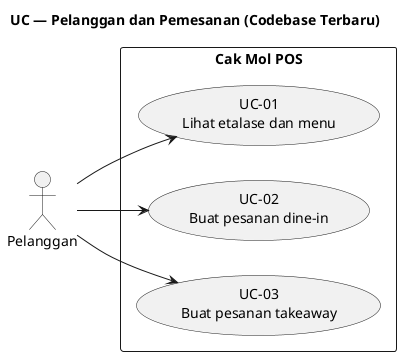

### Diagram 2 — Dapur dan kasir

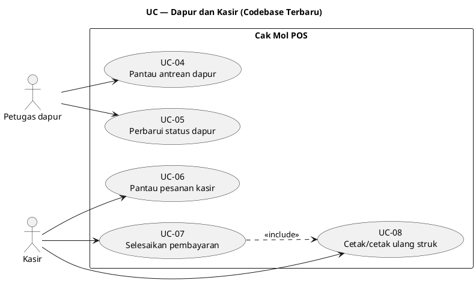

### Diagram 3 — Autentikasi dan administrasi

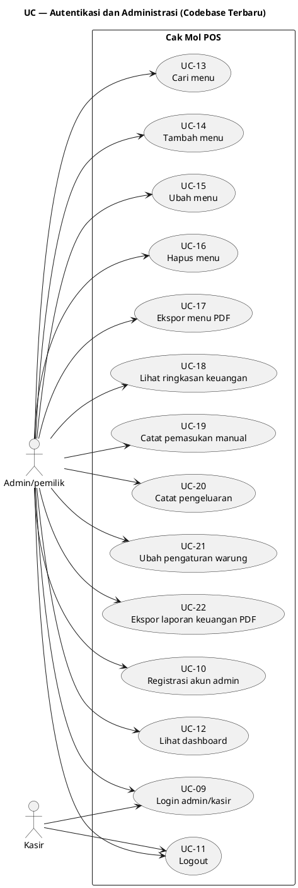

Diagram use case menampilkan kemampuan akun sebagaimana dipanggil dari UI, bukan jaminan role yang ditegakkan backend. UC-10 secara aktual terbuka untuk pengguna yang belum login; pengaitan aktor Admin menunjukkan tujuan fungsi, bukan kontrol otorisasi yang telah tersedia.

## 4.b Deskripsi Use Case

### UC-01 — Lihat etalase dan menu

| Elemen | Deskripsi |
|---|---|
| Tujuan | Mengetahui profil publik dan katalog menu warung. |
| Aktor utama | Pelanggan. |
| Aktor pendukung | Browser; database menyediakan data menu. |
| Deskripsi | Pelanggan membuka landing page. Server mengambil menu dan menyajikan halaman berisi profil/konten publik dan katalog. |
| Pemicu | Pelanggan membuka `user/index.php`. |
| Prasyarat | Apache/PHP dapat melayani halaman dan koneksi database berhasil. |
| Postcondition | Katalog dan konten publik ditampilkan; tidak ada order yang dibuat. |
| Relasi | Dapat dilanjutkan dengan UC-02 atau UC-03. |

### UC-02 — Buat pesanan dine-in

| Elemen | Deskripsi |
|---|---|
| Tujuan | Mengirim pesanan dine-in untuk diproses dapur dan kasir. |
| Aktor utama | Pelanggan. |
| Aktor pendukung | Browser, `user/order.php`, `user/process_order.php`, database. |
| Deskripsi | Pelanggan memilih meja, menu, jumlah dan kustomisasi. Keranjang disimpan lokal; saat konfirmasi backend menghitung harga dari database dan menyimpan header/detail dalam transaksi. |
| Pemicu | Pelanggan membuka halaman order dine-in dan memilih menu. |
| Prasyarat | Menu dan meja dapat dimuat; untuk checkout harus ada item dan ID meja positif. |
| Postcondition | Jika berhasil, order Pending/Menunggu tersimpan dengan detail snapshot dan muncul pada antrean. |
| Relasi | Berbeda dari UC-03 karena memakai meja; mengikuti UC-04 dan UC-06. |

### UC-03 — Buat pesanan takeaway

| Elemen | Deskripsi |
|---|---|
| Tujuan | Membuat pesanan bawa pulang tanpa alokasi meja. |
| Aktor utama | Pelanggan. |
| Aktor pendukung | Browser, `user/takeaway.php`, `user/process_order.php`, database. |
| Deskripsi | Pelanggan memilih menu, mengisi nama, lalu mengirim keranjang. Backend menyimpan tipe Takeaway dan `id_meja = NULL`. |
| Pemicu | Pelanggan membuka halaman takeaway dan mengonfirmasi keranjang. |
| Prasyarat | Ada item pada keranjang dan nama pelanggan terisi. |
| Postcondition | Jika berhasil, order Pending/Menunggu tanpa meja tersimpan dan dapat dipantau dapur/kasir. |
| Relasi | Berbeda dari UC-02; mengikuti UC-04 dan UC-06. |

### UC-04 — Pantau antrean dapur

| Elemen | Deskripsi |
|---|---|
| Tujuan | Melihat pesanan aktif yang harus disiapkan. |
| Aktor utama | Petugas dapur. |
| Aktor pendukung | Browser KDS, `kitchen/poll_kitchen.php`, database. |
| Deskripsi | Halaman KDS memanggil polling setiap 4 detik, merender order Pending berstatus dapur Menunggu/Dimasak dan memainkan audio jika antrean Menunggu bertambah. |
| Pemicu | Petugas membuka `kitchen/index.php`; polling berjalan selama halaman aktif. |
| Prasyarat | Server dan database tersedia. Tidak ada prasyarat login dalam implementasi. |
| Postcondition | Tampilan antrean diperbarui; tidak ada perubahan status dari use case pemantauan saja. |
| Relasi | Mendukung UC-05. |

### UC-05 — Perbarui status dapur

| Elemen | Deskripsi |
|---|---|
| Tujuan | Mencatat perkembangan persiapan pesanan. |
| Aktor utama | Petugas dapur. |
| Aktor pendukung | `kitchen/index.php`, `kitchen/update_status.php`, database. |
| Deskripsi | Petugas menekan Mulai Masak atau Siap Saji. Browser mengirim POST JSON untuk menetapkan Dimasak atau Siap. Pada Siap untuk dine-in, endpoint juga mengubah status meja menjadi Terisi. |
| Pemicu | Petugas memilih aksi pada kartu KDS. |
| Prasyarat | Ada ID order positif dan request mengirim salah satu nilai status yang diterima. Endpoint hanya memperbarui order Pending. |
| Postcondition | Status dapur diperbarui jika query berhasil; jika Siap, update meja dicoba untuk dine-in. |
| Relasi | Didahului UC-04; perubahan terpantau di UC-06. |

### UC-06 — Pantau pesanan kasir

| Elemen | Deskripsi |
|---|---|
| Tujuan | Melihat daftar pesanan Pending dan kesiapan dari dapur. |
| Aktor utama | Kasir. |
| Aktor pendukung | `user/kasir.php`, `user/poll_orders.php`, database. |
| Deskripsi | Kasir login, membuka monitor. Halaman menampilkan daftar Pending; endpoint polling berautentikasi melaporkan jumlah serta hash status dapur, dan UI reload saat berubah kecuali modal pembayaran terbuka. |
| Pemicu | Kasir membuka halaman monitor atau interval polling tercapai. |
| Prasyarat | Kasir memiliki sesi login aktif. |
| Postcondition | Daftar/indikator diperbarui; tidak ada pembayaran yang terjadi. |
| Relasi | Mendahului UC-07. |

### UC-07 — Selesaikan pembayaran

| Elemen | Deskripsi |
|---|---|
| Tujuan | Menandai pesanan telah dibayar dan menyiapkan bukti cetak. |
| Aktor utama | Kasir. |
| Aktor pendukung | Browser kasir, database, UC-08. |
| Deskripsi | Kasir memilih Cash/QRIS dan mengirim form ber-CSRF. Backend mengubah pesanan menjadi Selesai, menyimpan metode/waktu, mengosongkan meja bila ada, lalu redirect ke struk. Validasi kekurangan uang tunai terjadi pada UI. |
| Pemicu | Kasir mengonfirmasi pembayaran dalam modal. |
| Prasyarat | Sesi kasir dan token CSRF valid; ID pesanan diberikan. Status Pending tidak diverifikasi sebagai prasyarat oleh handler secara eksplisit. |
| Postcondition | Jika query berhasil, status transaksi menjadi Selesai dan browser diarahkan ke UC-08. |
| Relasi | `<<include>>` UC-08 pada alur normal. |

### UC-08 — Cetak/cetak ulang struk

| Elemen | Deskripsi |
|---|---|
| Tujuan | Menampilkan rincian pesanan dan membuka dialog cetak. |
| Aktor utama | Kasir. |
| Aktor pendukung | `user/cetak_struk.php`, browser, printer lokal. |
| Deskripsi | Halaman mengambil header pesanan dan detail snapshot berdasarkan ID, menampilkan ringkasan dan memanggil `window.print()` setelah render. |
| Pemicu | Redirect setelah UC-07 atau kasir membuka ulang URL struk yang valid. |
| Prasyarat | Sesi kasir aktif dan ID pesanan valid serta ditemukan. |
| Postcondition | Struk ditampilkan; pencetakan fisik bergantung pada pilihan dan kondisi printer/browser. |
| Relasi | Termasuk dalam alur normal UC-07; dapat dibuka ulang. |

### UC-09 — Login admin/kasir

| Elemen | Deskripsi |
|---|---|
| Tujuan | Membuat sesi agar halaman terproteksi dapat diakses. |
| Aktor utama | Admin atau kasir. |
| Aktor pendukung | `admin/login.php`, `admin/fungsi.php`, database/session PHP. |
| Deskripsi | Pengguna mengirim username/password; server mengambil akun dengan prepared statement dan memverifikasi password hash. Opsi remember-me membuat cookie. |
| Pemicu | Pengguna mengirim form login. |
| Prasyarat | Akun terdaftar di tabel `user`; database tersedia. |
| Postcondition | Jika kredensial cocok, session berisi login/user ID/username/nama dan browser menuju dashboard. |
| Relasi | Prasyarat akses UC-06, UC-08, UC-12–UC-22. |

### UC-10 — Registrasi akun admin

| Elemen | Deskripsi |
|---|---|
| Tujuan | Menambahkan akun baru ke tabel `user`. |
| Aktor utama | Pengunjung yang membuka halaman registrasi (fitur dimaksudkan untuk calon admin). |
| Aktor pendukung | `admin/registrasi.php`, `admin/fungsi.php`, database. |
| Deskripsi | Server memeriksa username yang sudah ada, menyamakan password/konfirmasi, membuat password hash, lalu menyimpan nama, username dan hash. |
| Pemicu | Pengunjung mengirim form registrasi. |
| Prasyarat | Database tersedia; pengguna belum login agar halaman registrasi ditampilkan. |
| Postcondition | Jika berhasil, record user dibuat. Kode menampilkan redirect ke index tetapi tidak membuat session login. |
| Relasi | Dapat dilanjutkan dengan UC-09. |

### UC-11 — Logout

| Elemen | Deskripsi |
|---|---|
| Tujuan | Mengakhiri sesi login dan menghapus cookie remember-me. |
| Aktor utama | Admin atau kasir. |
| Aktor pendukung | `admin/logout.php`, session PHP, browser. |
| Deskripsi | Endpoint mengosongkan session, menghapus cookie session bila berlaku, menghancurkan session server dan menghapus cookie `id`/`key`, kemudian redirect ke login. |
| Pemicu | Pengguna memilih tautan Logout. |
| Prasyarat | Sesi aktif; endpoint dapat diakses. |
| Postcondition | Sesi/cookie dibersihkan dan halaman login ditampilkan. |
| Relasi | Mengakhiri akses yang diperoleh dari UC-09. |

### UC-12 — Lihat dashboard admin

| Elemen | Deskripsi |
|---|---|
| Tujuan | Memantau ringkasan penjualan, transaksi dan keuangan. |
| Aktor utama | Admin/pemilik. |
| Aktor pendukung | `admin/index.php`, helper query dan database. |
| Deskripsi | Admin membuka view dashboard. Sistem menghitung omzet dan transaksi selesai, total uang masuk/keluar, saldo, top lima item berdasarkan detail, lima order terbaru, serta omzet per tanggal dalam tujuh hari terakhir. |
| Pemicu | Admin memilih dashboard atau membuka index admin. |
| Prasyarat | Sesi login aktif; database tersedia. |
| Postcondition | Ringkasan ditampilkan; tidak mengubah data bisnis. |
| Relasi | Memakai data transaksi dan catatan keuangan; terpisah dari UC-18 yang menampilkan ledger. |

### UC-13 — Cari menu

| Elemen | Deskripsi |
|---|---|
| Tujuan | Menemukan item katalog berdasarkan keyword. |
| Aktor utama | Admin/pemilik. |
| Aktor pendukung | `admin/index.php`, `admin/fungsi.php`, database. |
| Deskripsi | UI mengirim keyword melalui POST dan fungsi `search()` membentuk LIKE query terparameterisasi pada nama, harga, kategori dan deskripsi. |
| Pemicu | Admin menekan tombol Cari. |
| Prasyarat | Sesi login aktif dan view menu dibuka. |
| Postcondition | Jika sampai ke query, daftar hasil cocok ditampilkan; Reset kembali ke seluruh katalog. |
| Relasi | Bagian dari manajemen katalog, terpisah dari perubahan data. |
| Catatan implementasi | Form pencarian tidak mengirim `csrf_token`, sedangkan guard global menolak semua POST tanpa token; alur saat ini tidak mencapai hasil normal. |

### UC-14 — Tambah menu

| Elemen | Deskripsi |
|---|---|
| Tujuan | Menambahkan item katalog baru. |
| Aktor utama | Admin/pemilik. |
| Aktor pendukung | `admin/add.php`, `admin/fungsi.php`, filesystem `img/`, database. |
| Deskripsi | Admin mengisi nama, harga, kategori, deskripsi, foto; server memeriksa login/CSRF, memproses upload, lalu menambah record menu. |
| Pemicu | Admin membuka form Tambah Menu dan mengirimnya. |
| Prasyarat | Sesi admin/kasir aktif (helper tidak membedakan role), token CSRF valid dan form lengkap. |
| Postcondition | Jika operasi berhasil, record menu dan file gambar tersedia. |
| Relasi | Bagian dari pengelolaan katalog. |

### UC-15 — Ubah menu

| Elemen | Deskripsi |
|---|---|
| Tujuan | Memperbarui informasi menu dan opsional mengganti foto. |
| Aktor utama | Admin/pemilik. |
| Aktor pendukung | `admin/edit.php`, `admin/fungsi.php`, filesystem, database. |
| Deskripsi | Server membaca record berdasarkan ID; admin mengubah field dan dapat mempertahankan foto lama atau mengunggah pengganti. |
| Pemicu | Admin membuka menu Edit dan mengirim perubahan. |
| Prasyarat | Sesi login, ID menu ditemukan, CSRF valid. |
| Postcondition | Record berisi nilai terbaru; bila foto diganti, file baru dipakai dan file lama dicoba dihapus. |
| Relasi | Bagian dari pengelolaan katalog. |

### UC-16 — Hapus menu

| Elemen | Deskripsi |
|---|---|
| Tujuan | Menghapus menu dari katalog dan file gambarnya. |
| Aktor utama | Admin/pemilik. |
| Aktor pendukung | `admin/delete.php`, `admin/fungsi.php`, filesystem, database. |
| Deskripsi | Endpoint menerima POST, memeriksa sesi, CSRF dan ID, lalu fungsi hapus membaca nama file, menghapus file, dan mencoba menghapus baris menu. |
| Pemicu | Admin mengonfirmasi aksi Hapus. |
| Prasyarat | Sesi login dan CSRF valid; ID positif. |
| Postcondition | Jika DB mengizinkan, record dihapus; penghapusan file dilakukan sebelum penghapusan DB. |
| Relasi | Bagian dari pengelolaan katalog. |
| Catatan implementasi | FK historis detail pesanan dapat menolak penghapusan record setelah file gambar dihapus. |

### UC-17 — Ekspor menu PDF

| Elemen | Deskripsi |
|---|---|
| Tujuan | Menghasilkan dokumen daftar menu untuk ditampilkan/diunduh melalui browser. |
| Aktor utama | Admin/pemilik. |
| Aktor pendukung | `admin/cetakPDF.php`, mPDF, database, browser. |
| Deskripsi | Endpoint memeriksa sesi, mengambil seluruh menu dan merender tabel landscape ke PDF. |
| Pemicu | Admin memilih Cetak Menu (PDF). |
| Prasyarat | Sesi login dan dependency mPDF tersedia. |
| Postcondition | PDF dikirim inline ke browser bila proses berhasil. |
| Relasi | Membaca data katalog; tidak mengubah katalog. |

### UC-18 — Lihat ringkasan keuangan

| Elemen | Deskripsi |
|---|---|
| Tujuan | Meninjau daftar pemasukan, pengeluaran dan selisih total. |
| Aktor utama | Admin/pemilik. |
| Aktor pendukung | `admin/index.php`, database. |
| Deskripsi | View keuangan mengambil seluruh pesanan Selesai, pemasukan manual dan pengeluaran; menggabungkan pemasukan dan menghitung total pemasukan dikurangi pengeluaran. |
| Pemicu | Admin membuka `?page=keuangan`. |
| Prasyarat | Sesi login aktif dan database tersedia. |
| Postcondition | Ledger dan angka ringkasan ditampilkan tanpa mengubah data. |
| Relasi | Berkaitan dengan UC-19, UC-20, UC-22; sumber data juga tampil sebagian di UC-12. |

### UC-19 — Catat pemasukan manual

| Elemen | Deskripsi |
|---|---|
| Tujuan | Mencatat pemasukan selain transaksi penjualan POS. |
| Aktor utama | Admin/pemilik. |
| Aktor pendukung | Form POST di `admin/index.php`, database. |
| Deskripsi | Admin mengisi sumber, jumlah, tanggal dan keterangan. Handler memeriksa CSRF dan menjalankan prepared INSERT ke `uang_masuk`. |
| Pemicu | Admin mengirim form Tambah Pemasukan. |
| Prasyarat | Sesi login dan token CSRF valid. |
| Postcondition | Jika INSERT berhasil, record pemasukan manual tersedia pada view keuangan. |
| Relasi | Data terlihat melalui UC-18 dan UC-22. |

### UC-20 — Catat pengeluaran

| Elemen | Deskripsi |
|---|---|
| Tujuan | Mencatat biaya bahan/operasional dan bukti foto bila disediakan. |
| Aktor utama | Admin/pemilik. |
| Aktor pendukung | Form POST `admin/index.php`, filesystem `img/receipts/`, database. |
| Deskripsi | Admin mengirim jenis, jumlah, tanggal, keterangan dan opsional file foto. Handler memeriksa CSRF, memeriksa ekstensi ketika upload berhasil, memindahkan file, lalu menyimpan record `uang_keluar`. |
| Pemicu | Admin mengirim form Tambah Pengeluaran. |
| Prasyarat | Sesi login, CSRF valid, field form tersedia. |
| Postcondition | Jika INSERT berhasil, record pengeluaran tersimpan; foto dapat ditampilkan pada riwayat bila berhasil disimpan. |
| Relasi | Data terlihat melalui UC-18 dan UC-22. |
| Catatan implementasi | Validasi MIME dan ukuran file tidak terlihat; kegagalan pemindahan tidak selalu menghasilkan pesan error khusus. |

### UC-21 — Ubah pengaturan warung

| Elemen | Deskripsi |
|---|---|
| Tujuan | Menyimpan nilai profil dan jam operasional pada konfigurasi database. |
| Aktor utama | Admin/pemilik. |
| Aktor pendukung | Form POST `admin/index.php`, database. |
| Deskripsi | Admin mengirim nama warung, alamat, nomor HP, PPN, jam buka dan tutup. Server memeriksa CSRF dan melakukan upsert per key. |
| Pemicu | Admin mengirim form Pengaturan. |
| Prasyarat | Sesi login dan token CSRF valid. |
| Postcondition | Key/value konfigurasi diperbarui bila seluruh query berhasil. |
| Relasi | Nilai digunakan untuk beberapa tampilan/config, tetapi tidak terbukti seluruhnya diterapkan pada kalkulasi transaksi. |

### UC-22 — Ekspor laporan keuangan PDF

| Elemen | Deskripsi |
|---|---|
| Tujuan | Menghasilkan ringkasan dan rincian pemasukan/pengeluaran dalam PDF. |
| Aktor utama | Admin/pemilik. |
| Aktor pendukung | `admin/cetakLaporan.php`, mPDF, database, browser. |
| Deskripsi | Endpoint memeriksa sesi, mengambil seluruh pemasukan order selesai, pemasukan manual dan pengeluaran, menghitung selisih, merender HTML dan mengirim PDF inline. |
| Pemicu | Admin memilih tombol cetak laporan. |
| Prasyarat | Sesi login, koneksi DB dan mPDF tersedia. |
| Postcondition | Laporan PDF tersedia di browser jika query dan render berhasil. |
| Relasi | Menggunakan sumber data yang sama dengan UC-18; tidak menyediakan filter periode. |

## 4.c Skenario Use Case

Aktivitas sebelum/sesudah dituliskan terpisah pada setiap skenario sesuai permintaan. Alur alternatif yang tidak didukung oleh source ditandai sebagai rekomendasi, bukan sebagai perilaku yang sudah tersedia.

### Skenario UC-01 — Lihat etalase dan menu

| Elemen | Skenario |
|---|---|
| Aktor | Pelanggan |
| Prasyarat | Server web dan database tersedia. |
| Aktivitas sebelum | Pelanggan membuka browser dan mengakses URL aplikasi. |
| Alur utama | 1. Browser meminta `user/index.php`.<br>2. PHP memuat helper/koneksi.<br>3. Sistem membaca menu.<br>4. Sistem mengelompokkan data dan merender halaman publik.<br>5. Browser menampilkan katalog. |
| Alternatif | Jika menu kosong, halaman tetap dirender tanpa kartu menu yang berasal dari DB; tampilan persis bergantung markup. |
| Kesalahan | Jika koneksi DB gagal, `includes/koneksi.php` menghentikan request; tidak ada katalog yang dapat ditampilkan. |
| Aktivitas sesudah | Pelanggan dapat berpindah ke halaman dine-in atau takeaway. |
| Kondisi akhir | Halaman publik tampil; tidak ada pesanan baru. |

### Skenario UC-02 — Buat pesanan dine-in

| Elemen | Skenario |
|---|---|
| Aktor | Pelanggan |
| Prasyarat | Katalog/meja dapat diakses; checkout memerlukan `meja_id > 0` dan keranjang tidak kosong. |
| Aktivitas sebelum | Pelanggan membuka `user/order.php`, memilih meja melalui QR atau daftar, lalu memilih item. |
| Alur utama | 1. UI menambahkan item/kustomisasi ke cart.<br>2. Cart disimpan di `localStorage`.<br>3. Pelanggan membuka cart dan mengonfirmasi.<br>4. Browser POST JSON ke `user/process_order.php`.<br>5. Backend membaca harga menu dari DB dan menghitung total.<br>6. Backend memvalidasi jumlah, meja dan tipe Dine In.<br>7. Backend memulai transaksi, INSERT `pesanan`, lalu INSERT tiap `detail_pesanan` snapshot.<br>8. Backend commit dan mengirim JSON sukses/order ID.<br>9. Browser menampilkan konfirmasi dan menghapus cart lokal. |
| Alternatif | QR meja dipakai bila `kode_qr` cocok; jika tidak ada parameter valid, pelanggan memilih meja dari dropdown. Nama pelanggan dine-in bersifat opsional sesuai payload/UI. |
| Kesalahan | Cart kosong, meja tidak dipilih, kuantitas nonpositif, menu tidak ditemukan atau query insert gagal: backend mengembalikan status error; bila transaksi sudah dimulai, rollback dilakukan. |
| Aktivitas sesudah | Pesanan dapat muncul di KDS dan kasir. |
| Kondisi akhir | Berhasil: order Pending/Menunggu tersimpan; gagal: order tidak lengkap tidak boleh dianggap berhasil oleh UI. |

### Skenario UC-03 — Buat pesanan takeaway

| Elemen | Skenario |
|---|---|
| Aktor | Pelanggan |
| Prasyarat | Keranjang berisi item dan nama pelanggan diisi. |
| Aktivitas sebelum | Pelanggan membuka `user/takeaway.php`, memilih item dan menyesuaikan pesanan. |
| Alur utama | 1. UI menyimpan item pada cart lokal.<br>2. Pelanggan mengisi nama lalu konfirmasi.<br>3. Browser mengirim JSON bertipe Takeaway dengan meja 0.<br>4. Backend membaca harga dari database, menghitung total, mensyaratkan nama.<br>5. Backend menyimpan header dengan meja NULL dan detail snapshot dalam transaksi.<br>6. Backend commit dan merespons sukses.<br>7. Browser menampilkan konfirmasi dan membersihkan cart. |
| Alternatif | Tidak ada pemilihan meja untuk takeaway. |
| Kesalahan | Nama kosong atau item/kuantitas tidak valid menyebabkan respons error dan rollback jika transaksi aktif. |
| Aktivitas sesudah | Order tampil sebagai takeaway pada KDS/kasir. |
| Kondisi akhir | Berhasil: order Pending/Menunggu tanpa meja; gagal: tidak ada order sukses. |

### Skenario UC-04 — Pantau antrean dapur

| Elemen | Skenario |
|---|---|
| Aktor | Petugas dapur |
| Prasyarat | KDS dapat membuka halaman dan endpoint polling terjangkau; tidak ada login yang diwajibkan. |
| Aktivitas sebelum | Petugas membuka `kitchen/index.php` dan browser memuat halaman. |
| Alur utama | 1. UI menjalankan polling langsung dan setiap 4 detik.<br>2. `poll_kitchen.php` mengambil Pending berstatus Menunggu/Dimasak beserta detail.<br>3. Endpoint merespons JSON.<br>4. UI membandingkan jumlah Menunggu, memainkan notifikasi bila bertambah, lalu render dua kolom dan jumlah order. |
| Alternatif | Jika browser memblokir autoplay, halaman menampilkan aktivator audio; polling tetap dapat memperbarui antrean. |
| Kesalahan | Kegagalan request/JSON ditangkap di JavaScript dan dicatat ke console; UI tidak mendapat state server terbaru. |
| Aktivitas sesudah | Petugas memilih order untuk UC-05 atau terus memantau. |
| Kondisi akhir | Tampilan KDS berisi snapshot antrean yang terakhir berhasil diambil. |

### Skenario UC-05 — Perbarui status dapur

| Elemen | Skenario |
|---|---|
| Aktor | Petugas dapur |
| Prasyarat | Kartu pesanan tampil di KDS; endpoint menerima ID valid dan status Dimasak/Siap untuk order Pending. |
| Aktivitas sebelum | Petugas meninjau item lalu menekan tombol Mulai Masak atau Siap Saji. |
| Alur utama | 1. UI menonaktifkan sementara kartu secara visual.<br>2. Browser mengirim POST JSON ke `update_status.php`.<br>3. Endpoint memvalidasi method, ID dan daftar nilai status.<br>4. Endpoint meng-update status pada order Pending.<br>5. Jika status Siap, endpoint membaca meja/tipe; untuk dine-in mencoba set meja Terisi.<br>6. Endpoint merespons sukses; UI meminta polling dan render ulang. |
| Alternatif | Takeaway tidak memiliki meja sehingga hanya status order yang berubah. |
| Kesalahan | Method bukan POST atau parameter tidak valid menghasilkan error HTTP; kegagalan update menghasilkan error; UI menampilkan pesan dan polling ulang. |
| Aktivitas sesudah | Status terlihat pada KDS dan dapat terdeteksi kasir. |
| Kondisi akhir | Status DB berubah bila query berhasil; urutan transisi tidak dipastikan oleh endpoint saat ini. |

### Skenario UC-06 — Pantau pesanan kasir

| Elemen | Skenario |
|---|---|
| Aktor | Kasir |
| Prasyarat | Kasir berhasil login dan memiliki session. |
| Aktivitas sebelum | Kasir membuka `user/kasir.php`. |
| Alur utama | 1. Server memeriksa sesi dan mengambil semua pesanan Pending beserta nama meja.<br>2. UI menampilkan kartu, status dapur, total serta form pembayaran.<br>3. Browser memanggil `poll_orders.php` langsung dan tiap 8 detik.<br>4. Endpoint memeriksa sesi lalu mengembalikan jumlah Pending dan hash status dapur.<br>5. Jika nilai berubah dan modal tertutup, UI reload; jika tidak, indikator tetap aktif. |
| Alternatif | Jika modal pembayaran terbuka, reload ditunda untuk menjaga input kasir. |
| Kesalahan | Polling menerima HTTP non-OK atau gagal jaringan: UI menandai monitor mencoba ulang/offline dan melanjutkan interval berikutnya. |
| Aktivitas sesudah | Kasir memilih order dan membuka modal pembayaran (UC-07). |
| Kondisi akhir | Daftar Pending tampil berdasarkan pembacaan terakhir; order belum berubah. |

### Skenario UC-07 — Selesaikan pembayaran

| Elemen | Skenario |
|---|---|
| Aktor | Kasir |
| Prasyarat | Sesi login dan token CSRF valid; order ID dikirim. UI memungkinkan Cash/QRIS. |
| Aktivitas sebelum | Kasir melihat order melalui UC-06 dan membuka modal pembayaran. |
| Alur utama | 1. Kasir memilih metode.<br>2. Untuk tunai UI menghitung kembalian; untuk QRIS UI menampilkan gambar QR.<br>3. Kasir menekan Selesaikan.<br>4. Jika CSRF valid, PHP meng-update order menjadi Selesai beserta metode/waktu.<br>5. Handler mengambil ID meja dan, jika ada, meng-update meja menjadi Kosong.<br>6. Browser menerima redirect ke `cetak_struk.php?id=...`. |
| Alternatif | QRIS melewati validasi uang tunai di browser; konfirmasi pembayaran dilakukan kasir. |
| Kesalahan | CSRF invalid menghentikan proses. Bila UI mencegah submit tunai kurang, request tidak dikirim. Kegagalan query server tidak ditangani dengan respons kegagalan yang eksplisit sebelum redirect pada semua jalur. |
| Aktivitas sesudah | Browser membuka UC-08 untuk melihat/mencetak struk. |
| Kondisi akhir | Normal: transaksi selesai, metode/waktu tersimpan dan meja dicoba dikosongkan. Atomicity keseluruhan tidak dijamin karena query terpisah. |

### Skenario UC-08 — Cetak/cetak ulang struk

| Elemen | Skenario |
|---|---|
| Aktor | Kasir |
| Prasyarat | Sesi kasir aktif; ID positif dan order ditemukan. |
| Aktivitas sebelum | Kasir menyelesaikan order atau membuka URL struk yang sebelumnya didapat. |
| Alur utama | 1. Browser meminta `cetak_struk.php?id=...`.<br>2. PHP memeriksa session dan ID.<br>3. PHP mengambil header dan detail order.<br>4. Halaman merender item, total, metode, meja/takeaway dan waktu.<br>5. Browser menjalankan `window.print()` setelah jeda singkat. |
| Alternatif | Kasir memilih Cetak Ulang untuk membuka dialog print lagi. |
| Kesalahan | ID invalid atau data tidak ditemukan menghasilkan pesan dan berhenti; printer tidak tersedia ditangani melalui dialog browser/OS, bukan aplikasi. |
| Aktivitas sesudah | Kasir kembali ke monitor atau mengulang pencetakan. |
| Kondisi akhir | Struk tampil; hasil kertas bergantung pada dialog/perangkat printer. |

### Skenario UC-09 — Login admin/kasir

| Elemen | Skenario |
|---|---|
| Aktor | Admin/pemilik atau kasir |
| Prasyarat | Akun ada pada tabel `user`. |
| Aktivitas sebelum | Pengguna membuka halaman login dan memasukkan kredensial. |
| Alur utama | 1. Browser mengirim POST form.<br>2. PHP mencari username dengan prepared statement.<br>3. PHP memverifikasi password memakai `password_verify()`.<br>4. Jika cocok, helper meregenerasi ID session dan mengisi data session.<br>5. Browser diarahkan ke index admin. |
| Alternatif | Bila remember-me dipilih, handler membuat cookie `id` dan hash username dengan masa satu jam. |
| Kesalahan | Username/password salah atau query tidak menghasilkan akun menampilkan pesan generik login gagal. |
| Aktivitas sesudah | Pengguna terautentikasi dapat membuka halaman terproteksi; dashboard admin memerlukan UC-12 untuk ditampilkan. |
| Kondisi akhir | Sukses: session aktif; gagal: tidak ada session login baru. |

### Skenario UC-10 — Registrasi akun admin

| Elemen | Skenario |
|---|---|
| Aktor | Pengunjung/calon admin |
| Prasyarat | Halaman registrasi menampilkan form ketika session login tidak aktif. |
| Aktivitas sebelum | Pengunjung membuka `admin/registrasi.php` dan mengisi nama, username, password dan konfirmasi. |
| Alur utama | 1. Browser mengirim form.<br>2. Fungsi registrasi mencari username yang sama.<br>3. Fungsi memeriksa kecocokan password.<br>4. Password di-hash.<br>5. Prepared INSERT menambahkan akun.<br>6. Halaman menampilkan pesan sukses dan mengarahkan ke index. |
| Alternatif | Username sudah ada atau password tidak sama: pembuatan akun ditolak dengan pesan/alert. |
| Kesalahan | Kegagalan prepare/insert mengembalikan kegagalan. Tidak ada token CSRF atau kontrol role di implementasi. |
| Aktivitas sesudah | Pengguna dapat mencoba login melalui UC-09; registrasi tidak otomatis membuat sesi. |
| Kondisi akhir | Akun baru tersimpan hanya jika INSERT berhasil. |

### Skenario UC-11 — Logout

| Elemen | Skenario |
|---|---|
| Aktor | Admin atau kasir |
| Prasyarat | Session mungkin aktif. |
| Aktivitas sebelum | Pengguna memilih tautan Logout pada sidebar. |
| Alur utama | 1. `logout.php` memulai sesi bila perlu.<br>2. PHP mengosongkan variabel session.<br>3. Cookie session dihapus jika session menggunakan cookies.<br>4. Session server dihancurkan dan cookie remember-me dihapus.<br>5. Browser diarahkan ke login. |
| Alternatif | Tidak ada alternatif bisnis yang teridentifikasi. |
| Kesalahan | Jika header sudah terkirim sebelum redirect, perilaku redirect dapat terganggu; urutan source saat ini memproses logout sebelum output. |
| Aktivitas sesudah | Pengguna melihat halaman login. |
| Kondisi akhir | Session dan cookie remember-me tidak berlaku. |

### Skenario UC-12 — Lihat dashboard admin

| Elemen | Skenario |
|---|---|
| Aktor | Admin/pemilik |
| Prasyarat | Session login aktif dan DB tersedia. |
| Aktivitas sebelum | Admin membuka dashboard atau memilih menu Dashboard. |
| Alur utama | 1. `admin/index.php` memeriksa login dan memilih page dashboard.<br>2. Sistem query omzet/jumlah order Selesai, total pengeluaran/pemasukan manual, top 5, 5 order terbaru dan data tujuh hari.<br>3. Sistem menghitung saldo dan membentuk tujuh batang chart HTML/CSS.<br>4. Halaman merender metrik, chart, menu laris dan order terbaru. |
| Alternatif | Dataset kosong menampilkan nilai nol atau empty state sesuai bagian UI. |
| Kesalahan | Kegagalan query helper dapat ditafsirkan sebagai hasil kosong karena helper mengembalikan `[]`. |
| Aktivitas sesudah | Admin dapat menuju katalog/keuangan/pengaturan. |
| Kondisi akhir | Ringkasan ditampilkan tanpa perubahan database. |

### Skenario UC-13 — Cari menu

| Elemen | Skenario |
|---|---|
| Aktor | Admin/pemilik |
| Prasyarat | Session aktif dan view menu dibuka. |
| Aktivitas sebelum | Admin mengetik keyword lalu menekan Cari. |
| Alur utama yang dimaksud | 1. Form POST keyword ke `admin/index.php?page=menu`.<br>2. Guard CSRF menerima token.<br>3. Fungsi `search()` menjalankan LIKE query prepared pada nama/harga/kategori/deskripsi.<br>4. Daftar hasil ditampilkan. |
| Alternatif | Reset memakai link GET menuju daftar semua menu. |
| Kesalahan aktual | Form pencarian tidak menyertakan token, sedangkan guard menolak semua POST tanpa token; pencarian berhenti sebelum query. |
| Aktivitas sesudah | Setelah perbaikan form/token, admin dapat membuka hasil atau reset. |
| Kondisi akhir | Aktual: pencarian POST gagal pada pemeriksaan CSRF; skenario normal memerlukan perbaikan. |

### Skenario UC-14 — Tambah menu

| Elemen | Skenario |
|---|---|
| Aktor | Admin/pemilik |
| Prasyarat | Login/session, CSRF valid, field wajib terisi, file gambar dipilih. |
| Aktivitas sebelum | Admin membuka form tambah dari daftar menu. |
| Alur utama | 1. Admin mengisi data dan memilih kategori dari DB.<br>2. Admin mengirim multipart POST dengan CSRF.<br>3. PHP memvalidasi session/token.<br>4. Fungsi `tambah()` memproses foto; nama file baru dibentuk.<br>5. Prepared INSERT menambah record menu.<br>6. Jika berhasil, halaman menampilkan notifikasi dan kembali ke daftar. |
| Alternatif | Kategori tersedia dibaca dari tabel `kategori`; file dianggap wajib oleh form. |
| Kesalahan | Token invalid menghentikan proses; format/ukuran foto yang ditolak menampilkan alert; kegagalan query mengembalikan gagal. |
| Aktivitas sesudah | Admin memeriksa item di daftar dan dapat mengedit/mengekspor. |
| Kondisi akhir | Record baru dibuat bila insert sukses; validasi file belum memeriksa MIME/keberhasilan move secara eksplisit. |

### Skenario UC-15 — Ubah menu

| Elemen | Skenario |
|---|---|
| Aktor | Admin/pemilik |
| Prasyarat | Login/session, ID menu ditemukan, CSRF valid. |
| Aktivitas sebelum | Admin memilih Edit pada suatu menu. |
| Alur utama | 1. Halaman mengambil menu berdasar ID dengan prepared query.<br>2. Admin mengubah field dan/atau memilih foto baru.<br>3. Form multipart dikirim bersama ID dan nama foto lama.<br>4. Server memvalidasi token dan memanggil fungsi edit.<br>5. Bila foto tidak diganti, foto lama dipertahankan; jika diganti, fungsi upload lalu mencoba menghapus gambar lama.<br>6. Prepared UPDATE menyimpan nilai menu.<br>7. UI kembali ke daftar dengan pesan. |
| Alternatif | Tanpa unggahan baru, field gambar memakai nama foto sebelumnya. |
| Kesalahan | ID tidak ditemukan mengarahkan kembali ke menu; token invalid menghentikan request; upload/query gagal dapat mengembalikan false. |
| Aktivitas sesudah | Admin memeriksa perubahan dari daftar menu. |
| Kondisi akhir | Data diperbarui bila UPDATE berhasil; integritas file tidak dijamin bila operasi file gagal. |

### Skenario UC-16 — Hapus menu

| Elemen | Skenario |
|---|---|
| Aktor | Admin/pemilik |
| Prasyarat | Session aktif, request POST dan token CSRF valid, ID positif. |
| Aktivitas sebelum | Admin menekan Hapus dan mengonfirmasi bila dialog browser muncul. |
| Alur utama | 1. Browser POST ID dan token ke `delete.php`.<br>2. Endpoint memvalidasi sesi, method, CSRF dan ID.<br>3. Fungsi membaca nama gambar.<br>4. Fungsi menghapus file gambar jika ditemukan.<br>5. Fungsi menjalankan DELETE menu.<br>6. UI menampilkan hasil dan kembali ke daftar. |
| Alternatif | File gambar tidak ditemukan, proses tetap mencoba DELETE record. |
| Kesalahan | ID invalid/CSRF invalid menghentikan request; foreign key detail historis dapat menolak DELETE setelah gambar telanjur dihapus. |
| Aktivitas sesudah | Admin memeriksa daftar; bila penghapusan DB gagal, perlu pemulihan gambar dari backup. |
| Kondisi akhir | Record terhapus bila tidak terhalang FK; urutan operasi filesystem/DB menimbulkan risiko inkonsistensi. |

### Skenario UC-17 — Ekspor menu PDF

| Elemen | Skenario |
|---|---|
| Aktor | Admin/pemilik |
| Prasyarat | Session aktif dan mPDF tersedia. |
| Aktivitas sebelum | Admin menekan tombol Cetak Menu (PDF). |
| Alur utama | 1. Browser meminta `cetakPDF.php` pada tab/halaman baru.<br>2. Endpoint memeriksa login dan membaca semua menu.<br>3. Endpoint membangun HTML tabel landscape dan mengirim ke mPDF.<br>4. mPDF menghasilkan dokumen PDF inline. |
| Alternatif | Gambar yang tidak ditemukan ditampilkan sebagai teks No Image pada dokumen. |
| Kesalahan | Session tidak valid mengarahkan ke login; kegagalan dependency/render dapat menggagalkan output PDF. |
| Aktivitas sesudah | Admin meninjau atau mencetak PDF melalui browser. |
| Kondisi akhir | PDF katalog tersedia jika proses berhasil. |

### Skenario UC-18 — Lihat ringkasan keuangan

| Elemen | Skenario |
|---|---|
| Aktor | Admin/pemilik |
| Prasyarat | Session aktif dan DB tersedia. |
| Aktivitas sebelum | Admin memilih menu Keuangan. |
| Alur utama | 1. Sistem mengambil transaksi Selesai, pemasukan manual, dan seluruh pengeluaran.<br>2. Sistem menggabungkan pemasukan dan mengurutkan berdasarkan tanggal.<br>3. Sistem menghitung total pemasukan, total pengeluaran dan selisih.<br>4. UI menampilkan ikhtisar serta tabel riwayat pemasukan/pengeluaran. |
| Alternatif | Jika tabel belum memiliki data, UI menampilkan empty state. |
| Kesalahan | Query gagal dapat terlihat seperti data kosong karena helper query mengembalikan array kosong. |
| Aktivitas sesudah | Admin dapat mencatat pemasukan (UC-19), pengeluaran (UC-20), atau ekspor PDF (UC-22). |
| Kondisi akhir | Data keuangan ditampilkan; tidak ada perubahan record. |

### Skenario UC-19 — Catat pemasukan manual

| Elemen | Skenario |
|---|---|
| Aktor | Admin/pemilik |
| Prasyarat | Session aktif, CSRF token valid dan form berisi data. |
| Aktivitas sebelum | Admin membuka form pemasukan pada view keuangan. |
| Alur utama | 1. Admin mengisi sumber, jumlah, tanggal dan keterangan.<br>2. Browser mengirim POST dengan token.<br>3. Handler memvalidasi token, melakukan cast/sanitasi field.<br>4. Prepared INSERT menambah baris `uang_masuk`.<br>5. UI menampilkan pesan sukses/gagal. |
| Alternatif | Keterangan dapat kosong sesuai skema nullable. |
| Kesalahan | CSRF invalid menghentikan request; prepare/execute gagal menghasilkan pesan gagal bila statement tersedia. |
| Aktivitas sesudah | Admin memuat/meninjau riwayat UC-18. |
| Kondisi akhir | Baris pemasukan tersedia bila INSERT sukses. |

### Skenario UC-20 — Catat pengeluaran

| Elemen | Skenario |
|---|---|
| Aktor | Admin/pemilik |
| Prasyarat | Session aktif, CSRF valid, jenis/jumlah/tanggal tersedia; foto opsional. |
| Aktivitas sebelum | Admin membuka form pengeluaran dan memasukkan detail belanja/operasional. |
| Alur utama | 1. Admin mengirim multipart POST.<br>2. Handler memvalidasi token dan memproses nilai field.<br>3. Jika file sukses diunggah, ekstensi diperiksa dan file dipindahkan ke `img/receipts/` dengan nama baru.<br>4. Prepared INSERT menyimpan record di `uang_keluar` termasuk nama foto atau NULL.<br>5. UI menampilkan hasil. |
| Alternatif | Tanpa foto, record tetap dapat dibuat dengan `foto_struk = NULL`. |
| Kesalahan | Ekstensi selain JPG/JPEG/PNG menampilkan error format. Batas ukuran/MIME tidak ditemukan; kegagalan move tidak selalu menghasilkan pesan spesifik. |
| Aktivitas sesudah | Record tampil pada UC-18; jika memiliki foto, admin dapat membuka preview pada tabel pengeluaran. |
| Kondisi akhir | Record tersimpan bila INSERT sukses; file/database belum dikoordinasikan dalam transaksi. |

### Skenario UC-21 — Ubah pengaturan warung

| Elemen | Skenario |
|---|---|
| Aktor | Admin/pemilik |
| Prasyarat | Session aktif dan CSRF valid. |
| Aktivitas sebelum | Admin membuka halaman Pengaturan. |
| Alur utama | 1. Sistem membaca key/value pengaturan dan menampilkan default jika key tidak ditemukan.<br>2. Admin mengubah nama, alamat, nomor HP, PPN, jam buka/tutup.<br>3. Browser POST form beserta CSRF.<br>4. Handler melakukan upsert untuk setiap key.<br>5. Jika semua statement sukses, UI menampilkan pesan berhasil. |
| Alternatif | Key yang belum ada dibuat melalui INSERT; key yang sudah ada di-update. |
| Kesalahan | Token invalid menghentikan request; kegagalan salah satu statement menampilkan pesan error umum. |
| Aktivitas sesudah | Admin dapat kembali ke dashboard atau membuka ulang pengaturan untuk memeriksa nilai. |
| Kondisi akhir | Seluruh nilai tersimpan bila semua upsert berhasil; operasi multi-key tidak dibungkus transaksi. |

### Skenario UC-22 — Ekspor laporan keuangan PDF

| Elemen | Skenario |
|---|---|
| Aktor | Admin/pemilik |
| Prasyarat | Session aktif, DB dan mPDF tersedia. |
| Aktivitas sebelum | Admin memilih tombol cetak laporan pada halaman keuangan. |
| Alur utama | 1. Browser meminta `cetakLaporan.php`.<br>2. Endpoint memeriksa login.<br>3. Endpoint mengambil seluruh pesanan selesai, pemasukan manual, pengeluaran.<br>4. Sistem menghitung pemasukan, pengeluaran dan laba/rugi.<br>5. HTML laporan dirender mPDF dan dikirim inline. |
| Alternatif | Bila tidak ada pengeluaran, dokumen menampilkan pesan empty state untuk pengeluaran. |
| Kesalahan | Session tidak valid mengarah ke login; kesalahan DB/library dapat menggagalkan pembuatan PDF. |
| Aktivitas sesudah | Admin meninjau atau mencetak dokumen melalui browser. |
| Kondisi akhir | PDF semua periode tersedia bila pemrosesan sukses; filter tanggal tidak tersedia. |

---

# 5. Activity Diagram

Setiap use case memiliki diagram sendiri. Diagram menunjukkan alur implementasi saat ini, termasuk jalur gagal/alternatif yang relevan; rekomendasi yang belum tersedia tidak dimodelkan sebagai tindakan yang sudah berjalan.

## Activity UC-01 — Lihat etalase dan menu

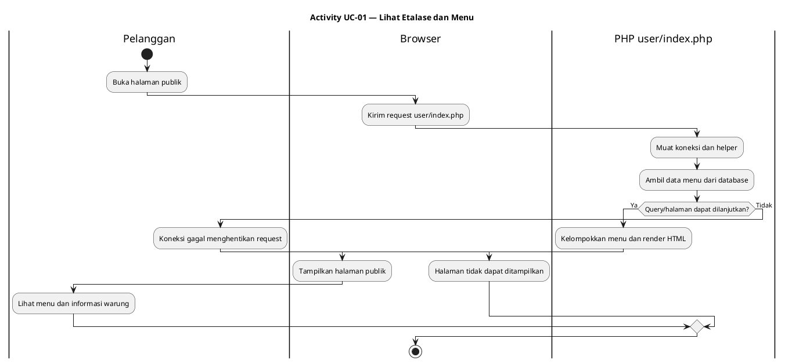

## Activity UC-02 — Buat pesanan dine-in

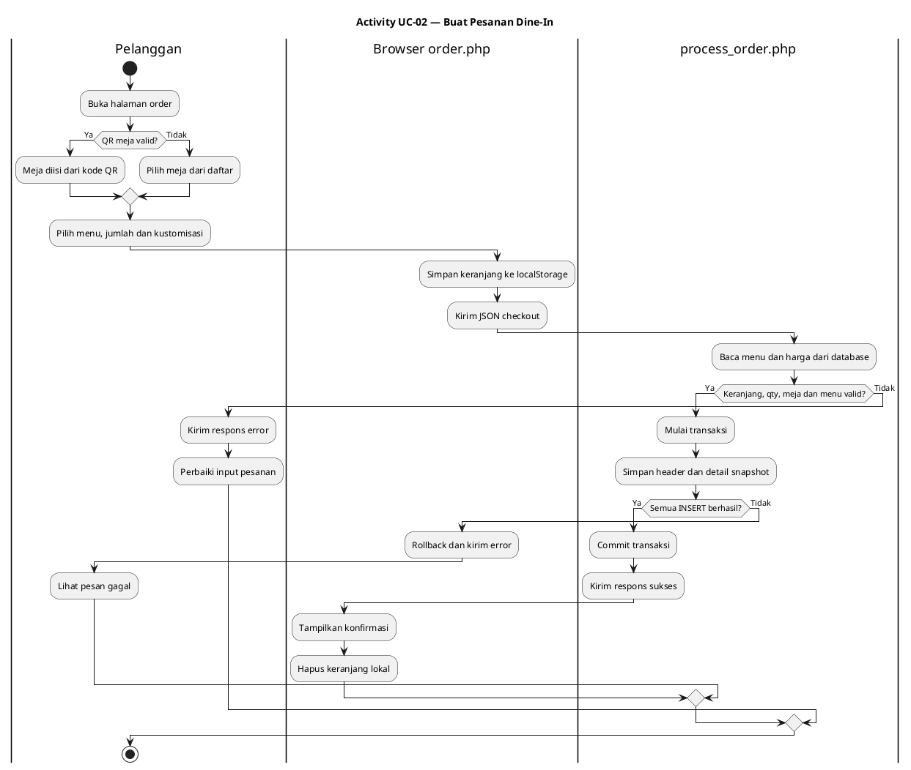

## Activity UC-03 — Buat pesanan takeaway

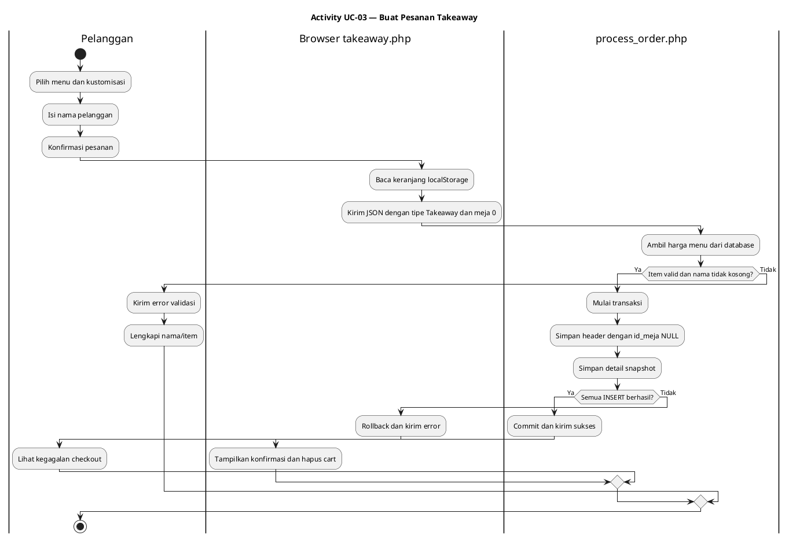

## Activity UC-04 — Pantau antrean dapur

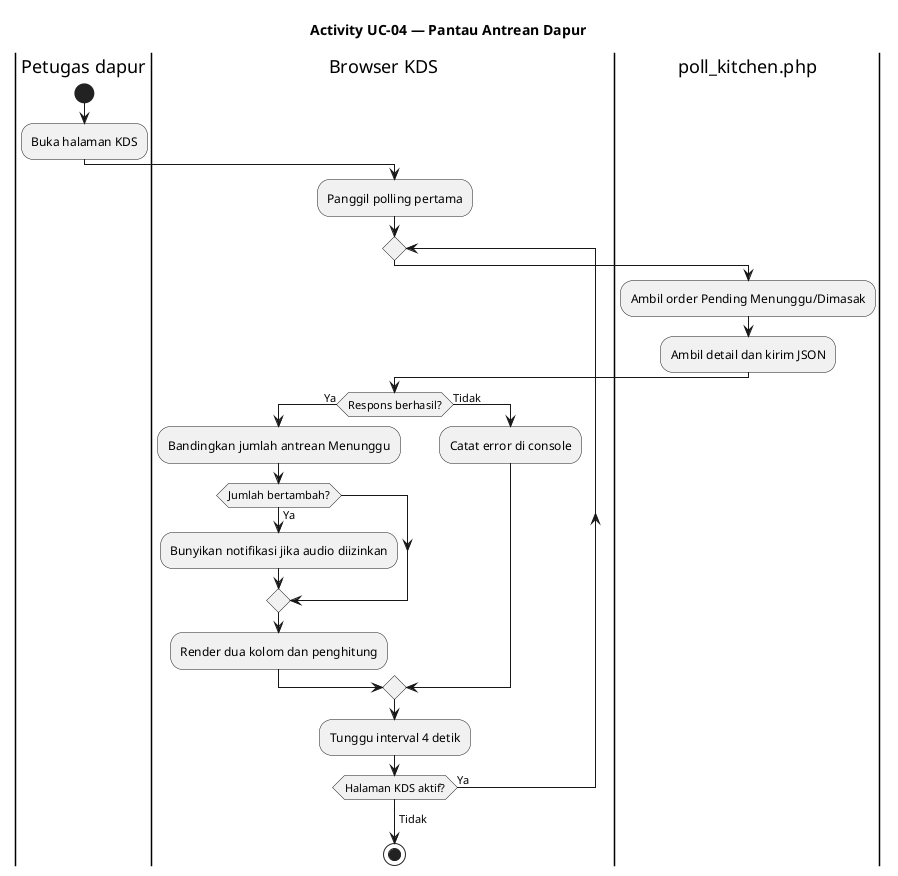

## Activity UC-05 — Perbarui status dapur

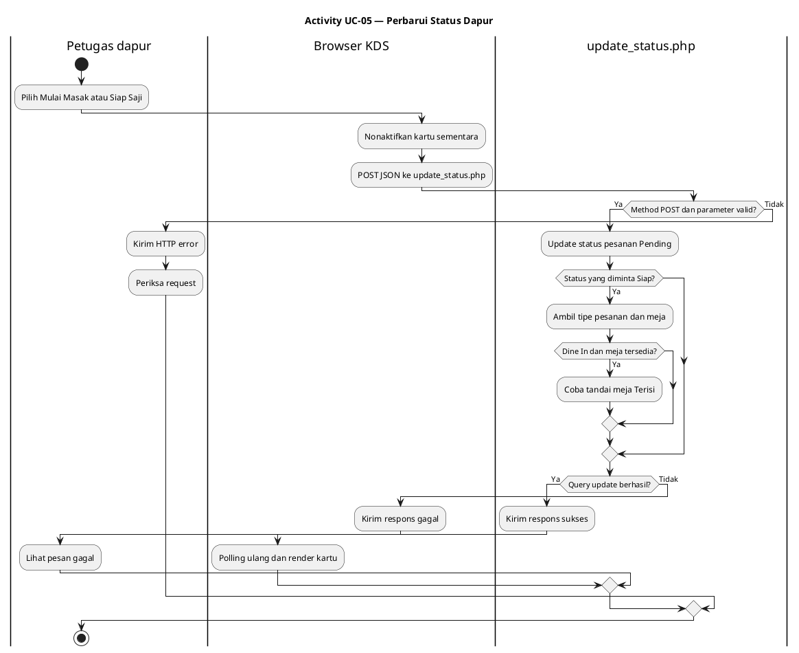

## Activity UC-06 — Pantau pesanan kasir

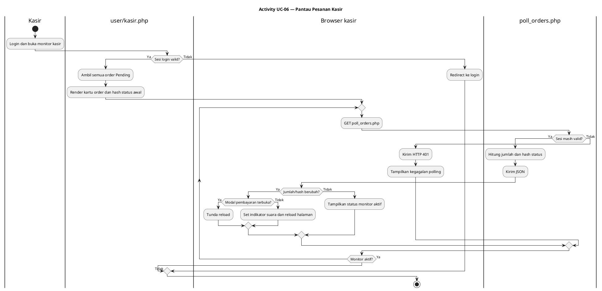

## Activity UC-07 — Selesaikan pembayaran

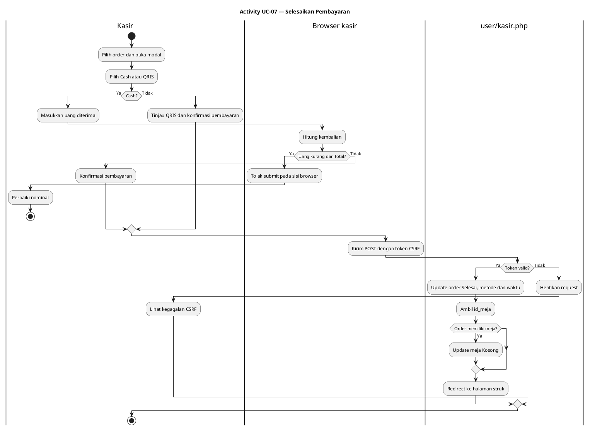

## Activity UC-08 — Cetak/cetak ulang struk

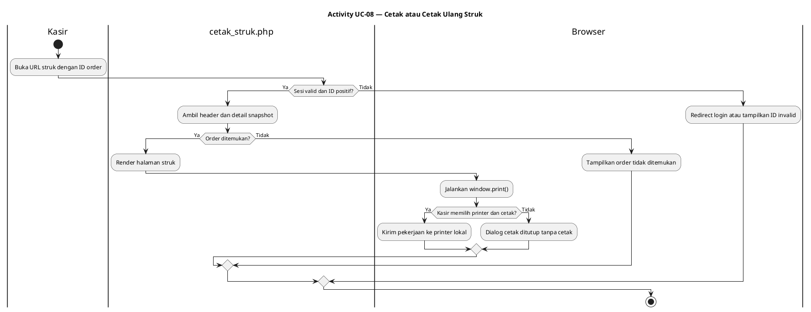

## Activity UC-09 — Login admin/kasir

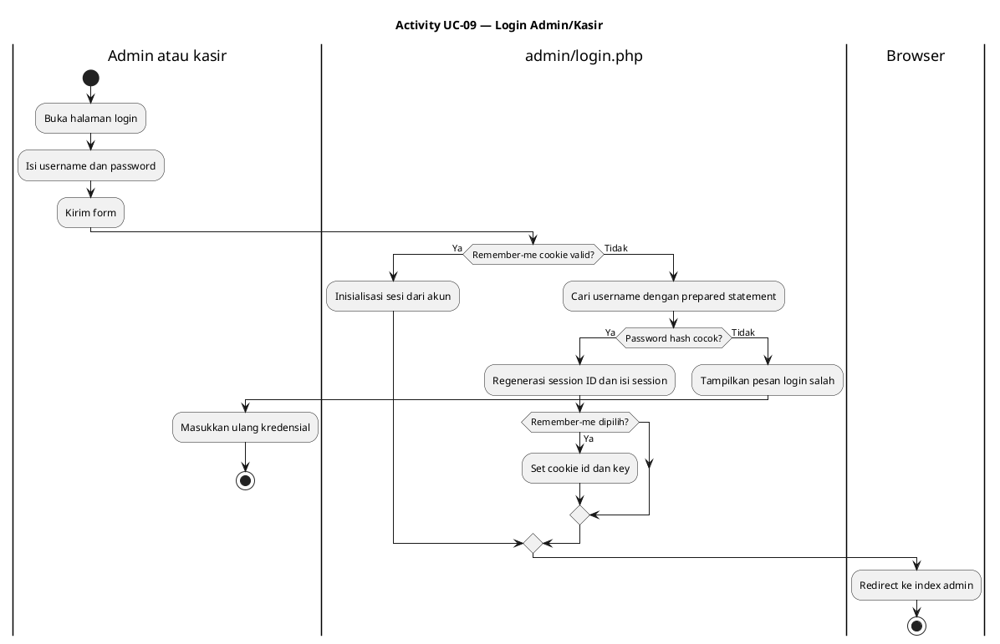

## Activity UC-10 — Registrasi akun admin

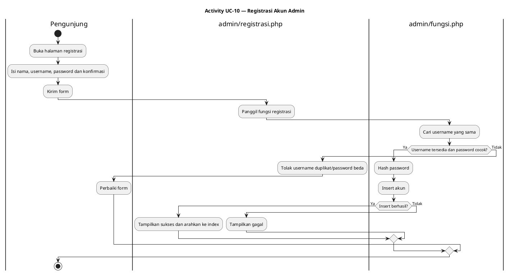

## Activity UC-11 — Logout

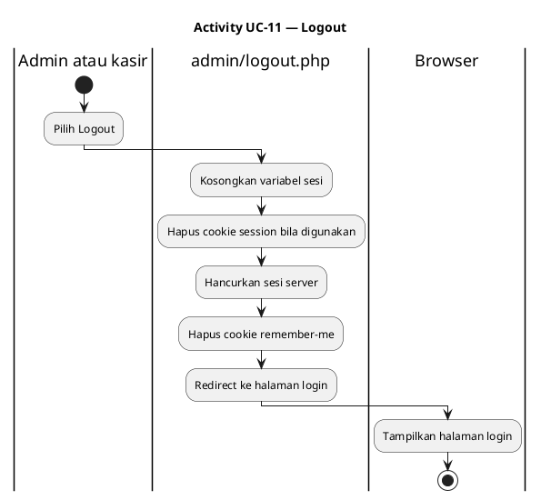

## Activity UC-12 — Lihat dashboard admin

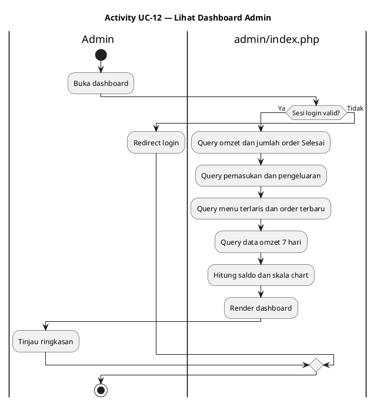

## Activity UC-13 — Cari menu

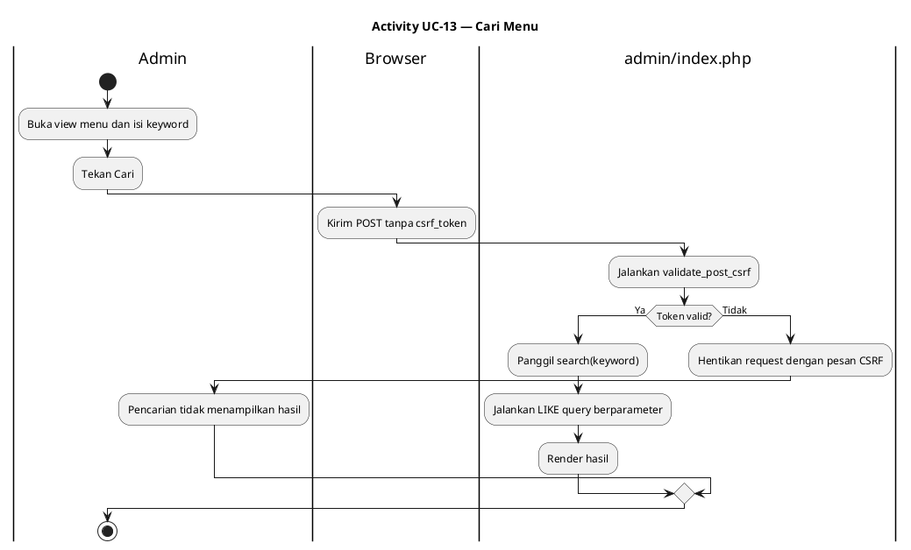

## Activity UC-14 — Tambah menu

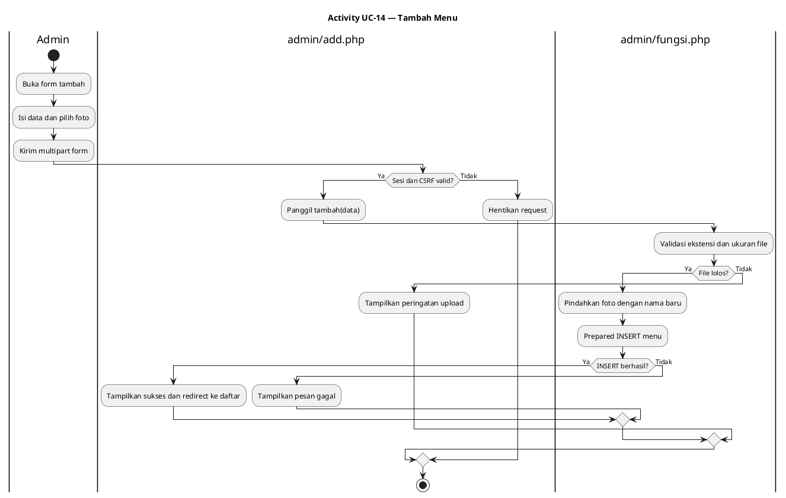

## Activity UC-15 — Ubah menu

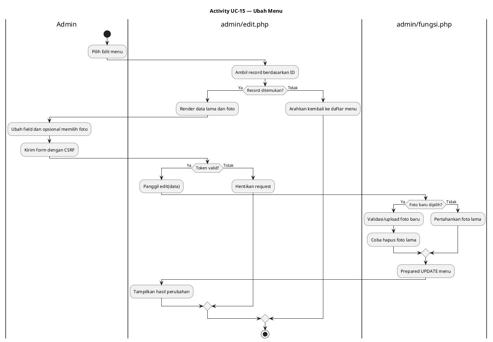

## Activity UC-16 — Hapus menu

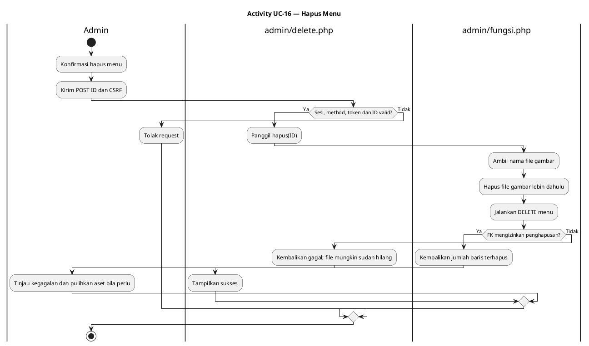

## Activity UC-17 — Ekspor menu PDF

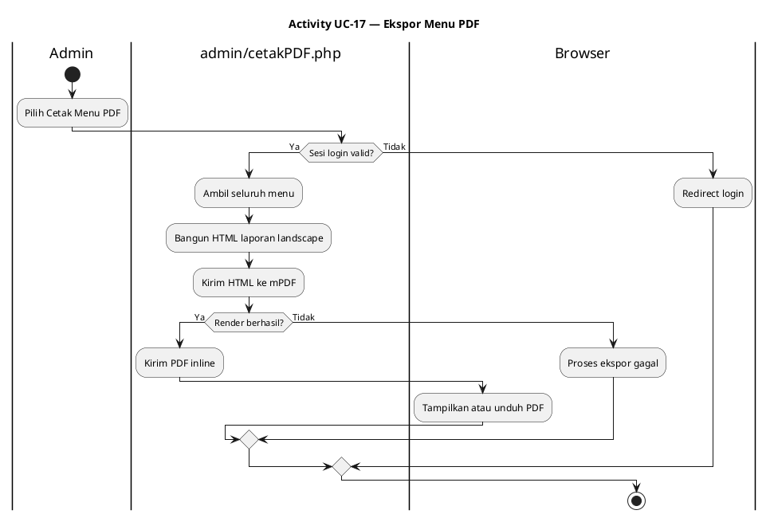

## Activity UC-18 — Lihat ringkasan keuangan

```plantuml
@startuml
title Activity UC-18 — Lihat Ringkasan Keuangan
|Admin|
start
:Pilih menu Keuangan;
|admin/index.php|
if (Sesi valid?) then (Ya)
  :Ambil pesanan Selesai;
  :Ambil pemasukan manual dan pengeluaran;
  :Gabungkan pemasukan;
  :Hitung total dan laba/rugi;
  :Render tabel dan ringkasan;
  |Admin|
  :Tinjau data keuangan;
else (Tidak)
  :Redirect login;
endif
stop
@enduml
```

## Activity UC-19 — Catat pemasukan manual

```plantuml
@startuml
title Activity UC-19 — Catat Pemasukan Manual
|Admin|
start
:Isi sumber, jumlah, tanggal, keterangan;
:Kirim form POST;
|admin/index.php|
if (Sesi dan CSRF valid?) then (Ya)
  :Sanitasi/cast nilai form;
  :Prepared INSERT uang_masuk;
  if (INSERT berhasil?) then (Ya)
    :Tampilkan pesan sukses;
  else (Tidak)
    :Tampilkan pesan gagal;
  endif
else (Tidak)
  :Hentikan request;
endif
stop
@enduml
```

## Activity UC-20 — Catat pengeluaran

```plantuml
@startuml
title Activity UC-20 — Catat Pengeluaran
|Admin|
start
:Isi jenis, jumlah, tanggal, keterangan;
if (Ada foto struk?) then (Ya)
  :Pilih file gambar;
endif
:Kirim multipart POST;
|admin/index.php|
if (Sesi dan CSRF valid?) then (Ya)
  if (Upload file sukses?) then (Ya)
    :Periksa ekstensi;
    if (Ekstensi JPG/JPEG/PNG?) then (Ya)
      :Pindahkan ke img/receipts;
    else (Tidak)
      :Set error format;
    endif
  endif
  if (Tidak ada error format?) then (Ya)
    :Prepared INSERT uang_keluar;
    if (INSERT berhasil?) then (Ya)
      :Tampilkan sukses;
    else (Tidak)
      :Tampilkan gagal;
    endif
  else (Tidak)
    :Tampilkan error upload;
  endif
else (Tidak)
  :Hentikan request;
endif
stop
@enduml
```

## Activity UC-21 — Ubah pengaturan warung

```plantuml
@startuml
title Activity UC-21 — Ubah Pengaturan Warung
|Admin|
start
:Ubah profil, PPN dan jam operasional;
:Kirim form dengan CSRF;
|admin/index.php|
if (Sesi dan token valid?) then (Ya)
  :Bangun daftar key/value;
  repeat
    :Upsert satu pengaturan;
  repeat while (Masih ada key?) is (Ya)
  -> Tidak;
  if (Semua query sukses?) then (Ya)
    :Tampilkan sukses;
  else (Tidak)
    :Tampilkan error umum;
  endif
else (Tidak)
  :Hentikan request;
endif
stop
@enduml
```

## Activity UC-22 — Ekspor laporan keuangan PDF

```plantuml
@startuml
title Activity UC-22 — Ekspor Laporan Keuangan PDF
|Admin|
start
:Pilih cetak laporan;
|admin/cetakLaporan.php|
if (Sesi login valid?) then (Ya)
  :Ambil pemasukan order selesai dan manual;
  :Ambil seluruh pengeluaran;
  :Hitung pemasukan, pengeluaran dan laba/rugi;
  :Bangun HTML laporan;
  :Render dengan mPDF;
  if (Render berhasil?) then (Ya)
    :Kirim PDF inline;
    |Browser|
    :Tampilkan laporan PDF;
  else (Tidak)
    :Ekspor gagal;
  endif
else (Tidak)
  :Redirect login;
endif
stop
@enduml
```

---

# 6. Sequence Diagram

Lifeline berikut hanya menyebut aktor, halaman/endpoint PHP, browser, database atau filesystem yang dapat ditelusuri dari implementasi. Tidak diasumsikan adanya controller/service layer. `alt` digunakan untuk cabang hasil dan `loop` untuk polling.

## Sequence UC-01 — Lihat etalase dan menu

```plantuml
@startuml
title Sequence UC-01 — Lihat Etalase dan Menu
actor Pelanggan
participant "Browser" as Browser
participant "user/index.php" as Page
participant "user/fungsi.php" as Helper
database "MySQL nasgorcakmoldb" as DB
Pelanggan -> Browser : Buka halaman publik
Browser -> Page : GET index.php
Page -> Helper : require fungsi.php
Helper -> DB : SELECT menu
DB --> Helper : baris menu
Helper --> Page : array hasil query
Page --> Browser : HTML landing + katalog
Browser --> Pelanggan : Tampilkan halaman
@enduml
```

## Sequence UC-02 — Buat pesanan dine-in

```plantuml
@startuml
title Sequence UC-02 — Buat Pesanan Dine-In
actor Pelanggan
participant "Browser order.php" as UI
participant "user/process_order.php" as API
participant "user/fungsi.php" as Helper
database "MySQL nasgorcakmoldb" as DB
Pelanggan -> UI : Pilih meja/menu/kustomisasi
UI -> UI : Simpan cart ke localStorage
Pelanggan -> UI : Konfirmasi
UI -> API : POST JSON items, meja_id, tipe
API -> Helper : require koneksi/helper/auth
API -> DB : BEGIN
loop Setiap item
  API -> DB : SELECT nama_menu, harga WHERE id_menu=?
  DB --> API : harga dan nama resmi
end
alt Input dan item lolos validasi
  API -> DB : INSERT pesanan (header)
  DB --> API : id_pesanan
  loop Setiap item
    API -> DB : INSERT detail_pesanan snapshot
    DB --> API : hasil INSERT
  end
  API -> DB : COMMIT
  API --> UI : JSON success + order_id
  UI -> UI : Render konfirmasi dan hapus cart
else Validasi atau query gagal
  API -> DB : ROLLBACK
  API --> UI : JSON error
  UI --> Pelanggan : Tampilkan kegagalan
end
@enduml
```

## Sequence UC-03 — Buat pesanan takeaway

```plantuml
@startuml
title Sequence UC-03 — Buat Pesanan Takeaway
actor Pelanggan
participant "Browser takeaway.php" as UI
participant "user/process_order.php" as API
participant "user/fungsi.php" as Helper
database "MySQL nasgorcakmoldb" as DB
Pelanggan -> UI : Pilih item dan isi nama
UI -> UI : Simpan cart pada localStorage
Pelanggan -> UI : Konfirmasi takeaway
UI -> API : POST JSON (Takeaway, meja_id=0)
API -> Helper : Muat koneksi/helper
API -> DB : BEGIN dan baca harga menu
DB --> API : harga/nama menu
alt Nama dan item valid
  API -> DB : INSERT pesanan id_meja=NULL
  DB --> API : id_pesanan
  API -> DB : INSERT detail snapshot
  DB --> API : hasil
  API -> DB : COMMIT
  API --> UI : JSON success + order_id
  UI --> Pelanggan : Tampilkan konfirmasi; hapus cart
else Data tidak valid/penyimpanan gagal
  API -> DB : ROLLBACK
  API --> UI : JSON error
  UI --> Pelanggan : Tampilkan error
end
@enduml
```

## Sequence UC-04 — Pantau antrean dapur

```plantuml
@startuml
title Sequence UC-04 — Pantau Antrean Dapur
actor "Petugas dapur" as Kitchen
participant "Browser KDS" as Browser
participant "kitchen/index.php JS" as UI
participant "kitchen/poll_kitchen.php" as Poll
database "MySQL nasgorcakmoldb" as DB
Kitchen -> Browser : Buka KDS
Browser -> UI : Muat halaman
loop Halaman aktif, setiap 4 detik
  UI -> Poll : GET poll_kitchen.php
  Poll -> DB : SELECT pesanan aktif Pending
  DB --> Poll : header order
  loop Tiap pesanan
    Poll -> DB : SELECT detail_pesanan
    DB --> Poll : item dan kustomisasi
  end
  Poll --> UI : JSON daftar order
  UI -> UI : Banding jumlah menunggu dan render
  opt antrean Menunggu bertambah
    UI -> Browser : Putar audio notifikasi
  end
end
@enduml
```

## Sequence UC-05 — Perbarui status dapur

```plantuml
@startuml
title Sequence UC-05 — Perbarui Status Dapur
actor "Petugas dapur" as Kitchen
participant "Browser KDS JS" as UI
participant "kitchen/update_status.php" as API
database "MySQL nasgorcakmoldb" as DB
Kitchen -> UI : Klik Mulai Masak atau Siap Saji
UI -> API : POST JSON id_pesanan, status_dapur
API -> API : Validasi method, ID dan status
alt Parameter valid
  API -> DB : UPDATE pesanan status_dapur untuk Pending
  DB --> API : status eksekusi
  alt Status diminta Siap
    API -> DB : SELECT id_meja, tipe_pesanan
    DB --> API : data pesanan
    opt Dine In memiliki meja
      API -> DB : UPDATE meja menjadi Terisi
      DB --> API : hasil update
    end
  end
  API --> UI : JSON success/error
  UI -> UI : Poll ulang dan render
else Parameter salah atau method salah
  API --> UI : HTTP 400/405 JSON error
  UI --> Kitchen : Tampilkan kegagalan
end
@enduml
```

## Sequence UC-06 — Pantau pesanan kasir

```plantuml
@startuml
title Sequence UC-06 — Pantau Pesanan Kasir
actor Kasir
participant "Browser kasir" as Browser
participant "user/kasir.php" as Page
participant "user/poll_orders.php" as Poll
database "MySQL nasgorcakmoldb" as DB
Kasir -> Browser : Buka monitor
Browser -> Page : GET kasir.php
Page -> Page : confirm_kasir_login()
Page -> DB : SELECT semua pesanan Pending
DB --> Page : daftar order
Page --> Browser : HTML kartu + hash awal
loop Setiap 8 detik
  Browser -> Poll : GET poll_orders.php
  Poll -> Poll : Periksa session login
  alt Session valid
    Poll -> DB : COUNT Pending dan GROUP_CONCAT status
    DB --> Poll : jumlah dan status string
    Poll --> Browser : JSON count + hash
    alt Hash/jumlah berubah dan modal tertutup
      Browser -> Browser : Reload halaman dan mainkan notifikasi
    else Modal terbuka atau tidak ada perubahan
      Browser -> Browser : Pertahankan modal/indikator online
    end
  else Session tidak valid
    Poll --> Browser : HTTP 401 JSON
  end
end
@enduml
```

## Sequence UC-07 — Selesaikan pembayaran

```plantuml
@startuml
title Sequence UC-07 — Selesaikan Pembayaran
actor Kasir
participant "Browser kasir" as UI
participant "user/kasir.php" as Handler
database "MySQL nasgorcakmoldb" as DB
Kasir -> UI : Buka modal dan pilih metode
opt Metode Cash
  Kasir -> UI : Masukkan uang diterima
  UI -> UI : Hitung kembalian di browser
  alt Uang kurang
    UI --> Kasir : Cegah submit
  else Uang cukup
    Kasir -> UI : Konfirmasi
  end
end
opt Metode QRIS
  UI --> Kasir : Tampilkan QRIS
  Kasir -> UI : Konfirmasi
end
UI -> Handler : POST CSRF, id_pesanan, metode_bayar
Handler -> Handler : confirm_kasir_login + validasi CSRF
alt CSRF valid
  Handler -> DB : UPDATE status Selesai, metode, waktu
  DB --> Handler : hasil update
  Handler -> DB : SELECT id_meja
  DB --> Handler : id_meja
  opt Pesanan memiliki meja
    Handler -> DB : UPDATE meja Kosong
    DB --> Handler : hasil update
  end
  Handler --> UI : HTTP redirect cetak_struk.php?id
else CSRF invalid
  Handler --> UI : Hentikan request
end
@enduml
```

## Sequence UC-08 — Cetak/cetak ulang struk

```plantuml
@startuml
title Sequence UC-08 — Cetak atau Cetak Ulang Struk
actor Kasir
participant "Browser" as Browser
participant "user/cetak_struk.php" as Page
participant "user/fungsi.php query()" as Helper
database "MySQL nasgorcakmoldb" as DB
participant "Dialog cetak browser/OS" as Print
Kasir -> Browser : Buka URL struk
Browser -> Page : GET id
Page -> Page : confirm_kasir_login dan validasi ID
Page -> DB : SELECT header pesanan + nama meja
DB --> Page : data header
Page -> Helper : Query detail snapshot
Helper -> DB : SELECT detail_pesanan WHERE id_pesanan=?
DB --> Helper : daftar item
Helper --> Page : data detail
Page --> Browser : HTML struk
Browser -> Print : window.print()
Print --> Kasir : Tampilkan opsi cetak
Kasir -> Print : Cetak atau batalkan
@enduml
```

## Sequence UC-09 — Login admin/kasir

```plantuml
@startuml
title Sequence UC-09 — Login Admin/Kasir
actor "Admin/kasir" as User
participant "Browser" as Browser
participant "admin/login.php" as Login
participant "admin/fungsi.php" as Functions
participant "includes/auth.php" as Auth
database "MySQL nasgorcakmoldb" as DB
User -> Browser : Isi kredensial dan submit
Browser -> Login : POST username, password, opsi remember
Login -> Functions : require fungsi.php
opt Cookie remember-me ada
  Login -> DB : SELECT user berdasarkan ID
  DB --> Login : record user
  Login -> Login : Bandingkan key hash username
end
alt Session belum login dan form dikirim
  Login -> DB : SELECT user berdasarkan username
  DB --> Login : record atau kosong
  alt Password verify berhasil
    Login -> Auth : init_user_session(id, username, nama)
    Auth -> Auth : Regenerasi ID dan isi session
    opt Remember-me dipilih
      Login --> Browser : Set cookie id dan key
    end
    Login --> Browser : Redirect index.php
  else Kredensial salah
    Login --> Browser : Render pesan login gagal
  end
end
@enduml
```

## Sequence UC-10 — Registrasi akun admin

```plantuml
@startuml
title Sequence UC-10 — Registrasi Akun Admin
actor Pengunjung
participant "Browser" as Browser
participant "admin/registrasi.php" as Page
participant "admin/fungsi.php::registrasi" as Register
database "MySQL nasgorcakmoldb" as DB
Pengunjung -> Browser : Isi form registrasi
Browser -> Page : POST fullname, username, password, password2
Page -> Register : registrasi($_POST)
Register -> DB : SELECT user berdasarkan username
DB --> Register : ada/tidak ada
alt Username tersedia dan password cocok
  Register -> Register : password_hash()
  Register -> DB : INSERT user
  DB --> Register : affected rows
  Register --> Page : hasil registrasi
  Page --> Browser : Alert sukses dan redirect index
else Username duplikat atau password beda
  Register --> Page : Gagal
  Page --> Browser : Alert gagal
end
note over Page,DB
Endpoint registrasi tidak memakai CSRF
dan tidak menetapkan sesi login.
end note
@enduml
```

## Sequence UC-11 — Logout

```plantuml
@startuml
title Sequence UC-11 — Logout
actor "Admin/kasir" as User
participant "Browser" as Browser
participant "admin/logout.php" as Logout
participant "PHP session" as Session
User -> Browser : Pilih Logout
Browser -> Logout : GET logout.php
Logout -> Session : Mulai bila belum aktif
Logout -> Session : Kosongkan $_SESSION
Logout -> Browser : Hapus cookie session
Logout -> Session : session_destroy()
Logout -> Browser : Hapus cookie id dan key
Logout --> Browser : Redirect login.php
Browser --> User : Tampilkan halaman login
@enduml
```

## Sequence UC-12 — Lihat dashboard admin

```plantuml
@startuml
title Sequence UC-12 — Lihat Dashboard Admin
actor Admin
participant "Browser" as Browser
participant "admin/index.php" as Page
participant "admin/fungsi.php query()" as Query
database "MySQL nasgorcakmoldb" as DB
Admin -> Browser : Buka dashboard
Browser -> Page : GET index.php?page=dashboard
Page -> Page : confirm_admin_login()
Page -> DB : SELECT SUM/COUNT pesanan selesai
DB --> Page : omzet dan transaksi
Page -> DB : SELECT total uang_keluar dan uang_masuk
DB --> Page : nilai agregat
Page -> Query : Query menu terlaris, order terbaru, data 7 hari
Query -> DB : SELECT detail/order agregat
DB --> Query : baris hasil
Query --> Page : array data
Page -> Page : Hitung saldo dan chart
Page --> Browser : HTML dashboard
Browser --> Admin : Tampilkan ringkasan
@enduml
```

## Sequence UC-13 — Cari menu

```plantuml
@startuml
title Sequence UC-13 — Cari Menu
actor Admin
participant "Browser" as Browser
participant "admin/index.php" as Page
participant "admin/fungsi.php::search" as Search
database "MySQL nasgorcakmoldb" as DB
Admin -> Browser : Isi keyword dan klik Cari
Browser -> Page : POST search, keyword (tanpa csrf_token)
Page -> Page : validate_post_csrf()
alt Token tersedia dan valid
  Page -> Search : search(keyword)
  Search -> DB : SELECT LIKE dengan prepared statement
  DB --> Search : hasil pencarian
  Search --> Page : array menu
  Page --> Browser : Render hasil
else Token tidak ada atau invalid (kondisi form aktual)
  Page --> Browser : Hentikan request dengan pesan CSRF
end
@enduml
```

## Sequence UC-14 — Tambah menu

```plantuml
@startuml
title Sequence UC-14 — Tambah Menu
actor Admin
participant "Browser" as Browser
participant "admin/add.php" as Page
participant "admin/fungsi.php::tambah/upload" as Functions
participant "Filesystem img/" as FS
database "MySQL nasgorcakmoldb" as DB
Admin -> Browser : Isi form dan pilih foto
Browser -> Page : Multipart POST + csrf_token
Page -> Page : confirm_admin_login dan cek CSRF
Page -> Functions : tambah($_POST)
Functions -> Functions : Validasi ekstensi dan ukuran
alt File diterima
  Functions -> FS : move_uploaded_file nama baru
  Functions -> DB : Prepared INSERT menu
  DB --> Functions : affected rows
  Functions --> Page : hasil
  Page --> Browser : Notifikasi sukses/gagal
else File ditolak
  Functions --> Page : false dan alert validasi
end
@enduml
```

## Sequence UC-15 — Ubah menu

```plantuml
@startuml
title Sequence UC-15 — Ubah Menu
actor Admin
participant "Browser" as Browser
participant "admin/edit.php" as Page
participant "admin/fungsi.php::edit/upload" as Functions
participant "Filesystem img/" as FS
database "MySQL nasgorcakmoldb" as DB
Admin -> Browser : Buka edit?id
Browser -> Page : GET id
Page -> DB : SELECT menu WHERE id_menu=?
DB --> Page : record menu
Page --> Browser : Form terisi data lama
Admin -> Browser : Ubah data dan submit
Browser -> Page : Multipart POST + CSRF
Page -> Page : Periksa sesi dan CSRF
Page -> Functions : edit($_POST)
alt Foto tidak diganti
  Functions -> Functions : Gunakan foto lama
else Foto baru dipilih
  Functions -> FS : Upload nama baru
  Functions -> FS : Coba hapus foto lama
end
Functions -> DB : Prepared UPDATE menu
DB --> Functions : affected rows
Functions --> Page : Hasil update
Page --> Browser : Tampilkan notifikasi/redirect
@enduml
```

## Sequence UC-16 — Hapus menu

```plantuml
@startuml
title Sequence UC-16 — Hapus Menu
actor Admin
participant "Browser" as Browser
participant "admin/delete.php" as Page
participant "admin/fungsi.php::hapus" as Delete
participant "Filesystem img/" as FS
database "MySQL nasgorcakmoldb" as DB
Admin -> Browser : Konfirmasi hapus
Browser -> Page : POST id + csrf_token
Page -> Page : Cek sesi, method, CSRF, ID
Page -> Delete : hapus(id)
Delete -> DB : SELECT nama file gambar
DB --> Delete : nama file
Delete -> FS : Hapus file bila ditemukan
Delete -> DB : DELETE menu WHERE id_menu=?
alt FK mengizinkan penghapusan
  DB --> Delete : affected rows
  Delete --> Page : sukses
  Page --> Browser : Redirect dengan pesan sukses
else Detail historis merujuk menu
  DB --> Delete : DELETE gagal
  Delete --> Page : gagal (file sudah dicoba dihapus)
  Page --> Browser : Redirect dengan pesan gagal
end
@enduml
```

## Sequence UC-17 — Ekspor menu PDF

```plantuml
@startuml
title Sequence UC-17 — Ekspor Menu PDF
actor Admin
participant "Browser" as Browser
participant "admin/cetakPDF.php" as Page
participant "admin/fungsi.php query()" as Query
database "MySQL nasgorcakmoldb" as DB
participant "mPDF" as PDF
Admin -> Browser : Pilih cetak menu
Browser -> Page : GET cetakPDF.php
Page -> Page : confirm_admin_login()
Page -> Query : Ambil semua menu
Query -> DB : SELECT menu ORDER BY id
DB --> Query : baris menu
Query --> Page : data menu
Page -> PDF : WriteHTML tabel katalog
PDF --> Page : Dokumen PDF
Page --> Browser : Output inline
Browser --> Admin : Tampilkan PDF
@enduml
```

## Sequence UC-18 — Lihat ringkasan keuangan

```plantuml
@startuml
title Sequence UC-18 — Lihat Ringkasan Keuangan
actor Admin
participant "Browser" as Browser
participant "admin/index.php" as Page
participant "admin/fungsi.php query()" as Query
database "MySQL nasgorcakmoldb" as DB
Admin -> Browser : Buka menu Keuangan
Browser -> Page : GET index.php?page=keuangan
Page -> Page : confirm_admin_login()
Page -> Query : Ambil order selesai
Query -> DB : SELECT pesanan Selesai
DB --> Query : transaksi
Page -> Query : Ambil pemasukan manual dan pengeluaran
Query -> DB : SELECT uang_masuk, uang_keluar
DB --> Query : catatan keuangan
Query --> Page : Data ledger
Page -> Page : Gabung pemasukan dan hitung selisih
Page --> Browser : HTML ringkasan dan tabel
Browser --> Admin : Tampilkan ledger
@enduml
```

## Sequence UC-19 — Catat pemasukan manual

```plantuml
@startuml
title Sequence UC-19 — Catat Pemasukan Manual
actor Admin
participant "Browser" as Browser
participant "admin/index.php" as Handler
database "MySQL nasgorcakmoldb" as DB
Admin -> Browser : Isi form pemasukan
Browser -> Handler : POST fields + csrf_token
Handler -> Handler : Validasi session dan CSRF
alt Token valid
  Handler -> DB : Prepared INSERT uang_masuk
  alt Execute berhasil
    DB --> Handler : affected rows
    Handler --> Browser : Render pesan sukses
  else Execute gagal
    DB --> Handler : false
    Handler --> Browser : Render pesan gagal
  end
else Token invalid
  Handler --> Browser : Hentikan request
end
@enduml
```

## Sequence UC-20 — Catat pengeluaran

```plantuml
@startuml
title Sequence UC-20 — Catat Pengeluaran
actor Admin
participant "Browser" as Browser
participant "admin/index.php" as Handler
participant "Filesystem img/receipts/" as FS
database "MySQL nasgorcakmoldb" as DB
Admin -> Browser : Isi data biaya dan pilih foto opsional
Browser -> Handler : Multipart POST + CSRF
Handler -> Handler : Validasi session/CSRF dan baca field
alt File upload sukses
  Handler -> Handler : Periksa ekstensi jpg/jpeg/png
  alt Ekstensi diizinkan
    Handler -> FS : move_uploaded_file dengan nama baru
    FS --> Handler : hasil move
  else Ekstensi ditolak
    Handler -> Handler : Set error format
  end
else Tidak ada file sukses
  Handler -> Handler : Foto tetap NULL
end
alt Tidak ada error format
  Handler -> DB : Prepared INSERT uang_keluar
  DB --> Handler : hasil execute
  Handler --> Browser : Pesan sukses/gagal
else Format invalid
  Handler --> Browser : Pesan format tidak valid
end
@enduml
```

## Sequence UC-21 — Ubah pengaturan warung

```plantuml
@startuml
title Sequence UC-21 — Ubah Pengaturan Warung
actor Admin
participant "Browser" as Browser
participant "admin/index.php" as Handler
database "MySQL nasgorcakmoldb" as DB
Admin -> Browser : Ubah profil/jam/PPN dan submit
Browser -> Handler : POST fields + csrf_token
Handler -> Handler : Validasi session dan token
alt Token valid
  loop Setiap key pengaturan
    Handler -> DB : INSERT ... ON DUPLICATE KEY UPDATE
    DB --> Handler : hasil execute
  end
  alt Semua query sukses
    Handler --> Browser : Pesan berhasil
  else Minimal satu query gagal
    Handler --> Browser : Pesan error umum
  end
else Token invalid
  Handler --> Browser : Hentikan request
end
@enduml
```

## Sequence UC-22 — Ekspor laporan keuangan PDF

```plantuml
@startuml
title Sequence UC-22 — Ekspor Laporan Keuangan PDF
actor Admin
participant "Browser" as Browser
participant "admin/cetakLaporan.php" as Page
participant "admin/fungsi.php query()" as Query
database "MySQL nasgorcakmoldb" as DB
participant "mPDF" as PDF
Admin -> Browser : Pilih cetak laporan keuangan
Browser -> Page : GET cetakLaporan.php
Page -> Page : confirm_admin_login()
Page -> Query : Ambil order selesai
Query -> DB : SELECT pesanan Selesai
DB --> Query : data transaksi
Page -> Query : Ambil pemasukan manual/pengeluaran
Query -> DB : SELECT uang_masuk dan uang_keluar
DB --> Query : data finansial
Query --> Page : Hasil query
Page -> Page : Hitung total pemasukan, biaya, laba/rugi
Page -> PDF : WriteHTML laporan
PDF --> Page : Dokumen PDF
Page --> Browser : Output inline
Browser --> Admin : Tampilkan PDF
@enduml
```

---

# 7. Kesimpulan dan Rekomendasi

## 7.1 Kesimpulan

Codebase `warungcakmol-copy` telah menghubungkan katalog publik dan checkout mandiri dengan database; mendukung pesanan dine-in serta takeaway; memproses antrean dapur melalui polling KDS; menyediakan monitor kasir, metode pembayaran Cash/QRIS dan struk; serta menyediakan modul administrasi katalog dan pencatatan keuangan. Pembuatan pesanan menghitung harga server-side, membuat header/detail di dalam transaksi, dan menyimpan snapshot nama/harga untuk transaksi historis.

Implementasi tetap berupa aplikasi PHP prosedural yang relatif monolitik. Sejumlah mekanisme keamanan telah ada—prepared statements pada operasi berparameter, password hashing, session check untuk admin/kasir, CSRF pada beberapa form, dan escaping output pada sebagian tampilan—namun penerapannya belum konsisten pada seluruh alur. Beberapa kondisi, seperti form pencarian yang tidak mengirim token, endpoint KDS tanpa login/CSRF, validasi pembayaran tunai di sisi client saja, dan operasi pembayaran/meja yang tidak atomik, perlu ditangani sebelum menyimpulkan sistem aman atau siap produksi.

Tidak ditemukan inventori/stok, CRUD kategori, akun/riwayat pelanggan, payment gateway QRIS terintegrasi, pencetakan langsung tanpa dialog browser, test otomatis, maupun migration runner. Hal-hal tersebut tidak boleh dinyatakan sebagai fitur yang telah tersedia.

## 7.2 Rekomendasi prioritas

1. **Perbaiki alur yang terblokir:** tambahkan token CSRF pada form pencarian atau ubah metode/kontrak dengan proteksi yang benar; uji alur POST admin lain.
2. **Amankan endpoint dapur dan registrasi:** tentukan model akses jaringan, autentikasi/otorisasi, kontrol CSRF atau token sesuai threat model, serta batasi pembuatan akun admin.
3. **Kuatkan pembayaran:** validasi nominal tunai, metode dan status order di server; batasi penyelesaian ganda; buat transaksi DB untuk status order dan meja.
4. **Terapkan transisi state eksplisit:** pastikan Menunggu→Dimasak→Siap berjalan sesuai aturan, cek affected rows, dan tangani request bersamaan.
5. **Perbaiki upload dan lifecycle file:** validasi ukuran/MIME/isi, cek hasil pemindahan, gunakan penyimpanan aman, dan koordinasikan hapus/update file dengan DB.
6. **Lindungi riwayat transaksi:** pertimbangkan arsip/nonaktif menu alih-alih penghapusan fisik agar FK dan bukti historis tetap konsisten.
7. **Perkuat data keuangan:** filter periode, validasi nilai/tanggal/kategori, audit perubahan dan dokumentasi definisi omzet/laba.
8. **Perbaiki observabilitas:** bedakan kegagalan query dari hasil kosong, tambahkan logging error internal tanpa mengekspos detail ke pelanggan.
9. **Kelola konfigurasi dan deployment:** pindahkan kredensial dari source, gunakan akun DB terbatas, dokumentasikan versi runtime, backup dan prosedur pemulihan.
10. **Bangun verifikasi regresi:** tambahkan test untuk aturan checkout, role/CSRF, status, perhitungan pembayaran, upload dan kontrak polling. Sementara test otomatis belum tersedia, jalankan checklist manual yang dapat diulang pada DB pengembangan.

## 7.3 Konsistensi dan batas validasi dokumen

- Jumlah use case yang dianalisis: **22** (UC-01 sampai UC-22).
- Deskripsi use case terpisah: **22**.
- Skenario use case terpisah dengan aktivitas sebelum/sesudah: **22**.
- Activity diagram individual: **22**.
- Sequence diagram individual: **22**.
- Use case diagram ringkasan: **3** diagram per kelompok aktor/modul.
- Semua diagram ditulis dalam blok PlantUML lengkap dengan `@startuml`/`@enduml` dan diperiksa konsistensi manual antara ID, peserta, alur serta referensi endpoint.
- Sintaks **belum diverifikasi dengan renderer PlantUML**: executable PlantUML tidak tersedia di environment yang diperiksa; Java tersedia, tetapi tidak dilakukan pengunduhan dependency atau penggunaan layanan eksternal. Oleh karena itu laporan tidak mengklaim diagram berhasil dirender. Sebelum pengumpulan, render semua blok PlantUML dengan instalasi lokal PlantUML atau plugin editor dan koreksi error renderer bila ada.
- `Tugas_RPL_Nasgor.md` tidak ditemukan pada workspace; laporan ini memakai spesifikasi tugas yang disediakan dalam percakapan dan mengacu pada codebase aktif. Salinan `warungcakmol-copy-2/` sengaja tidak dianalisis sesuai instruksi terbaru.
