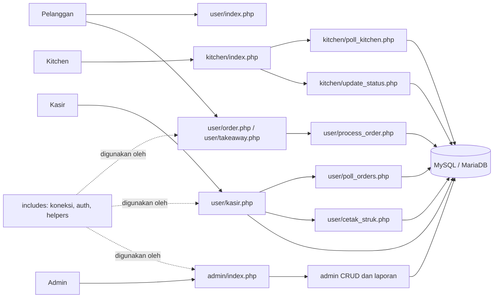

# Arsitektur Aplikasi

## Gambaran umum

Aplikasi adalah web POS monolitik kecil yang berjalan pada satu aplikasi PHP dan satu database MySQL/MariaDB. Pola yang digunakan bersifat prosedural: endpoint dan halaman PHP memuat logika request, query `mysqli`, serta HTML; JavaScript di browser menangani interaksi dan polling. Tidak ada framework MVC atau frontend build terpisah.

## Peta direktori

| Path | Tanggung jawab |
|---|---|
| `user/` | Beranda publik, katalog dan keranjang dine-in/takeaway, endpoint pembuatan pesanan, halaman kasir, polling kasir, dan cetak struk. |
| `kitchen/` | Board KDS, polling daftar pesanan aktif, dan endpoint perubahan status dapur. |
| `admin/` | Login/registrasi, dashboard, CRUD menu, pencatatan keuangan/pengaturan, dan ekspor PDF. |
| `includes/` | Koneksi database bersama, session/auth helper, dan helper umum. |
| `css/` | Stylesheet halaman admin dan pelanggan/kasir. Sebagian style dan JavaScript tetap inline di halaman. |
| `img/`, `assets/` | Gambar menu, gambar struk pengeluaran, QRIS, suara notifikasi, dan aset UI. |
| `nasgorcakmoldb (2).sql` | Dump schema dan data database untuk setup lokal; bukan migration runner. |
| `vendor/` | Dependency Composer terpasang; bukan source aplikasi. |

`warungcakmol-copy-2/` adalah salinan berbeda, bukan bagian dari aplikasi aktif ini.

## Batas modul dan kontrak

### Pelanggan

- `user/index.php` menampilkan menu/profil publik.
- `user/order.php` dan `user/takeaway.php` membangun tampilan menu dari database dan menyimpan keranjang sisi browser di `localStorage`.
- Keduanya mengirim JSON ke `user/process_order.php`. Harga dan nama item untuk transaksi diambil lagi dari database; data harga yang dikirim browser bukan sumber kebenaran.
- Kontrak respons utama endpoint checkout adalah JSON dengan `status`, `message`, dan `order_id` saat berhasil. Pertahankan bentuk respons yang dibaca JavaScript pemanggil.

### Dapur (KDS)

- `kitchen/index.php` mengambil daftar aktif dari `kitchen/poll_kitchen.php` setiap beberapa detik dan mengirim aksi ke `kitchen/update_status.php`.
- Polling mengembalikan pesanan Pending yang status dapurnya `Menunggu` atau `Dimasak`, berikut detail item.
- Endpoint update menerima POST JSON dengan `id_pesanan` dan status `Dimasak` atau `Siap`.
- KDS saat ini dapat diakses tanpa login sesuai implementasi yang ada. Jangan mengubah asumsi akses tanpa mempertimbangkan konfigurasi jaringan dan kebutuhan deployment.

### Kasir

- `user/kasir.php` memerlukan sesi login admin/kasir dan menampilkan pesanan Pending.
- `user/poll_orders.php` adalah endpoint polling berautentikasi; UI menggunakannya untuk jumlah pesanan dan perubahan status dapur.
- Penyelesaian pembayaran memperbarui status pesanan, metode pembayaran, waktu selesai, dan status meja dine-in, lalu menuju `user/cetak_struk.php`.
- Struk memerlukan sesi kasir dan mengambil header/detail berdasarkan ID pesanan.

### Admin

- `admin/index.php` adalah halaman dashboard dengan pemilihan view melalui `?page=dashboard|menu|keuangan|pengaturan`.
- CRUD menu menggunakan halaman `admin/add.php`, `admin/edit.php`, `admin/delete.php` dan fungsi di `admin/fungsi.php`.
- `admin/cetakPDF.php` mengekspor katalog menu; `admin/cetakLaporan.php` mengekspor ringkasan keuangan.
- Akses admin dikendalikan melalui helper di `includes/auth.php`; operasi perubahan data memakai token CSRF pada form yang mendukungnya.

### Infrastruktur bersama

- `includes/koneksi.php` membuat koneksi `mysqli` ke database `nasgorcakmoldb` dan menetapkan charset `utf8mb4`.
- `includes/auth.php` memulai sesi dan menyediakan pemeriksaan login serta inisialisasi sesi.
- `includes/helpers.php` menyediakan `sanitize()`, `csrf_token()`, `check_csrf_token()`, dan `formatRupiah()`.
- `admin/fungsi.php` dan `user/fungsi.php` masing-masing memiliki helper query bernama `query()`. Periksa keduanya dan pola pemanggilannya sebelum menambah utilitas database agar helper tidak diduplikasi.
- `user/koneksi.php` adalah proxy kompatibilitas ke `includes/koneksi.php`.

## Panduan evolusi

- Pertahankan batas endpoint dan kontrak request/response yang digunakan browser, kecuali perubahan kontraknya memang diminta dan semua pemanggil diperbarui.
- Perubahan alur pesanan harus meninjau pelanggan, proses simpan, polling KDS, aksi KDS, polling kasir, pembayaran, status meja, dan struk.
- Perubahan skema harus ditelusuri di seluruh query PHP serta diselaraskan dengan dump SQL. Belum ada migration runner.
- Jangan menambah layer/framework baru hanya demi abstraksi; cocokkan skala perubahan dengan pola aplikasi saat ini dan jelaskan bila perlu ada penyimpangan.
