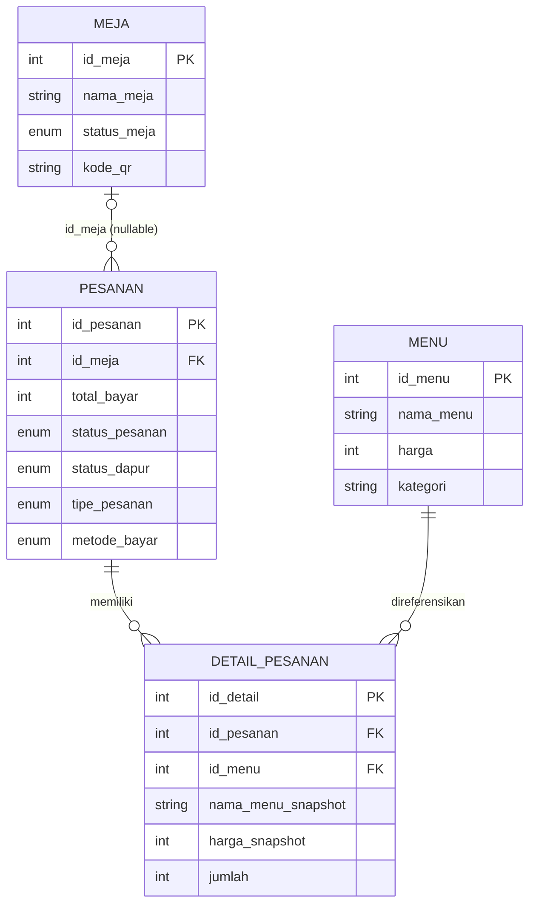

# Model Data

## Sumber schema

Dump yang tersedia adalah [`nasgorcakmoldb (2).sql`](../nasgorcakmoldb%20%282%29.sql), untuk database `nasgorcakmoldb`. Dump tersebut mencakup schema dan data contoh. Saat ini tidak ditemukan sistem migration atau schema versioning. Jangan mengimpor dump ke database berisi data tanpa backup dan persetujuan.

Semua tabel pada dump menggunakan InnoDB dan `utf8mb4`. Tabel utama:

| Tabel | Fungsi |
|---|---|
| `menu` | Katalog item yang dapat dipesan. |
| `kategori` | Label, icon, dan urutan kategori menu. |
| `meja` | Meja dine-in dan kode QR. |
| `pesanan` | Header transaksi, tipe pesanan, total, status dapur/pembayaran. |
| `detail_pesanan` | Item pesanan beserta snapshot nama/harga dan kustomisasi. |
| `user` | Akun admin/kasir untuk login. |
| `uang_masuk` | Pemasukan manual. |
| `uang_keluar` | Pengeluaran dan referensi foto struk. |
| `pengaturan` | Konfigurasi warung sebagai pasangan kunci/nilai. |

## Tabel dan kolom penting

### `menu`

`id_menu` (PK), `nama_menu`, `harga`, `deskripsi`, `kategori`, `gambar`, `badge`, `badge_color`.

`kategori` adalah teks yang dicocokkan ke `kategori.nama_kategori`; schema tidak mendefinisikan foreign key untuk hubungan ini.

### `kategori`

`id_kategori` (PK), `nama_kategori`, `icon_name`, `urutan`.

UI mengurutkan kategori menurut `urutan`. Pertahankan kesesuaian ejaan nama kategori yang digunakan katalog dengan nilai `menu.kategori`.

### `meja`

`id_meja` (PK), `nama_meja`, `status_meja` (`Kosong`/`Terisi`), `kode_qr`.

### `pesanan`

| Kolom | Arti |
|---|---|
| `id_pesanan` | Primary key. |
| `id_meja` | Referensi nullable ke `meja.id_meja`; NULL untuk takeaway. |
| `total_bayar` | Total pesanan dalam rupiah, dihitung dari harga menu di server saat checkout. |
| `status_pesanan` | `Pending` atau `Selesai`; merepresentasikan status pembayaran/transaksi. |
| `waktu_pesan` | Waktu pembuatan; default `CURRENT_TIMESTAMP`. |
| `nama_pelanggan` | Nama pelanggan, wajib untuk takeaway menurut endpoint checkout. |
| `tipe_pesanan` | `Dine In` atau `Takeaway`. |
| `metode_bayar` | `Cash` atau `QRIS`; NULL sebelum pembayaran. |
| `waktu_selesai` | Waktu transaksi diselesaikan. |
| `status_dapur` | `Menunggu`, `Dimasak`, atau `Siap`; default `Menunggu`. |

### `detail_pesanan`

`id_detail` (PK), `id_pesanan`, `id_menu`, `nama_menu_snapshot`, `harga_snapshot`, `jumlah`, `level_pedas`, `catatan`.

- `id_pesanan` merujuk ke header `pesanan`.
- `id_menu` merujuk ke katalog `menu`.
- `nama_menu_snapshot` dan `harga_snapshot` merekam identitas/harga saat pemesanan. Gunakan snapshot untuk riwayat dan struk.
- `jumlah` adalah kuantitas item; `level_pedas` dan `catatan` adalah kustomisasi pesanan.

### `user`

`id` (PK), `nama`, `username`, `password`. Registrasi memakai `password_hash()` dan login memakai `password_verify()`. Jangan menyimpan atau menampilkan password plaintext.

### `uang_masuk`

`id` (PK), `sumber`, `jumlah`, `tanggal`, `keterangan`, `created_at`. Tabel ini berisi pemasukan manual, terpisah dari omzet transaksi.

### `uang_keluar`

`id` (PK), `jenis` (`Belanja Bahan`/`Operasional`/`Lainnya`), `jumlah`, `tanggal`, `keterangan`, `foto_struk`, `created_at`. File foto disimpan di `img/receipts/`; database menyimpan nama file.

### `pengaturan`

`kunci` (PK), `nilai`. Kunci yang ada di dump meliputi `nama_warung`, `alamat`, `nomor_hp`, `ppn_persen`, `jam_buka`, dan `jam_tutup`.

## Relasi yang didefinisikan dump

Dump mendefinisikan foreign key dari `pesanan.id_meja` ke `meja.id_meja` dengan `ON DELETE SET NULL` dan `ON UPDATE CASCADE`, serta foreign key `detail_pesanan.id_pesanan` ke `pesanan.id_pesanan` dan `detail_pesanan.id_menu` ke `menu.id_menu`. Dua foreign key detail tidak memiliki aturan penghapusan cascade pada dump. Relasi `menu.kategori` ↔ `kategori.nama_kategori` hanya konvensi aplikasi, bukan foreign key.

## Aturan data yang penting untuk agent

- Pisahkan `status_pesanan` dan `status_dapur`; status dapur `Siap` tidak berarti pembayaran selesai.
- Nilai enum peka terhadap ejaan/case karena dipakai query, validasi, dan database.
- Takeaway: `tipe_pesanan = 'Takeaway'`, `id_meja = NULL`, nama pelanggan terisi. Dine-in memerlukan meja.
- Harga browser tidak authoritative. Hitung dari `menu.harga` saat checkout dan simpan snapshot pada detail.
- Omzet laporan berasal dari pesanan `Selesai`; pemasukan manual dan pengeluaran berada di tabel masing-masing.
- Sebelum menambah, mengubah, atau menghapus kolom/relasi, cari semua query dan form/endpoint pemakainya, lalu tentukan cara upgrade database yang aman. Dump saat ini bukan migration plan.
