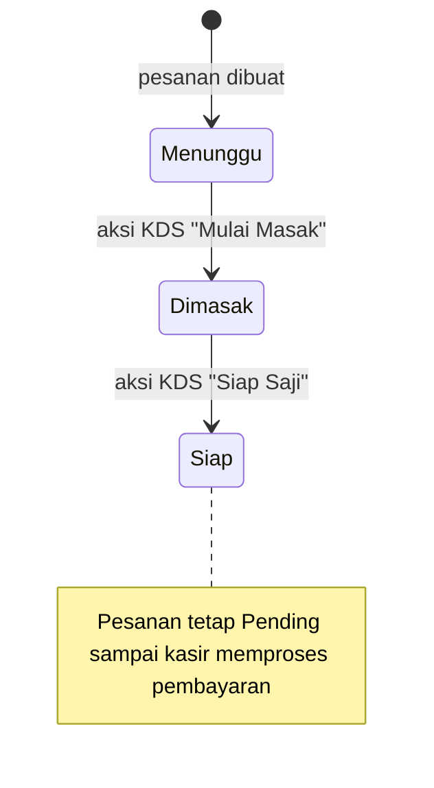

# Alur Bisnis

Dokumen ini menjelaskan perilaku yang terlihat pada source saat ini. Status dan kontrak endpoint adalah bagian dari integrasi antarhalaman, jadi ubah seluruh pemanggil/penerima secara konsisten.

## Pemesanan dine-in

1. Pelanggan membuka `user/order.php`, dapat memilih meja dari QR (`?meja=<kode_qr>`) atau memilih meja pada halaman.
2. Katalog dan kategori dimuat dari database. Keranjang dan konfigurasi item disimpan di browser melalui `localStorage`.
3. Pelanggan mengirim pesanan. Browser mengirim JSON ke `user/process_order.php`.
4. Backend membaca ulang menu dan harga dari database, memvalidasi kuantitas serta meja, lalu menyimpan header `pesanan` dan baris `detail_pesanan` dalam satu transaksi.
5. Header dibuat dengan `status_pesanan = Pending`. Nilai bawaan schema membuat `status_dapur = Menunggu`.
6. Setelah sukses, browser menampilkan konfirmasi/struk digital dan mengosongkan keranjang lokal.

## Pemesanan takeaway

1. Pelanggan membuka `user/takeaway.php`, memilih menu, lalu memasukkan nama pelanggan.
2. Checkout mengirim data ke endpoint yang sama, `user/process_order.php`, dengan `tipe_pesanan = Takeaway` dan `meja_id = 0`.
3. Backend menyimpan `id_meja = NULL` dan menolak takeaway tanpa nama pelanggan.
4. Setelah pesanan tersimpan, pesanan masuk antrean KDS dan kasir seperti pesanan dine-in.

## Pemrosesan KDS

1. `kitchen/index.php` memanggil `kitchen/poll_kitchen.php` secara berkala.
2. Polling mengambil header pesanan Pending dengan status dapur `Menunggu` atau `Dimasak`, serta detail item dari `detail_pesanan`.
3. Koki mengirim POST JSON ke `kitchen/update_status.php` untuk status `Dimasak` atau `Siap`.
4. Ketika status dapur menjadi `Siap`, endpoint saat ini menandai meja dine-in sebagai `Terisi`. Takeaway tidak mengubah meja.
5. Status dapur `Siap` tidak menyelesaikan transaksi. Pesanan tetap berstatus `Pending` sampai kasir menandai pembayaran selesai.

KDS melakukan polling sekitar setiap 4 detik. Notifikasi suara bergantung pada izin autoplay browser dan kontrol audio di halaman.

## Pembayaran kasir dan struk

1. Kasir login melalui `admin/login.php`, lalu membuka `user/kasir.php`.
2. Kasir melihat pesanan berstatus `Pending`; polling `user/poll_orders.php` memperbarui indikator perubahan antrean/status dapur.
3. Kasir memilih `Cash` atau `QRIS`. UI menyediakan input/preset nominal tunai dan menghitung kembalian di browser.
4. Saat form pembayaran dikirim, backend saat ini menyimpan status pesanan `Selesai`, metode bayar, serta waktu selesai. Nominal uang diterima/kembalian bukan bagian dari kolom yang disimpan pada schema saat ini.
5. Untuk pesanan yang memiliki meja, handler pembayaran menandai meja `Kosong`, kemudian mengarahkan ke `user/cetak_struk.php?id=<id_pesanan>`.
6. Halaman struk memeriksa sesi kasir, memuat snapshot detail pesanan, dan memicu dialog cetak browser.

## Administrasi

- Admin login lalu mengakses `admin/index.php?page=dashboard|menu|keuangan|pengaturan`.
- Manajemen menu memiliki halaman tambah, edit, dan hapus tersendiri. Foto menu disimpan di `img/`.
- Catatan uang masuk dan keluar tersimpan di tabel terpisah. Bukti pengeluaran yang diunggah disimpan di `img/receipts/`.
- Dashboard dan laporan hanya menghitung pesanan berstatus `Selesai` sebagai omzet penjualan; laporan menggabungkannya dengan pemasukan manual dan mengurangkan pengeluaran.
- Pengaturan disimpan sebagai pasangan `kunci`/`nilai` pada tabel `pengaturan`.
- PDF daftar menu dan laporan keuangan dibuat oleh endpoint admin terpisah menggunakan mPDF.

## Ketentuan saat mengubah alur

- Jangan menganggap status dapur sama dengan status pembayaran/pesanan.
- Jangan mengubah ejaan/case status, tipe pesanan, atau metode pembayaran tanpa memperbarui enum database, query, UI, dan validasi endpoint.
- Jangan mempercayai total atau harga yang dikirim browser; harga authoritative berasal dari tabel `menu`.
- Pertahankan snapshot nama dan harga item ketika pesanan dibuat agar struk/laporan historis tidak berubah karena perubahan katalog.
- Uji kedua jenis pesanan, termasuk relasi meja dine-in dan nilai meja NULL untuk takeaway.
- Pembayaran dan pengosongan meja saat ini terjadi pada beberapa query terpisah, bukan satu transaksi gabungan. Perubahan yang menyentuh konsistensi keduanya perlu mempertimbangkan atomicity.

## Batasan implementasi yang diketahui

- Pembuatan pesanan melakukan transaksi untuk header/detail. Pembayaran dan perubahan meja belum dibungkus dalam satu transaksi.
- Nominal tunai/kembalian hanya dihitung di UI; schema tidak menyimpan uang diterima atau kembalian.
- Endpoint KDS tidak menggunakan pemeriksaan sesi pada implementasi yang ada. Jangan menganggap endpoint tersebut terlindungi autentikasi.
- Keranjang pelanggan menggunakan `localStorage` browser; data itu bukan record pesanan sampai checkout berhasil di backend.
