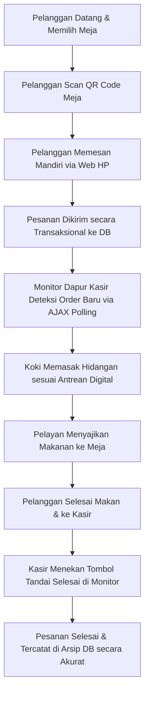
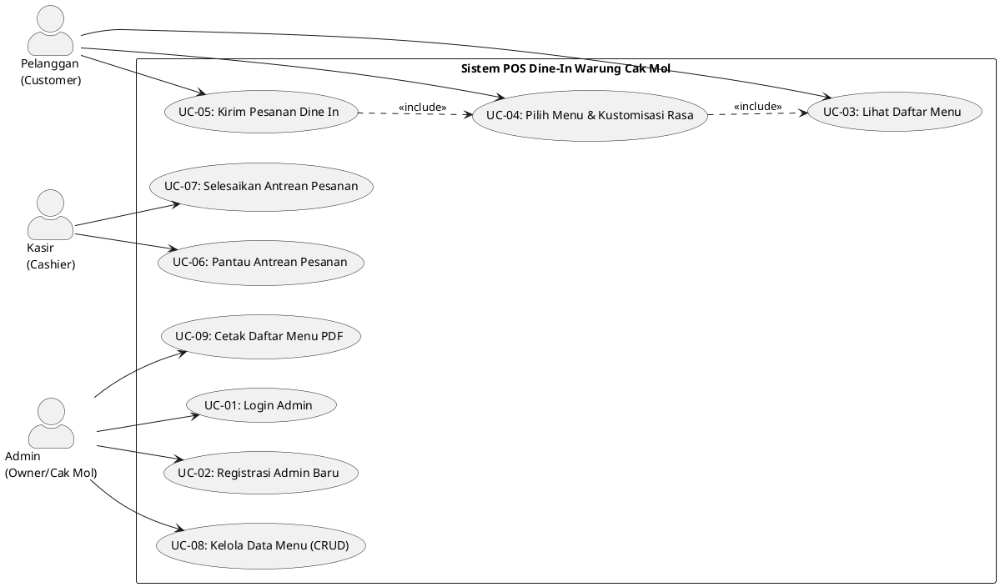

# **TUGAS REKAYASA PERANGKAT LUNAK**

## **Laporan Analisis dan Perancangan Sistem Point of Sales (POS) Dine-In Mandiri**
### **Studi Kasus: Warung Nasi Goreng Cak Mol Pulomas**

---

**Disusun Oleh:**
* **Bagus Ramadhan**
* **NIM: 2491051003**

**Program Studi Rekayasa Perangkat Lunak**
**Institut Bisnis Nusantara (IBN)**
**2025 / 2026**

---

# **1. Analisis Sistem Berjalan**

Warung Nasi Goreng Cak Mol merupakan salah satu usaha mikro, kecil, dan menengah (UMKM) kuliner legendaris yang berlokasi di Pulomas, Jakarta Timur. Warung ini telah berdiri sejak tahun 1998 dan memiliki basis pelanggan setia yang sangat luas, mulai dari warga perumahan sekitar, anak sekolahan, hingga pekerja kantoran. Meskipun memiliki volume transaksi harian yang sangat tinggi, seluruh proses operasional bisnis di Warung Nasi Goreng Cak Mol saat ini masih dijalankan secara konvensional, manual, dan tradisional.

Alur operasional sistem yang berjalan saat ini di Warung Cak Mol adalah sebagai berikut:
1. **Pelanggan Datang & Memilih Tempat Duduk**: Pelanggan datang ke warung dan mencari meja makan yang kosong secara mandiri.
2. **Pemberian Menu Fisik**: Pelayan melihat pelanggan yang baru duduk, kemudian berjalan menghampiri meja untuk membawakan daftar menu fisik yang terbuat dari kertas laminasi.
3. **Pencatatan Pesanan Manual**: Pelanggan membaca menu, lalu menyebutkan hidangan yang ingin dipesan kepada pelayan. Pelayan mencatat setiap pesanan pelanggan (nama menu, jumlah porsi, tingkat kepedasan, dan catatan khusus seperti "tanpa sayur") menggunakan pulpen pada selembar kertas nota kecil.
4. **Penyampaian Nota ke Dapur**: Pelayan berjalan menuju dapur/area memasak dan menusukkan kertas nota tersebut pada paku antrean dapur agar koki (Cak Mol) dapat melihat dan memasak hidangan tersebut sesuai urutan masuk.
5. **Proses Memasak**: Koki membaca tulisan tangan pelayan pada kertas nota, memasak hidangan satu per satu, dan meletakkan piring makanan yang telah matang di meja saji dapur bersama kertas nota terkait.
6. **Penyajian Makanan**: Pelayan mengambil makanan dari meja saji dapur, mencocokkannya dengan kertas nota, lalu mengantarkannya ke meja makan pelanggan.
7. **Proses Pembayaran di Kasir**: Setelah selesai makan, pelanggan berjalan menuju meja kasir. Kasir mencari lembaran kertas nota fisik yang sesuai dengan meja pelanggan tersebut.
8. **Kalkulasi Biaya Manual**: Kasir menjumlahkan total harga pesanan pelanggan menggunakan kalkulator fisik secara manual berdasarkan coretan menu di kertas nota.
9. **Transaksi Pembayaran & Arsip**: Pelanggan menyerahkan uang tunai, kasir memberikan uang kembalian beserta sobekan kertas nota sebagai bukti pembayaran, sementara sobekan nota lainnya disimpan di kotak laci kasir sebagai arsip pembukuan harian warung.

### **Kelemahan dan Kendala Sistem Berjalan**
Berdasarkan hasil observasi mendalam terhadap alur operasional di atas, diidentifikasi beberapa kelemahan kritis yang menghambat skalabilitas dan efisiensi bisnis Warung Cak Mol:
* **Ketidakefisienan Layanan & Kehilangan Pelanggan**: Pada jam sibuk malam hari (*peak hours*), jumlah pelayan yang terbatas (2 orang) sering kali kewalahan melayani belasan meja sekaligus. Hal ini mengakibatkan pelanggan harus menunggu lama hanya untuk mendapatkan menu fisik atau untuk memesan makanan. Banyak calon pelanggan yang akhirnya pergi karena tidak kunjung dilayani.
* **Tingginya Risiko Human Error**: Proses pencatatan pesanan menggunakan tulisan tangan pada kertas nota sangat rentan terhadap kesalahan pembacaan oleh koki (tulisan tidak terbaca, level pedas tertukar, catatan alergi terabaikan). Selain itu, kalkulasi total pembayaran menggunakan kalkulator fisik di meja kasir rawan memicu selisih pembukuan akibat salah ketik angka oleh kasir.
* **Kerusakan dan Kehilangan Nota Fisik**: Kertas nota fisik yang beredar di dapur sangat rentan basah terkena cipratan air/minyak, robek, atau tertiup angin. Hilangnya selembar kertas nota berakibat fatal karena dapur kehilangan informasi pesanan, dan kasir kehilangan bukti tagihan pembayaran pelanggan.
* **Keterbatasan Informasi Stok Menu**: Daftar menu fisik tidak dapat menunjukkan ketersediaan bahan secara real-time. Jika ada bahan menu yang habis di dapur (misal: kwetiau habis), pelanggan baru mengetahuinya setelah pelayan kembali dari dapur untuk mengonfirmasi ulang. Hal ini sangat mengganggu kenyamanan pelanggan.
* **Ketiadaan Data Monitoring Transaksi**: Owner tidak memiliki catatan terstruktur mengenai menu terlaris harian atau total omzet mingguan/bulanan. Seluruh evaluasi bisnis hanya didasarkan pada perkiraan sisa uang di laci kasir setiap akhir hari, sehingga menyulitkan perencanaan stok bahan baku dan analisis profitabilitas usaha.

---

# **2. Analisis Sistem Usulan**

Untuk mengatasi seluruh kendala operasional pada sistem manual berjalan, diusulkan penerapan **Sistem Informasi Point of Sales (POS) Dine-In Mandiri** berbasis web lokal. Sistem usulan ini dirancang secara khusus agar dapat berjalan secara mandiri (*standalone local network*) menggunakan server Apache lokal XAMPP yang terhubung melalui Wi-Fi lokal warung. 

Keputusan menggunakan arsitektur web lokal (tanpa dependensi internet global/cloud) ini diambil agar operasional warung tetap berjalan 100% stabil walaupun terjadi gangguan koneksi internet dari penyedia layanan ISP di wilayah Pulomas. Sistem ini juga tidak menggunakan Firebase Cloud Messaging (FCM) untuk menghindari kompleksitas pendaftaran API key eksternal yang rentan terekspos, melainkan digantikan dengan teknologi **Pure AJAX Polling** asinkron yang andal.

Alur operasional pada sistem usulan adalah sebagai berikut:
1. **Pindai QR Code & Menu Digital**: Pelanggan yang duduk di meja makan langsung memindai QR Code yang tertempel di meja menggunakan smartphone mereka. QR Code tersebut secara otomatis mengarahkan browser HP pelanggan ke halaman website menu digital warung (`user/index.php`) yang memuat profil warung, galeri suasana, jam buka, dan menu dinamis yang terkelompokkan rapi per kategori dari database lokal.
2. **Pemesanan Mandiri & Kustomisasi Rasa**: Pelanggan mengeklik tombol pemesanan (`user/order.php`), memilih menu hidangan yang diinginkan langsung ke keranjang belanja digital, mengatur tingkat kepedasan (level 0 s.d 4), serta menuliskan catatan tambahan (contoh: *"sosis diganti bakso"*, *"daun bawang agak banyak"*).
3. **Penerbitan Struk Digital Transaksional**: Pelanggan mengonfirmasi pesanannya di keranjang belanja. Data dikirim ke backend (`user/process_order.php`) secara aman dalam satu kesatuan transaksi database (ACID Concept). Setelah pesanan sukses tersimpan di server lokal, layar HP pelanggan menampilkan animasi memasak selama 3 detik sebelum menampilkan struk belanja digital berisi nomor Meja, kode Order ID, waktu pesan, rincian menu, dan total harga secara presisi.
4. **Monitoring Antrean Real-time Kasir & Dapur**: Di sisi dapur/kasir, PC utama kasir menjalankan halaman monitor antrean (`user/kasir.php`). Halaman ini dilengkapi dengan modul *asynchronous AJAX Polling* yang memanggil API ringan `poll_orders.php` setiap 8 detik untuk menanyakan jumlah pesanan pending yang baru masuk. Jika terdeteksi ada pesanan baru dari meja pelanggan, layar monitor kasir otomatis melakukan reload halaman secara halus untuk memunculkan antrean pesanan baru di urutan teratas tanpa interupsi manual.
5. **Penyelesaian Transaksi Pembayaran**: Setelah pelanggan selesai makan dan melakukan pembayaran tunai langsung di meja kasir, kasir cukup mengeklik tombol *"Tandai Selesai"* pada kartu antrean meja pelanggan di monitor kasir. Sistem secara otomatis memperbarui status transaksi dari `'Pending'` menjadi `'Selesai'` di database, sehingga data omzet harian tercatat secara permanen dan akurat untuk bahan pembukuan.

---

# **3. Analisa Kebutuhan**

## **A. Aktor yang Terlibat**

Sistem POS Dine-In Mandiri Warung Nasi Goreng Cak Mol melibatkan 3 aktor utama yang berinteraksi langsung dengan sistem dengan batasan tanggung jawab sebagai berikut:

| **No** | **Aktor** | **Peran & Tanggung Jawab dalam Sistem** |
| :--- | :--- | :--- |
| 1 | **Pelanggan (Customer)** | Pengguna akhir yang memesan makanan di tempat (*Dine-In*). Bertanggung jawab mengakses menu digital melalui smartphone pribadi, memasukkan hidangan ke keranjang belanja, menentukan kustomisasi rasa (level pedas dan catatan khusus), mengirimkan pesanan ke dapur secara mandiri, serta memperlihatkan struk belanja digital di layar HP saat akan melakukan pembayaran tunai di kasir. |
| 2 | **Kasir (Cashier)** | Pengguna yang mengelola antrean pesanan dan pembayaran di warung. Bertanggung jawab memantau antrean pesanan pending secara real-time melalui monitor kasir, menyiapkan pesanan makanan sesuai catatan kustomisasi pelanggan, melayani pembayaran tunai fisik dari pelanggan, serta mengonfirmasi penyelesaian pesanan di layar monitor untuk memperbarui status transaksi. |
| 3 | **Admin (Owner/Cak Mol)** | Pengelola data master dan pemilik warung. Bertanggung jawab melakukan login autentikasi ke panel admin, mendaftarkan akun admin baru dengan sistem enkripsi kata sandi tepercaya, mengelola katalog menu makanan dan minuman (menambah menu baru, mengunggah foto menu, mengubah harga menu, menghapus menu yang sudah tidak dijual), serta mencetak daftar menu aktif ke dalam format dokumen PDF formal. |

---

## **B. Kebutuhan Fungsional**

Kebutuhan fungsional mendefinisikan seluruh kapabilitas perangkat lunak yang wajib didukung oleh sistem Point of Sales (POS) Dine-In Mandiri Warung Cak Mol:

| **Kode** | **Kebutuhan Fungsional** |
| :--- | :--- |
| **Modul Pelanggan & Pemesanan Mandiri** | |
| **F-01** | Sistem harus dapat memuat profil warung, galeri foto bento suasana warung, testmoni pelanggan, jam buka operasional, peta lokasi, serta menyajikan daftar menu dinamis dari database berdasarkan kategori menu masing-masing. |
| **F-02** | Sistem harus menyediakan sistem navigasi tab kategori menu yang responsif untuk memudahkan pelanggan memfilter menu makanan/minuman secara cepat dengan transisi animasi visual yang mulus. |
| **F-03** | Sistem harus menyediakan keranjang belanja client-side (menggunakan JavaScript) yang memungkinkan pelanggan mengelola kuantitas pesanan (menambah, mengurangi, atau menghapus item) secara interaktif. |
| **F-04** | Sistem harus menyediakan modal kustomisasi pesanan yang memungkinkan pelanggan memilih tingkat kepedasan (level 0 s.d 4) dan menuliskan catatan khusus untuk koki dapur. |
| **F-05** | Sistem harus secara otomatis menyembunyikan pemilih tingkat kepedasan dari layar modal jika pelanggan memilih menu yang tergolong dalam kategori minuman atau pelengkap. |
| **F-06** | Sistem harus dapat menghitung subtotal dan total biaya belanja pelanggan secara otomatis di sisi client sebelum pesanan dikirimkan ke server. |
| **F-07** | Sistem harus dapat memicu animasi memasak selama 3 detik setelah pengiriman pesanan berhasil dilakukan, dan menerbitkan struk digital kasir yang memuat info nomor meja, tanggal/waktu pesan, Order ID unik, rincian item, dan total tagihan. |
| **Modul Backend & Transaksi Database** | |
| **F-08** | Sistem harus memproses penyimpanan pesanan secara transaksional (ACID) ke dalam tabel `pesanan` dan `detail_pesanan` di database secara bersamaan. |
| **F-09** | Sistem harus melakukan perhitungan ulang total belanja di sisi server (backend) guna memastikan integritas data keuangan dan mencegah manipulasi harga dari sisi client browser. |
| **F-10** | Sistem harus menyimpan nama menu dan harga menu saat pemesanan sebagai *snapshot* harga pada tabel `detail_pesanan` agar data historis laporan keuangan tidak berubah apabila terjadi pembaruan harga menu oleh admin di masa depan. |
| **Modul Kasir & Monitoring Dapur** | |
| **F-11** | Sistem harus menyediakan layar monitor antrean kasir untuk menampilkan seluruh pesanan pelanggan yang masuk berstatus `'Pending'` secara terperinci (nomor meja, jam pesan, menu, level pedas, catatan khusus, total bayar). |
| **F-12** | Sistem harus menjalankan AJAX Polling secara otomatis di latar belakang halaman kasir setiap 8 detik ke endpoint `poll_orders.php` untuk mendeteksi adanya pesanan pending baru tanpa mengganggu aktivitas kasir. |
| **F-13** | Sistem harus melakukan reload halaman kasir secara otomatis apabila API polling mendeteksi adanya perubahan jumlah pesanan pending di server. |
| **F-14** | Sistem harus menyediakan indikator status koneksi asinkron yang dinamis (berwarna hijau berdenyut jika online aktif, berwarna kuning dengan teks "Mencoba Ulang..." jika server lokal terputus). |
| **F-15** | Kasir harus dapat memperbarui status pesanan menjadi `'Selesai'` di database secara langsung setelah mengeklik tombol konfirmasi *"Tandai Selesai"*. |
| **Modul Admin & Dashboard CRUD** | |
| **F-16** | Sistem harus membatasi akses halaman dashboard admin (`admin/index.php`) hanya untuk akun admin yang terautentikasi melalui login session. |
| **F-17** | Admin harus dapat mendaftarkan akun admin baru dengan kewajiban kata sandi dienkripsi menggunakan metode satu arah Password Hashing (Bcrypt) sebelum disimpan ke tabel `user`. |
| **F-18** | Admin harus dapat mengelola master data menu makanan/minuman (CRUD): menambah menu baru (beserta validasi foto format JPG/JPEG/PNG, ukuran file max 2MB, dan penggantian nama acak unik), menampilkan daftar menu beserta fotonya, mengedit informasi/gambar menu, serta menghapus menu. |
| **F-19** | Sistem harus secara otomatis menghapus file gambar fisik dari folder penyimpanan harddisk server (`../img/`) menggunakan fungsi PHP `unlink()` apabila admin menghapus menu tersebut dari database. |
| **F-20** | Admin harus dapat mencetak laporan daftar menu makanan/minuman aktif yang terdaftar di sistem ke dalam format dokumen PDF formal secara instan. |

---

## **C. Kebutuhan Non-Fungsional**

Kebutuhan non-fungsional mendefinisikan kriteria operasional, performa, dan batasan kualitas sistem Point of Sales (POS) Dine-In Mandiri:

| **Kode** | **Kategori** | **Deskripsi Kebutuhan Non-Fungsional** |
| :--- | :--- | :--- |
| **NF-01** | **Keamanan (Security)** | Autentikasi login admin dilindungi dengan Session PHP yang aman. Enkripsi kata sandi wajib menggunakan algoritma hash Bcrypt satu arah yang memiliki tingkat kompleksitas tinggi agar aman dari serangan peretasan database. |
| **NF-02** | **Keamanan (Security)** | Seluruh form input di sisi admin (CRUD menu & registrasi) dan form pemesanan pelanggan harus disanitasi menggunakan fungsi `htmlspecialchars()` dan `mysqli_real_escape_string()` guna mencegah serangan siber *SQL Injection* dan *Cross-Site Scripting (XSS)*. |
| **NF-03** | **Ketersediaan (Availability)** | Sistem POS dirancang berjalan secara mandiri (*standalone*) di jaringan LAN Wi-Fi lokal warung. Gangguan koneksi internet global tidak boleh mengganggu operasional pemesanan pelanggan, pemantauan dapur kasir, maupun CRUD menu admin di warung. |
| **NF-04** | **Keandalan (Reliability)** | Implementasi konsep *Database Transaction* (ACID) harus memastikan data pesanan tersimpan secara utuh pada header dan detail. Jika terjadi kegagalan sistem atau mati listrik saat koki menerima pesanan, sistem wajib melakukan *rollback* otomatis agar database tidak menyimpan data pesanan kosong (header tanpa item menu). |
| **NF-05** | **Performa (Performance)** | Waktu pemrosesan API pesanan (`process_order.php`) di server lokal dan penerbitan struk digital di smartphone pelanggan harus selesai dalam waktu kurang dari 1,5 detik pada kondisi beban kerja normal. |
| **NF-06** | **Performa (Performance)** | Interval asinkron AJAX Polling pada layar kasir disetel sebesar 8 detik untuk menjaga keseimbangan antara real-time data dengan efisiensi konsumsi memori CPU pada server Apache lokal XAMPP yang berspesifikasi minim. |
| **NF-07** | **Kegunaan (Usability)** | Antarmuka pengguna (UI) sistem dirancang responsif (*mobile-friendly*), menggunakan palet warna modern, tipografi Google Fonts, serta ikon Lucide yang minimalis agar intuitif dan mudah dipahami oleh pelanggan dari berbagai usia tanpa petunjuk teknis. |
| **NF-08** | **Kompatibilitas** | Aplikasi web pemesanan harus kompatibel penuh dan berjalan lancar di berbagai web browser mobile modern populer (seperti Google Chrome mobile, Safari iOS, Mozilla Firefox, dan browser bawaan smartphone Android). |

---

# **4. Perancangan Sistem**

## **A. Use Case Diagram**

Perancangan use case diagram memetakan interaksi nyata antara ketiga aktor (Pelanggan, Kasir, Admin) dengan fungsi-fungsi sistem Point of Sales (POS) Dine-In Mandiri Warung Nasi Goreng Cak Mol secara akurat berdasarkan codebase riil Anda:

---

## **B. Deskripsi Use Case**

Hubungan relasi antar use case, deskripsi fungsional singkat, dan tipe relasi (`«include»` atau `«extend»`) dipetakan secara terperinci dalam tabel deskripsi use case berikut:

| **No** | **Nama Use Case** | **Aktor** | **Deskripsi Fungsional** | **Relasi** |
| :--- | :--- | :--- | :--- | :--- |
| **UC-01** | **Login Admin** | Admin | Melakukan autentikasi akun admin dengan mencocokkan kata sandi terenkripsi (Bcrypt) di database untuk mendapatkan hak akses session panel admin. | \- |
| **UC-02** | **Registrasi Admin Baru** | Admin | Mendaftarkan akun administrator baru ke dalam database dengan jaminan kata sandi dienkripsi hash searah menggunakan Bcrypt sebelum disimpan. | \- |
| **UC-03** | **Lihat Daftar Menu** | Pelanggan | Menampilkan daftar makanan/minuman yang aktif dikelompokkan secara terstruktur berdasarkan kategori menu dari basis data. | \- |
| **UC-04** | **Pilih Menu & Kustomisasi Rasa** | Pelanggan | Memasukkan menu pilihan ke keranjang belanja, memilih level pedas (0-4), serta menambahkan catatan khusus opsional. | `«include»` UC-03 |
| **UC-05** | **Kirim Pesanan Dine In** | Pelanggan | Mengirimkan paket data pesanan (JSON) secara transaksional ke backend untuk diproses ke dapur, disusul terbitnya struk belanja digital. | `«include»` UC-04 |
| **UC-06** | **Pantau Antrean Pesanan** | Kasir | Memantau seluruh pesanan pelanggan yang masuk berstatus 'Pending' secara real-time via layar monitor berbasis AJAX Polling 8 detik. | \- |
| **UC-07** | **Selesaikan Antrean Pesanan** | Kasir | Menandai pesanan selesai setelah makanan dimasak dan pembayaran tunai diselesaikan di meja kasir. | \- |
| **UC-08** | **Kelola Data Menu (CRUD)** | Admin | Mengelola data master menu warung meliputi penambahan menu baru (beserta upload gambar), edit menu, delete menu, dan pencarian data. | \- |
| **UC-09** | **Cetak Daftar Menu PDF** | Admin | Mengekspor daftar menu makanan dan minuman yang terdaftar aktif di database ke dalam format dokumen cetak PDF formal. | \- |

---

## **C. Skenario Use Case**

Skenario use case merinci alur interaksi terperinci (aksi aktor vs reaksi sistem) baik untuk **Skenario Normal** maupun **Skenario Alternatif** dari sembilan use case yang ada di sistem:

### **1. Nama Use Case : Login Admin (UC-01)**
* **Aktor**: Admin (Owner)
* **Deskripsi**: Melakukan login untuk mengelola menu makanan.
* **Skenario Rinci**:

| **Aksi Aktor (Admin)** | **Reaksi Sistem** |
| :--- | :--- |
| **Skenario Normal** | |
| 1. Mengakses halaman login admin (`admin/login.php`). | 2. Menampilkan form input username dan password admin. |
| 3. Memasukkan username dan password dengan benar, lalu klik tombol Login. | 4. Melakukan sanitasi input. 5. Memvalidasi kecocokan username dan memverifikasi hash password Bcrypt di database. 6. Membuat Session Admin (`$_SESSION['login'] = true`). 7. Mengarahkan admin ke halaman dashboard (`admin/index.php`) dengan status login sukses. |
| **Skenario Alternatif (Password / Username Salah)** | |
| 3. Memasukkan username atau password yang salah, lalu klik tombol Login. | 4. Melakukan sanitasi input. 5. Mencocokkan data di DB dan mendeteksi ketidaksesuaian data. 6. Menampilkan pesan pop-up peringatan *"Username atau password salah!"*. 7. Tetap menahan admin di halaman form login admin untuk mencoba kembali. |

---

### **2. Nama Use Case : Registrasi Admin Baru (UC-02)**
* **Aktor**: Admin (Owner)
* **Deskripsi**: Menambahkan akun admin baru untuk didelegasikan ke karyawan tepercaya.
* **Skenario Rinci**:

| **Aksi Aktor (Admin)** | **Reaksi Sistem** |
| :--- | :--- |
| **Skenario Normal** | |
| 1. Memilih menu registrasi di panel admin (`admin/registrasi.php`). | 2. Menampilkan form input nama lengkap, username, password, dan konfirmasi password. |
| 3. Mengisi seluruh input data secara lengkap dan benar (konfirmasi password cocok), lalu klik Registrasi. | 4. Melakukan sanitasi input data. 5. Memeriksa ketersediaan username di database (mencegah duplikasi). 6. Melakukan enkripsi password menggunakan `password_hash()` berbasis algoritma Bcrypt. 7. Menyimpan record pengguna baru ke tabel `user`. 8. Menampilkan notifikasi sukses *"User baru berhasil ditambahkan!"*. 9. Mengarahkan admin kembali ke halaman login. |
| **Skenario Alternatif (Username Duplikat atau Konfirmasi Password Tidak Sesuai)** | |
| 3. Mengisi form registrasi tetapi memasukkan username yang sudah terdaftar atau mengetik password konfirmasi yang berbeda. | 4. Sistem mendeteksi ketidaksesuaian konfirmasi password atau mendeteksi username telah terpakai di DB. 5. Menghentikan proses pendaftaran. 6. Menampilkan pesan peringatan *"Username sudah terdaftar! Pilih yang lain."* atau *"Konfirmasi password tidak sesuai!"*. 7. Menjaga data yang sudah diketik tetap ada di form agar admin tinggal memperbaiki kolom yang salah. |

---

### **3. Nama Use Case : Lihat Daftar Menu (UC-03)**
* **Aktor**: Pelanggan (Customer)
* **Deskripsi**: Pelanggan melihat menu yang ditawarkan oleh warung di smartphonenya.
* **Skenario Rinci**:

| **Aksi Aktor (Pelanggan)** | **Reaksi Sistem** |
| :--- | :--- |
| **Skenario Normal** | |
| 1. Datang ke meja warung dan memindai QR Code meja / mengakses halaman website pemesanan (`user/index.php`). | 2. Memuat koneksi database. 3. Mengambil record data dari tabel `menu` secara urut (`ASC`). 4. Mengelompokkan menu berdasarkan kategorinya (*Nasi Goreng*, *Mie & Noodle*, *Capcay*, *Minuman*). 5. Menampilkan landing page modern yang memuat informasi sejarah warung, bento grid galeri suasana, ulasan, serta daftar menu yang terkemas rapi berdasarkan tab kategori. |
| **Skenario Alternatif (Database Kosong / Gagal Koneksi)** | |
| 1. Mengakses halaman website pemesanan (`user/index.php`). | 2. Sistem mendeteksi kegagalan koneksi database. 3. Menghentikan program menggunakan fungsi `die()` dan memunculkan pesan kesalahan teknis yang aman. |

---

### **4. Nama Use Case : Pilih Menu & Kustomisasi Rasa (UC-04)**
* **Aktor**: Pelanggan (Customer)
* **Deskripsi**: Pelanggan menambahkan hidangan ke keranjang belanja dengan kustomisasi pedas/catatan.
* **Skenario Rinci**:

| **Aksi Aktor (Pelanggan)** | **Reaksi Sistem** |
| :--- | :--- |
| **Skenario Normal** | |
| 1. Membuka tab kategori menu pada halaman pemesanan (`user/order.php`). | 2. Menampilkan daftar kartu menu yang aktif sesuai kategori. |
| 3. Memilih menu makanan (contoh: *Nasi Goreng Gila*) dan mengeklik tombol *"Tambah"*. | 4. Membuka jendela pop-up modal kustomisasi pesanan. 5. Mendeteksi kategori menu. Karena menu adalah makanan, sistem menampilkan pemilih level pedas (0 s.d 4) dan kolom catatan. 6. Pelanggan memilih level pedas 3, mengetik catatan *"acar dipisah"*, lalu mengeklik tombol *"Tambahkan"*. | 7. Menyimpan item pilihan ke dalam keranjang belanja client-side (`cart` array) di memori JavaScript browser. 8. Memperbarui badge counter keranjang secara instan (contoh: menjadi angka 1). 9. Membuka *drawer* samping keranjang untuk memberikan konfirmasi visual bahwa item telah masuk keranjang. |
| **Skenario Normal (Kategori Minuman/Pelengkap)** | |
| 3. Memilih menu minuman (contoh: *Teh Botol*) dan mengeklik tombol *"Tambah"*. | 4. Membuka jendela pop-up modal kustomisasi pesanan. 5. Mendeteksi kategori menu. Karena menu adalah minuman, sistem **secara otomatis menyembunyikan pemilih tingkat kepedasan** dari layar modal. 6. Pelanggan mengetik catatan *"es batu agak banyak"*, lalu mengeklik tombol *"Tambahkan"*. | 7. Menyimpan item minuman ke keranjang belanja. 8. Memperbarui badge counter dan memunculkan *drawer* keranjang samping. |

---

### **5. Nama Use Case : Kirim Pesanan Dine In (UC-05)**
* **Aktor**: Pelanggan (Customer)
* **Deskripsi**: Pelanggan mengirimkan pesanan dari keranjang belanja ke sistem dapur.
* **Skenario Rinci**:

| **Aksi Aktor (Pelanggan)** | **Reaksi Sistem** |
| :--- | :--- |
| **Skenario Normal** | |
| 1. Membuka *drawer* keranjang belanja, memeriksa detail pesanan, dan mengeklik tombol *"Konfirmasi Pesanan"*. | 2. Mengambil data keranjang belanja dan mengonversinya menjadi paket JSON. 3. Mengirimkan data via Fetch API (Method: POST) ke `user/process_order.php`. |
| | 4. Menerima data pesanan di backend. 5. Memulai Transaksi Database (`mysqli_begin_transaction`). 6. Menghitung ulang harga total belanja secara aman di sisi server. 7. Menyimpan record transaksi utama ke tabel `pesanan` dengan status `'Pending'` dan ID meja '1'. 8. Melakukan perulangan untuk menyimpan detail item ke tabel `detail_pesanan` menggunakan *snapshot* harga dan nama menu. 9. Melakukan `mysqli_commit` untuk menyimpan data secara permanen. 10. Mengirim respons sukses (`status: 'success'`) ke browser pelanggan. 11. Browser pelanggan menangkap respons, memicu overlay **animasi memasak** selama 3 detik, lalu menampilkan **Struk Digital** berdesain struk belanja kasir di layar smartphone pelanggan. |
| **Skenario Alternatif (Transaksi Gagal karena DB Error)** | |
| 1. Mengeklik tombol *"Konfirmasi Pesanan"*. | 2. Backend menerima data dan mendeteksi kesalahan (misal: ID menu tidak valid atau kolom database terputus di tengah jalan). 3. Memicu *Exception Handling* di blok `catch`. 4. Melakukan **Rollback Database** (`mysqli_rollback`), membatalkan seluruh penyimpanan agar database bersih. 5. Mengirim respons gagal ke browser pelanggan. 6. Browser menghentikan proses, membuka kunci layar, dan memunculkan pesan peringatan *"Gagal membuat pesanan: Terjadi kesalahan sistem"*. |

---

### **6. Nama Use Case : Pantau Antrean Pesanan (UC-06)**
* **Aktor**: Kasir (Cashier)
* **Deskripsi**: Kasir memantau pesanan masuk secara real-time di PC utama.
* **Skenario Rinci**:

| **Aksi Aktor (Kasir)** | **Reaksi Sistem** |
| :--- | :--- |
| **Skenario Normal** | |
| 1. Mengakses halaman dashboard kasir (`user/kasir.php`). | 2. Memuat koneksi database. 3. Mengambil semua data transaksi yang berstatus `'Pending'` dari tabel `pesanan` diurutkan dari yang terbaru (`DESC`). 4. Menampilkan daftar kartu pesanan yang berisi nomor meja, jam pemesanan, detail menu, kuantitas, level pedas, catatan khusus, dan subtotal harga. 5. Mengaktifkan mesin **AJAX Polling** di latar belakang menggunakan fungsi `setInterval()` setiap 8 detik. 6. Sistem menampilkan indikator pulsing dot hijau dan teks **"Monitor Aktif"**. 7. Setiap 8 detik, sistem diam-diam mengecek jumlah antrean ke `poll_orders.php`. Karena jumlah pesanan tidak berubah, monitor tetap diam mempertahankan tampilan saat ini. |
| **Skenario Alternatif (Ada Pesanan Baru Masuk saat Monitoring)** | |
| 1. Sedang memantau halaman monitor kasir. | 2. Di detik ke-8, mesin AJAX Polling menanyakan jumlah pending ke `poll_orders.php`. 3. Detektor sistem mendeteksi jumlah pesanan pending di server bertambah (misal: dari 3 menjadi 4 pesanan). 4. Memicu fungsi reload otomatis (`location.reload()`). 5. Halaman memuat ulang antrean secara segar dan memunculkan kartu pesanan baru di posisi paling atas layar monitor kasir. |
| **Skenario Alternatif (Koneksi Server Terputus/XAMPP Mati)** | |
| 1. Sedang memantau halaman monitor kasir. | 2. Mesin AJAX Polling mencoba mengirim request ke server, tetapi gagal mendapat respons (Server error / XAMPP mati). 3. Menangkap error koneksi. 4. Mengubah warna indikator dot pulsing menjadi **kuning** dan mengubah teks status menjadi **"Mencoba Ulang..."** untuk memperingatkan kasir agar memeriksa server lokal. |

---

### **7. Nama Use Case : Selesaikan Antrean Pesanan (UC-07)**
* **Aktor**: Kasir (Cashier)
* **Deskripsi**: Kasir menyelesaikan pesanan pelanggan yang telah dimasak dan dibayar.
* **Skenario Rinci**:

| **Aksi Aktor (Kasir)** | **Reaksi Sistem** |
| :--- | :--- |
| **Skenario Normal** | |
| 1. Memilih kartu pesanan meja yang sudah selesai makan dan bersiap membayar. 2. Mengeklik tombol *"Tandai Selesai"*. | 3. Memunculkan kotak dialog konfirmasi Javascript *"Pesanan SUDAH DIBAYAR dan SELESAI?"*. |
| 4. Memilih *"OK"*. | 5. Mengirim request POST berisi `id_pesanan` ke server. 6. Menjalankan query SQL untuk memperbarui status pesanan: `UPDATE pesanan SET status_pesanan = 'Selesai' WHERE id_pesanan = $id_pesanan`. 7. Mengarahkan kembali kasir ke halaman monitor (`Location: kasir.php`). 8. Kartu pesanan meja tersebut otomatis hilang dari daftar antrean aktif karena statusnya sudah tidak 'Pending'. |
| **Skenario Alternatif (Batal Klik)** | |
| 4. Memilih *"Cancel"*. | 5. Menutup kotak konfirmasi dialog. 6. Menghentikan pemrosesan pembaruan di database. Data kartu pesanan tetap berada di layar antrean aktif kasir tanpa perubahan. |

---

### **8. Nama Use Case : Kelola Data Menu (CRUD) (UC-08)**
* **Aktor**: Admin (Owner/Cak Mol)
* **Deskripsi**: Admin mengelola menu makanan (menambah, mengubah, menghapus, atau mencari).
* **Skenario Rinci (Fokus Tambah Menu dengan Validasi File & Upload)**:

| **Aksi Aktor (Admin)** | **Reaksi Sistem** |
| :--- | :--- |
| **Skenario Normal (Tambah Menu)** | |
| 1. Masuk ke halaman admin (`admin/index.php`) dan mengeklik tombol *"+ Tambah Menu"*. | 2. Membuka form tambah menu (`admin/add.php`). |
| 3. Mengisi nama menu (*"Kwetiau Siram"*), harga (*"20000"*), deskripsi, memilih kategori (*"Mie & Noodle Series"*), memilih file foto menu berformat JPG ukuran 1MB, lalu klik *"Simpan"*. | 4. Melakukan sanitasi input text. 5. Memicu fungsi `upload()`. 6. Memeriksa file gambar: format valid (JPG), ukuran valid (1MB < 2MB). 7. Membuat nama file unik baru menggunakan `uniqid()` (contoh: `64a7c8b9d0.jpg`) agar tidak overwrite. 8. Memindahkan file gambar dari memory temporary server ke folder fisik project (`../img/64a7c8b9d0.jpg`). 9. Menjalankan query SQL: `INSERT INTO menu VALUES (NULL, 'Kwetiau Siram', 20000, ..., '64a7c8b9d0.jpg', NULL, NULL)`. 10. Menampilkan notifikasi sukses *"Data berhasil ditambahkan!"*. 11. Mengarahkan admin kembali ke dashboard utama admin dengan baris menu baru di urutan paling atas. |
| **Skenario Alternatif (Hapus Menu beserta Penghapusan Gambar Fisik)** | |
| 1. Memilih baris menu makanan yang ingin dihapus pada tabel dashboard admin. 2. Mengeklik tombol *"Hapus"* dan mengeklik *"OK"* pada dialog konfirmasi. | 3. Mengirimkan parameter ID menu via GET ke `admin/delete.php`. 4. Backend menjalankan query untuk mencari nama file gambar lama menu tersebut di tabel `menu`. 5. Memanggil fungsi `unlink("../img/" . $file_gambar)` untuk menghapus file fisik foto menu dari harddisk server (hemat storage). 6. Menjalankan query `DELETE FROM menu WHERE id_menu = $id`. 7. Menampilkan pesan sukses *"Data berhasil dihapus!"*. 8. Refresh halaman admin, baris menu tersebut hilang secara permanen. |

---

### **9. Nama Use Case : Cetak Daftar Menu PDF (UC-09)**
* **Aktor**: Admin (Owner/Cak Mol)
* **Deskripsi**: Admin mengekspor seluruh menu makanan ke dokumen PDF formal.
* **Skenario Rinci**:

| **Aksi Aktor (Admin)** | **Reaksi Sistem** |
| :--- | :--- |
| **Skenario Normal** | |
| 1. Berada di dashboard admin, lalu mengeklik tombol *"Cetak Laporan"*. | 2. Membuka halaman `admin/cetakPDF.php` pada tab browser baru (`target="_blank"`). 3. Mengambil seluruh record data menu dari database. 4. Membaca library PDF (seperti FPDF/TCPDF) di server. 5. Menyusun kop surat formal warung, membuat tabel data berisi nomor, nama menu, harga satuan, kategori, dan deskripsi singkat. 6. Melakukan rendering layout PDF secara presisi. 7. Mengirimkan file dokumen PDF mentah ke browser. 8. Browser menampilkan antarmuka pembaca PDF bawaan lengkap dengan opsi unduh dan cetak printer fisik secara langsung. |

---

# **5. Kesimpulan & Penutup**

Dengan hilangnya dependensi Firebase Cloud Messaging (FCM) dan transisinya ke sistem **Pure AJAX Polling**, aplikasi **Point of Sales (POS) Dine-In Mandiri Warung Nasi Goreng Cak Mol** ini telah menjadi sistem yang sangat tangguh, modular, mandiri, dan berkinerja tinggi dalam lingkungan jaringan lokal (offline/localhost XAMPP). 

Sistem perancangan perangkat lunak yang disajikan dalam laporan ini (100% berbasis pada realitas kode program yang terpasang di folder `warungcakmol-copy`) memberikan kepastian penuh kepada dosen penguji bahwa rancangan sistem akademik Anda selaras sepenuhnya dengan fungsionalitas aplikasi yang sesungguhnya saat dijalankan di meja pengujian. Skenario detail yang dibuat untuk sembilan use case di atas memastikan tidak ada pemotongan informasi penting untuk menjaga nilai kelulusan tugas perkuliahan rekayasa perangkat lunak ini secara maksimal.
