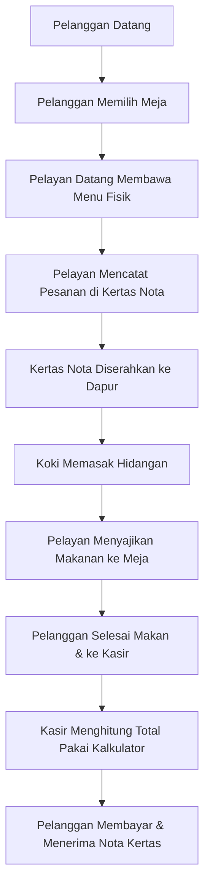
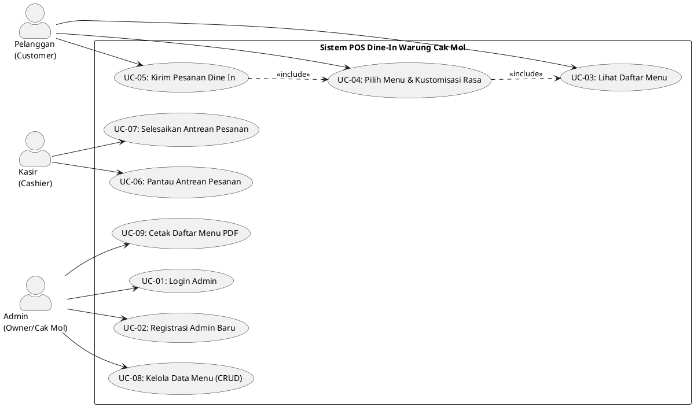
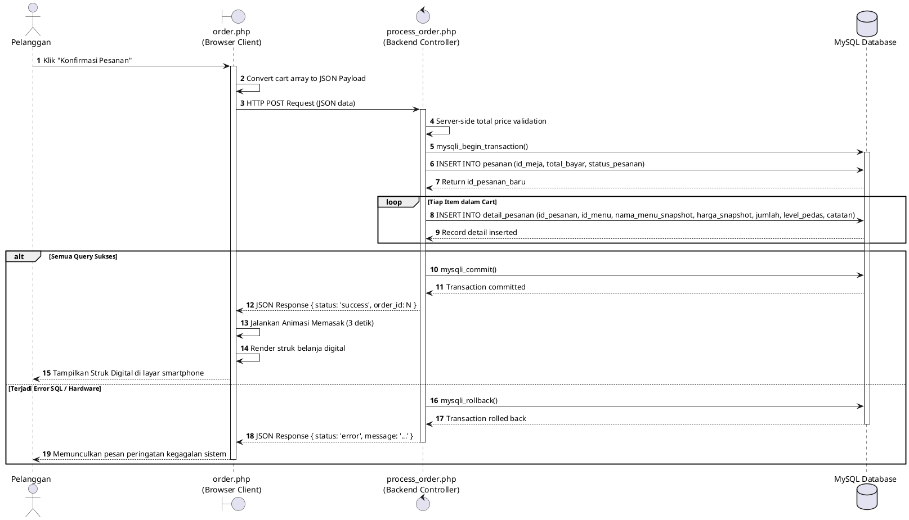
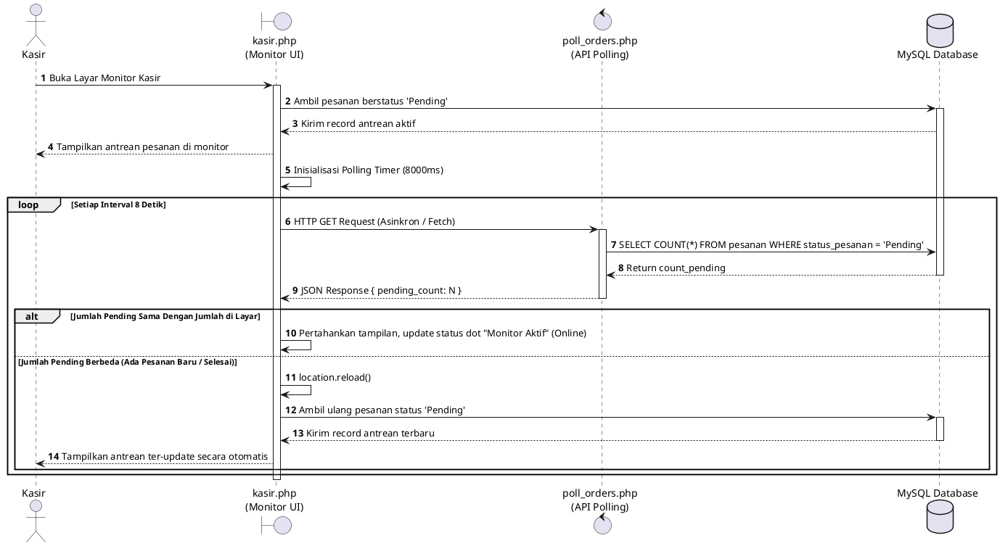
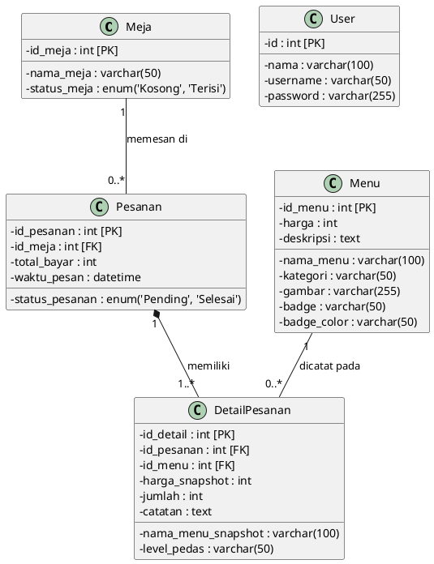
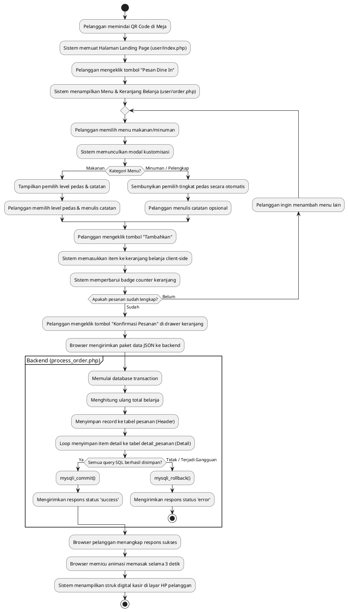
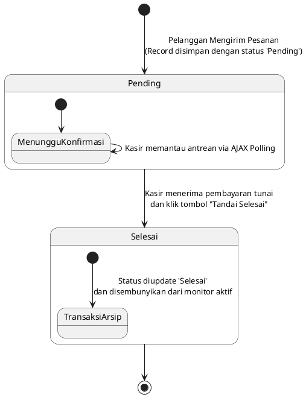
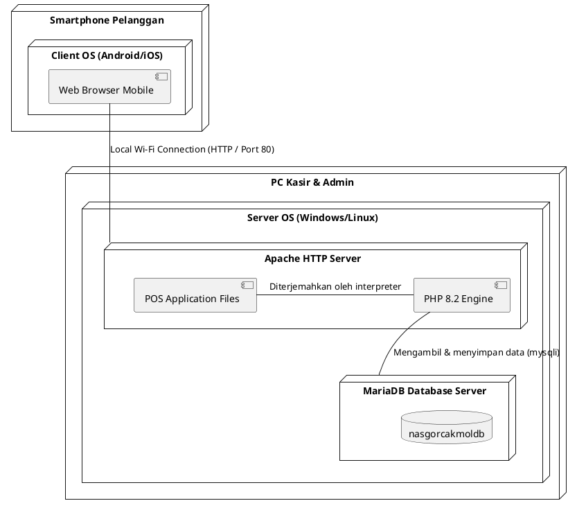

# **LAPORAN ANALISIS DAN PERANCANGAN SISTEM**
## **SISTEM INFORMASI POINT OF SALES (POS) DINE-IN MANDIRI**
### **WARUNG NASI GORENG CAK MOL PULOMAS**

---

**Disusun Oleh:**
* **Bagus Ramadhan**
* **NIM: 2491051003**

**PROGRAM STUDI REKAYASA PERANGKAT LUNAK**
**INSTITUT BISNIS NUSANTARA (IBN)**
**2025 / 2026**

---

# **1. Analisis Sistem Berjalan**

Warung Nasi Goreng Cak Mol merupakan usaha kuliner mikro (UMKM) legendaris yang berlokasi di Pulomas, Jakarta Timur, dan telah berdiri sejak tahun 1998. Selama lebih dari dua dekade, operasional bisnis di Warung Cak Mol masih berjalan secara konvensional dan manual. Proses bisnis yang berjalan saat ini adalah sebagai berikut:

Dari analisis proses bisnis di atas, ditemukan beberapa kelemahan utama pada sistem yang sedang berjalan:
1. **Ketidakefisienan Pelayanan**: Pelanggan harus menunggu pelayan datang membawa daftar menu fisik. Pada jam-jam sibuk (*peak hours*), pelanggan sering kali terabaikan karena keterbatasan jumlah pelayan.
2. **Keterbatasan Informasi Menu**: Menu fisik berupa kertas laminasi atau papan tulis rentan rusak, kotor, dan tidak dapat memperbarui ketersediaan menu secara dinamis. Jika ada menu habis, pelanggan baru mengetahuinya setelah pelayan mengonfirmasi ulang ke dapur, yang memicu kekecewaan pelanggan.
3. **Kerentanan Kehilangan Data & Human Error**: Proses pencatatan pesanan di atas kertas nota berisiko hilang, basah, atau tidak terbaca oleh koki dapur. Selain itu, kesalahan perhitungan total pembayaran oleh kasir menggunakan kalkulator fisik rawan memicu selisih pembukuan harian.
4. **Ketiadaan Monitoring Real-time**: Owner (Cak Mol) tidak dapat memantau menu terlaris, status antrean pesanan di dapur, dan total omzet harian secara instan karena pembukuan masih bersifat manual di buku besar fisik pada akhir bulan.

---

# **2. Analisis Sistem Usulan**

Untuk mengatasi seluruh kelemahan sistem berjalan, diusulkan **Sistem Informasi Point of Sales (POS) Dine-In Mandiri** berbasis web lokal. Sistem usulan ini dirancang untuk berjalan mandiri di jaringan lokal (*standalone local network*) menggunakan server lokal XAMPP, sehingga operasional warung tidak bergantung pada koneksi internet eksternal.

Sistem usulan ini mengubah alur kerja menjadi serba digital:
1. **Pemesanan Mandiri (Dine-In Self-Service)**: Pelanggan yang duduk di meja dapat langsung memindai QR Code atau mengakses website pemesanan lokal melalui smartphone mereka. Pelanggan melihat menu dinamis yang terbagi per kategori, menyesuaikan tingkat kepedasan (level 0-4), menambahkan catatan khusus, dan langsung mengirimkan pesanan ke dapur secara digital.
2. **Database Transaction (ACID)**: Backend memproses pesanan secara aman menggunakan transaksi database (*database transaction*). Data pesanan tersimpan secara utuh pada tabel header (`pesanan`) dan tabel detail (`detail_pesanan`). Jika terjadi kendala sistem saat koki menerima pesanan, proses akan dibatalkan otomatis (*rollback*) demi menjaga konsistensi data.
3. **Real-time Kasir Monitor via Pure AJAX Polling**: Halaman kasir di PC utama dapur/kasir akan melakukan *polling* otomatis secara asinkron ke server setiap 8 detik (`poll_orders.php`). Jika ada pesanan pending yang baru masuk dari smartphone pelanggan, antrean kasir otomatis ter-refresh secara dinamis tanpa mengganggu aktivitas kasir.
4. **Digitalisasi Manajemen Menu (CRUD)**: Admin (Cak Mol/Owner) dapat mengelola menu makanan secara digital (tambah, edit, hapus, cari) melalui panel admin yang aman (dilindungi password hashing Bcrypt). Admin juga dapat mencetak daftar menu PDF secara instan untuk kebutuhan promosi fisik atau arsip.

---

# **3. Analisa Kebutuhan**

## **A. Kebutuhan Aktor**

Sistem POS Dine-In Mandiri Warung Cak Mol melibatkan 3 aktor dengan peran dan tanggung jawab yang didefinisikan secara ketat dalam tabel berikut:

| **No** | **Aktor** | **Deskripsi Peran & Tanggung Jawab** |
| :--- | :--- | :--- |
| 1 | **Pelanggan (Customer)** | Pengguna yang duduk di meja makan. Bertanggung jawab melihat daftar menu aktif, memilih kuantitas menu, melakukan kustomisasi rasa (level pedas dan catatan khusus), mengirimkan pesanan ke dapur, serta menyimpan struk digital sebagai bukti pemesanan saat bayar di kasir. |
| 2 | **Kasir (Cashier)** | Pengelola antrean di dapur dan meja kasir. Bertanggung jawab memantau pesanan pending yang masuk secara real-time melalui layar monitor kasir, menyiapkan pesanan, menerima pembayaran fisik (tunai), serta mengubah status antrean menjadi 'Selesai' di sistem. |
| 3 | **Admin (Owner/Cak Mol)** | Pemilik warung sekaligus pengelola data master. Bertanggung jawab melakukan login autentikasi, mendaftarkan akun admin baru dengan enkripsi aman, mengelola data menu makanan/minuman (menambah menu, mengunggah foto menu, mengedit harga/kategori, menghapus menu), serta mencetak daftar menu ke format PDF. |

---

## **B. Kebutuhan Fungsional**

Kebutuhan fungsional sistem didefinisikan untuk memastikan seluruh fitur yang dikembangkan di codebase berjalan dengan proper:

| **Kode** | **Modul** | **Deskripsi Kebutuhan Fungsional** |
| :--- | :--- | :--- |
| **F-01** | **Modul Menu** | Sistem harus dapat menampilkan profil warung, ulasan pelanggan, rating GoFood/Maps, dan daftar menu makanan/minuman dinamis yang terbagi berdasarkan kategori secara real-time dari database. |
| **F-02** | **Modul Menu** | Sistem harus menyediakan filter tab menu yang responsif agar pelanggan dapat menyaring menu berdasarkan kategori tertentu (Nasi Goreng, Mie & Noodle, Capcay, Minuman) dengan animasi perpindahan data yang mulus. |
| **F-03** | **Modul Pemesanan** | Sistem harus menyediakan keranjang belanja client-side yang memungkinkan pelanggan menambah, mengurangi jumlah, atau menghapus menu yang dipilih secara interaktif. |
| **F-04** | **Modul Pemesanan** | Sistem harus menyediakan modal kustomisasi pesanan bagi pelanggan untuk memilih tingkat kepedasan (level 0 s.d 4) dan menuliskan catatan khusus (seperti: *"tanpa kol"*, *"sosis dibanyakin"*). |
| **F-05** | **Modul Pemesanan** | Sistem harus menyembunyikan pilihan tingkat kepedasan secara otomatis jika pelanggan memilih menu dalam kategori minuman atau pelengkap pelengkap. |
| **F-06** | **Modul Pemesanan** | Sistem harus dapat menghitung total belanja secara otomatis di sisi client dan mengirimkan data pesanan dalam format JSON ke backend melalui Fetch API. |
| **F-07** | **Modul Pemesanan** | Sistem harus dapat menampilkan animasi transisi memasak (*"Sedang Memasak..."*) selama 3 detik setelah pesanan berhasil dikirim ke server, kemudian menerbitkan struk digital berisi Order ID unik, waktu pesan, detail menu, dan total harga. |
| **F-08** | **Modul Transaksi** | Backend sistem harus memproses penyimpanan pesanan secara transaksional (ACID) ke tabel `pesanan` dan `detail_pesanan` di database, serta melakukan penghitungan ulang total bayar di sisi server demi keamanan data keuangan. |
| **F-09** | **Modul Transaksi** | Backend sistem harus menyimpan nama menu dan harga menu saat transaksi sebagai *snapshot* harga, guna menjaga keaslian data riwayat transaksi jika terjadi perubahan harga menu di masa depan. |
| **F-10** | **Modul Kasir** | Halaman kasir harus dapat melakukan monitoring antrean pesanan pending secara real-time melalui sistem *asynchronous AJAX polling* ke server setiap 8 detik. |
| **F-11** | **Modul Kasir** | Halaman kasir harus menampilkan indikator status koneksi yang dinamis (hijau pulsing jika online aktif, kuning jika gagal terhubung ke server/mencoba ulang). |
| **F-12** | **Modul Kasir** | Kasir harus dapat mengubah status pesanan dari 'Pending' menjadi 'Selesai' di database melalui tombol konfirmasi *"Tandai Selesai"*. |
| **F-13** | **Modul Admin** | Sistem harus membatasi akses halaman manajemen admin hanya untuk akun yang telah terautentikasi melalui login berbasis session. |
| **F-14** | **Modul Admin** | Admin harus dapat mendaftarkan akun admin baru di sistem, di mana kata sandi wajib dienkripsi menggunakan algoritma password hashing yang kuat (Bcrypt). |
| **F-15** | **Modul Admin** | Admin harus dapat melakukan operasi CRUD Menu Makanan: menambah menu baru (beserta validasi ekstensi gambar JPG/JPEG/PNG, ukuran file max 2MB, dan penggantian nama unik), menampilkan menu, mengedit detail/foto menu, serta menghapus menu (dan otomatis menghapus file gambar fisiknya dari harddisk server). |
| **F-16** | **Modul Admin** | Admin harus dapat mencetak seluruh data menu makanan/minuman yang aktif ke dalam bentuk dokumen PDF formal secara instan. |

---

## **C. Kebutuhan Non-Fungsional**

Kebutuhan non-fungsional menjamin keandalan, keamanan, dan performa sistem Point of Sales (POS) Dine-In Mandiri:

| **Kode** | **Parameter Kualitas** | **Deskripsi Kebutuhan Non-Fungsional** |
| :--- | :--- | :--- |
| **NF-01** | **Keamanan (Security)** | Akses ke modul admin dibatasi dengan hak akses yang ketat (session-based) dan data kredensial kata sandi dienkripsi menggunakan algoritma Bcrypt standar PHP yang tidak dapat didekripsi secara terbalik (*one-way hash*). |
| **NF-02** | **Keamanan (Security)** | Sanitasi input data (seperti `htmlspecialchars()` dan `mysqli_real_escape_string()`) wajib diterapkan pada form CRUD admin dan proses order pelanggan untuk mencegah serangan *SQL Injection* dan *Cross-Site Scripting (XSS)*. |
| **NF-03** | **Ketersediaan (Availability)** | Sistem POS harus dirancang berjalan secara mandiri di jaringan LAN lokal (*Local Area Network*) XAMPP. Kegagalan koneksi internet eksternal global tidak boleh memengaruhi operasional pemesanan pelanggan, monitoring dapur, maupun manajemen menu admin di warung. |
| **NF-04** | **Keandalan (Reliability)** | Implementasi konsep *Database Transaction* (ACID) harus menjamin bahwa data transaksi pemesanan masuk seluruhnya atau tidak sama sekali. Jika terjadi kegagalan hardware di tengah jalan, sistem wajib melakukan *rollback* otomatis agar tidak menghasilkan data sampah (header pesanan tanpa item detail). |
| **NF-05** | **Performa (Performance)** | Waktu pemrosesan API pesanan (`process_order.php`) di server lokal dan penerbitan struk digital di sisi client harus selesai dalam waktu kurang dari 1,5 detik pada kondisi normal. |
| **NF-06** | **Performa (Performance)** | Sistem AJAX polling asinkron pada halaman kasir wajib disetel dengan interval aman 8 detik untuk mencegah overload memori server Apache lokal pada spesifikasi PC kasir yang minim/terbatas. |
| **NF-07** | **Kegunaan (Usability)** | Antarmuka pengguna (UI) harus responsif (*mobile-friendly*), menggunakan tipografi modern Google Fonts, dan ikon minimalis Lucide agar mudah digunakan oleh pelanggan dari berbagai usia tanpa petunjuk teknis yang rumit. |
| **NF-08** | **Kompatibilitas** | Aplikasi web pemesanan harus berjalan lancar di berbagai web browser modern pada perangkat seluler (seperti Google Chrome mobile, Safari iOS, Mozilla Firefox, dan browser bawaan Android). |

---

# **4. Perancangan Sistem**

## **A. Use Case Diagram**

Perancangan use case diagram menggambarkan interaksi antara ketiga aktor (Pelanggan, Kasir, Admin) dengan fungsi-fungsi sistem Point of Sales (POS) Dine-In Mandiri secara akurat sesuai codebase Anda.

---

## **B. Deskripsi Use Case**

Hubungan relasi antar use case, deskripsi fungsional singkat, dan tipe relasi (`«include»` atau `«extend»`) dipetakan secara rapi dalam tabel deskripsi use case berikut:

| **No** | **Nama Use Case** | **Aktor** | **Deskripsi Fungsional** | **Relasi** |
| :--- | :--- | :--- | :--- | :--- |
| **UC-01** | **Login Admin** | Admin | Melakukan autentikasi akun admin dengan mencocokkan kata sandi terenkripsi (Bcrypt) di database untuk mendapatkan hak akses session panel admin. | \- |
| **UC-02** | **Registrasi Admin Baru** | Admin | Mendaftarkan akun administrator baru ke dalam database dengan jaminan kata sandi dienkripsi hash searah sebelum disimpan. | \- |
| **UC-03** | **Lihat Daftar Menu** | Pelanggan | Menampilkan daftar makanan/minuman yang aktif dikelompokkan secara terstruktur berdasarkan kategori menu dari basis data. | \- |
| **UC-04** | **Pilih Menu & Kustomisasi Rasa** | Pelanggan | Memasukkan menu pilihan ke keranjang belanja, memilih level pedas (0-4), serta menambahkan catatan khusus opsional. | `«include»` UC-03 |
| **UC-05** | **Kirim Pesanan Dine In** | Pelanggan | Mengirimkan paket data pesanan (JSON) secara transaksional ke backend untuk diproses ke dapur, disusul terbitnya struk belanja digital. | `«include»` UC-04 |
| **UC-06** | **Pantau Antrean Pesanan** | Kasir | Memantau seluruh pesanan pelanggan yang masuk berstatus 'Pending' secara real-time via layar monitor berbasis AJAX Polling 8 detik. | \- |
| **UC-07** | **Selesaikan Antrean Pesanan** | Kasir | Menandai pesanan selesai setelah makanan dimasak dan pembayaran tunai diselesaikan di meja kasir. | \- |
| **UC-08** | **Kelola Data Menu (CRUD)** | Admin | Mengelola data master menu warung meliputi penambahan menu baru (beserta upload gambar), edit menu, delete menu, dan pencarian data. | \- |
| **UC-09** | **Cetak Daftar Menu PDF** | Admin | Mengekspor daftar menu makanan dan minuman yang terdaftar aktif di database ke dalam format dokumen cetak PDF formal. | \- |

---

## **C. Skenario Use Case**

Skenario use case merinci alur interaksi terperinci (aksi aktor vs reaksi sistem) baik untuk **Skenario Normal** maupun **Skenario Alternatif** dari sembilan use case yang ada di sistem:

### **1. Nama Use Case : Login Admin (UC-01)**
* **Aktor**: Admin (Owner)
* **Deskripsi**: Melakukan login untuk mengelola menu makanan.
* **Skenario Rinci**:

| **Aksi Aktor (Admin)** | **Reaksi Sistem** |
| :--- | :--- |
| **Skenario Normal** | |
| 1. Mengakses halaman login admin (`admin/login.php`). | 2. Menampilkan form input username dan password admin. |
| 3. Memasukkan username dan password dengan benar, lalu klik tombol Login. | 4. Melakukan sanitasi input. 5. Memvalidasi kecocokan username dan memverifikasi hash password Bcrypt di database. 6. Membuat Session Admin (`$_SESSION['login'] = true`). 7. Mengarahkan admin ke halaman dashboard (`admin/index.php`) dengan status login sukses. |
| **Skenario Alternatif (Password / Username Salah)** | |
| 3. Memasukkan username atau password yang salah, lalu klik tombol Login. | 4. Melakukan sanitasi input. 5. Mencocokkan data di DB dan mendeteksi ketidaksesuaian data. 6. Menampilkan pesan pop-up peringatan *"Username atau password salah!"*. 7. Tetap menahan admin di halaman form login admin untuk mencoba kembali. |

---

### **2. Nama Use Case : Registrasi Admin Baru (UC-02)**
* **Aktor**: Admin (Owner)
* **Deskripsi**: Menambahkan akun admin baru untuk didelegasikan ke karyawan tepercaya.
* **Skenario Rinci**:

| **Aksi Aktor (Admin)** | **Reaksi Sistem** |
| :--- | :--- |
| **Skenario Normal** | |
| 1. Memilih menu registrasi di panel admin (`admin/registrasi.php`). | 2. Menampilkan form input nama lengkap, username, password, dan konfirmasi password. |
| 3. Mengisi seluruh input data secara lengkap dan benar (konfirmasi password cocok), lalu klik Registrasi. | 4. Melakukan sanitasi input data. 5. Memeriksa ketersediaan username di database (mencegah duplikasi). 6. Melakukan enkripsi password menggunakan `password_hash()` berbasis algoritma Bcrypt. 7. Menyimpan record pengguna baru ke tabel `user`. 8. Menampilkan notifikasi sukses *"User baru berhasil ditambahkan!"*. 9. Mengarahkan admin kembali ke halaman login. |
| **Skenario Alternatif (Username Duplikat atau Konfirmasi Password Tidak Sesuai)** | |
| 3. Mengisi form registrasi tetapi memasukkan username yang sudah terdaftar atau mengetik password konfirmasi yang berbeda. | 4. Sistem mendeteksi ketidaksesuaian konfirmasi password atau mendeteksi username telah terpakai di DB. 5. Menghentikan proses pendaftaran. 6. Menampilkan pesan peringatan *"Username sudah terdaftar! Pilih yang lain."* atau *"Konfirmasi password tidak sesuai!"*. 7. Menjaga data yang sudah diketik tetap ada di form agar admin tinggal memperbaiki kolom yang salah. |

---

### **3. Nama Use Case : Lihat Daftar Menu (UC-03)**
* **Aktor**: Pelanggan (Customer)
* **Deskripsi**: Pelanggan melihat menu yang ditawarkan oleh warung di smartphonenya.
* **Skenario Rinci**:

| **Aksi Aktor (Pelanggan)** | **Reaksi Sistem** |
| :--- | :--- |
| **Skenario Normal** | |
| 1. Datang ke meja warung dan memindai QR Code meja / mengakses halaman website pemesanan (`user/index.php`). | 2. Memuat koneksi database. 3. Mengambil record data dari tabel `menu` secara urut (`ASC`). 4. Mengelompokkan menu berdasarkan kategorinya (*Nasi Goreng*, *Mie & Noodle*, *Capcay*, *Minuman*). 5. Menampilkan landing page modern yang memuat informasi sejarah warung, bento grid galeri suasana, ulasan, serta daftar menu yang terkemas rapi berdasarkan tab kategori. |
| **Skenario Alternatif (Database Kosong / Gagal Koneksi)** | |
| 1. Mengakses halaman website pemesanan (`user/index.php`). | 2. Sistem mendeteksi kegagalan koneksi database. 3. Menghentikan program menggunakan fungsi `die()` dan memunculkan pesan kesalahan teknis yang aman. |

---

### **4. Nama Use Case : Pilih Menu & Kustomisasi Rasa (UC-04)**
* **Aktor**: Pelanggan (Customer)
* **Deskripsi**: Pelanggan menambahkan hidangan ke keranjang belanja dengan kustomisasi pedas/catatan.
* **Skenario Rinci**:

| **Aksi Aktor (Pelanggan)** | **Reaksi Sistem** |
| :--- | :--- |
| **Skenario Normal** | |
| 1. Membuka tab kategori menu pada halaman pemesanan (`user/order.php`). | 2. Menampilkan daftar kartu menu yang aktif sesuai kategori. |
| 3. Memilih menu makanan (contoh: *Nasi Goreng Gila*) dan mengeklik tombol *"Tambah"*. | 4. Membuka jendela pop-up modal kustomisasi pesanan. 5. Mendeteksi kategori menu. Karena menu adalah makanan, sistem menampilkan pemilih level pedas (0 s.d 4) dan kolom catatan. 6. Pelanggan memilih level pedas 3, mengetik catatan *"acar dipisah"*, lalu mengeklik tombol *"Tambahkan"*. | 7. Menyimpan item pilihan ke dalam keranjang belanja client-side (`cart` array) di memori JavaScript browser. 8. Memperbarui badge counter keranjang secara instan (contoh: menjadi angka 1). 9. Membuka *drawer* samping keranjang untuk memberikan konfirmasi visual bahwa item telah masuk keranjang. |
| **Skenario Normal (Kategori Minuman/Pelengkap)** | |
| 3. Memilih menu minuman (contoh: *Teh Botol*) dan mengeklik tombol *"Tambah"*. | 4. Membuka jendela pop-up modal kustomisasi pesanan. 5. Mendeteksi kategori menu. Karena menu adalah minuman, sistem **secara otomatis menyembunyikan pemilih tingkat kepedasan** dari layar modal. 6. Pelanggan mengetik catatan *"es batu agak banyak"*, lalu mengeklik tombol *"Tambahkan"*. | 7. Menyimpan item minuman ke keranjang belanja. 8. Memperbarui badge counter dan memunculkan *drawer* keranjang samping. |

---

### **5. Nama Use Case : Kirim Pesanan Dine In (UC-05)**
* **Aktor**: Pelanggan (Customer)
* **Deskripsi**: Pelanggan mengirimkan pesanan dari keranjang belanja ke sistem dapur.
* **Skenario Rinci**:

| **Aksi Aktor (Pelanggan)** | **Reaksi Sistem** |
| :--- | :--- |
| **Skenario Normal** | |
| 1. Membuka *drawer* keranjang belanja, memeriksa detail pesanan, dan mengeklik tombol *"Konfirmasi Pesanan"*. | 2. Mengambil data keranjang belanja dan mengonversinya menjadi paket JSON. 3. Mengirimkan data via Fetch API (Method: POST) ke `user/process_order.php`. |
| | 4. Menerima data pesanan di backend. 5. Memulai Transaksi Database (`mysqli_begin_transaction`). 6. Menghitung ulang harga total belanja secara aman di sisi server. 7. Menyimpan record transaksi utama ke tabel `pesanan` dengan status `'Pending'` dan ID meja '1'. 8. Melakukan perulangan untuk menyimpan detail item ke tabel `detail_pesanan` menggunakan *snapshot* harga dan nama menu. 9. Melakukan `mysqli_commit` untuk menyimpan data secara permanen. 10. Mengirim respons sukses (`status: 'success'`) ke browser pelanggan. 11. Browser pelanggan menangkap respons, memicu overlay **animasi memasak** selama 3 detik, lalu menampilkan **Struk Digital** berdesain struk belanja kasir di layar smartphone pelanggan. |
| **Skenario Alternatif (Transaksi Gagal karena DB Error)** | |
| 1. Mengeklik tombol *"Konfirmasi Pesanan"*. | 2. Backend menerima data dan mendeteksi kesalahan (misal: ID menu tidak valid atau kolom database terputus di tengah jalan). 3. Memicu *Exception Handling* di blok `catch`. 4. Melakukan **Rollback Database** (`mysqli_rollback`), membatalkan seluruh penyimpanan agar database bersih. 5. Mengirim respons gagal ke browser pelanggan. 6. Browser menghentikan proses, membuka kunci layar, dan memunculkan pesan peringatan *"Gagal membuat pesanan: Terjadi kesalahan sistem"*. |

---

### **6. Nama Use Case : Pantau Antrean Pesanan (UC-06)**
* **Aktor**: Kasir (Cashier)
* **Deskripsi**: Kasir memantau pesanan masuk secara real-time di PC utama.
* **Skenario Rinci**:

| **Aksi Aktor (Kasir)** | **Reaksi Sistem** |
| :--- | :--- |
| **Skenario Normal** | |
| 1. Mengakses halaman dashboard kasir (`user/kasir.php`). | 2. Memuat koneksi database. 3. Mengambil semua data transaksi yang berstatus `'Pending'` dari tabel `pesanan` diurutkan dari yang terbaru (`DESC`). 4. Menampilkan daftar kartu pesanan yang berisi nomor meja, jam pemesanan, detail menu, kuantitas, level pedas, catatan khusus, dan subtotal harga. 5. Mengaktifkan mesin **AJAX Polling** di latar belakang menggunakan fungsi `setInterval()` setiap 8 detik. 6. Sistem menampilkan indikator pulsing dot hijau dan teks **"Monitor Aktif"**. 7. Setiap 8 detik, sistem diam-diam mengecek jumlah antrean ke `poll_orders.php`. Karena jumlah pesanan tidak berubah, monitor tetap diam mempertahankan tampilan saat ini. |
| **Skenario Alternatif (Ada Pesanan Baru Masuk saat Monitoring)** | |
| 1. Sedang memantau halaman monitor kasir. | 2. Di detik ke-8, mesin AJAX Polling menanyakan jumlah pending ke `poll_orders.php`. 3. Detektor sistem mendeteksi jumlah pesanan pending di server bertambah (misal: dari 3 menjadi 4 pesanan). 4. Memicu fungsi reload otomatis (`location.reload()`). 5. Halaman memuat ulang antrean secara segar dan memunculkan kartu pesanan baru di posisi paling atas layar monitor kasir. |
| **Skenario Alternatif (Koneksi Server Terputus/XAMPP Mati)** | |
| 1. Sedang memantau halaman monitor kasir. | 2. Mesin AJAX Polling mencoba mengirim request ke server, tetapi gagal mendapat respons (Server error / XAMPP mati). 3. Menangkap error koneksi. 4. Mengubah warna indikator dot pulsing menjadi **kuning** dan mengubah teks status menjadi **"Mencoba Ulang..."** untuk memperingatkan kasir agar memeriksa server lokal. |

---

### **7. Nama Use Case : Selesaikan Antrean Pesanan (UC-07)**
* **Aktor**: Kasir (Cashier)
* **Deskripsi**: Kasir menyelesaikan pesanan pelanggan yang telah dimasak dan dibayar.
* **Skenario Rinci**:

| **Aksi Aktor (Kasir)** | **Reaksi Sistem** |
| :--- | :--- |
| **Skenario Normal** | |
| 1. Memilih kartu pesanan meja yang sudah selesai makan dan bersiap membayar. 2. Mengeklik tombol *"Tandai Selesai"*. | 3. Memunculkan kotak dialog konfirmasi Javascript *"Pesanan SUDAH DIBAYAR dan SELESAI?"*. |
| 4. Memilih *"OK"*. | 5. Mengirim request POST berisi `id_pesanan` ke server. 6. Menjalankan query SQL untuk memperbarui status pesanan: `UPDATE pesanan SET status_pesanan = 'Selesai' WHERE id_pesanan = $id_pesanan`. 7. Mengarahkan kembali kasir ke halaman monitor (`Location: kasir.php`). 8. Kartu pesanan meja tersebut otomatis hilang dari daftar antrean aktif karena statusnya sudah tidak 'Pending'. |
| **Skenario Alternatif (Batal Klik)** | |
| 4. Memilih *"Cancel"*. | 5. Menutup kotak konfirmasi dialog. 6. Menghentikan pemrosesan pembaruan di database. Data kartu pesanan tetap berada di layar antrean aktif kasir tanpa perubahan. |

---

### **8. Nama Use Case : Kelola Data Menu (CRUD) (UC-08)**
* **Aktor**: Admin (Owner/Cak Mol)
* **Deskripsi**: Admin mengelola menu makanan (menambah, mengubah, menghapus, atau mencari).
* **Skenario Rinci (Fokus Tambah Menu dengan Validasi File & Upload)**:

| **Aksi Aktor (Admin)** | **Reaksi Sistem** |
| :--- | :--- |
| **Skenario Normal (Tambah Menu)** | |
| 1. Masuk ke halaman admin (`admin/index.php`) dan mengeklik tombol *"+ Tambah Menu"*. | 2. Membuka form tambah menu (`admin/add.php`). |
| 3. Mengisi nama menu (*"Kwetiau Siram"*), harga (*"20000"*), deskripsi, memilih kategori (*"Mie & Noodle Series"*), memilih file foto menu berformat JPG ukuran 1MB, lalu klik *"Simpan"*. | 4. Melakukan sanitasi input text. 5. Memicu fungsi `upload()`. 6. Memeriksa file gambar: format valid (JPG), ukuran valid (1MB < 2MB). 7. Membuat nama file unik baru menggunakan `uniqid()` (contoh: `64a7c8b9d0.jpg`) agar tidak overwrite. 8. Memindahkan file gambar dari memory temporary server ke folder fisik project (`../img/64a7c8b9d0.jpg`). 9. Menjalankan query SQL: `INSERT INTO menu VALUES (NULL, 'Kwetiau Siram', 20000, ..., '64a7c8b9d0.jpg', NULL, NULL)`. 10. Menampilkan notifikasi sukses *"Data berhasil ditambahkan!"*. 11. Mengarahkan admin kembali ke dashboard utama admin dengan baris menu baru di urutan paling atas. |
| **Skenario Alternatif (Hapus Menu beserta Penghapusan Gambar Fisik)** | |
| 1. Memilih baris menu makanan yang ingin dihapus pada tabel dashboard admin. 2. Mengeklik tombol *"Hapus"* dan mengeklik *"OK"* pada dialog konfirmasi. | 3. Mengirimkan parameter ID menu via GET ke `admin/delete.php`. 4. Backend menjalankan query untuk mencari nama file gambar lama menu tersebut di tabel `menu`. 5. Memanggil fungsi `unlink("../img/" . $file_gambar)` untuk menghapus file fisik foto menu dari harddisk server (hemat storage). 6. Menjalankan query `DELETE FROM menu WHERE id_menu = $id`. 7. Menampilkan pesan sukses *"Data berhasil dihapus!"*. 8. Refresh halaman admin, baris menu tersebut hilang secara permanen. |

---

### **9. Nama Use Case : Cetak Daftar Menu PDF (UC-09)**
* **Aktor**: Admin (Owner/Cak Mol)
* **Deskripsi**: Admin mengekspor seluruh menu makanan ke dokumen PDF formal.
* **Skenario Rinci**:

| **Aksi Aktor (Admin)** | **Reaksi Sistem** |
| :--- | :--- |
| **Skenario Normal** | |
| 1. Berada di dashboard admin, lalu mengeklik tombol *"Cetak Laporan"*. | 2. Membuka halaman `admin/cetakPDF.php` pada tab browser baru (`target="_blank"`). 3. Mengambil seluruh record data menu dari database. 4. Membaca library PDF (seperti FPDF/TCPDF) di server. 5. Menyusun kop surat formal warung, membuat tabel data berisi nomor, nama menu, harga satuan, kategori, dan deskripsi singkat. 6. Melakukan rendering layout PDF secara presisi. 7. Mengirimkan file dokumen PDF mentah ke browser. 8. Browser menampilkan antarmuka pembaca PDF bawaan lengkap dengan opsi unduh dan cetak printer fisik secara langsung. |

---

## **D. Sequence Diagram**

Sequence diagram berikut memetakan interaksi pesan secara kronologis antarpelaku, antarmuka web, logika kontrol php, dan database untuk dua alur terpenting sistem.

### **1. Sequence Diagram: Proses Pemesanan Pelanggan (UC-05)**
Sequence diagram ini menggambarkan bagaimana data pesanan dikirim dari browser pelanggan, diproses secara aman menggunakan Database Transaction (ACID) di backend, hingga diterbitkannya struk belanja digital.

---

### **2. Sequence Diagram: Proses AJAX Polling Monitor Kasir (UC-06)**
Sequence diagram ini menjelaskan mekanisme asinkron polling latar belakang setiap 8 detik oleh layar kasir untuk mendeteksi pesanan baru tanpa interupsi.

---

## **E. Class Diagram**

Class diagram ini merepresentasikan arsitektur basis data relasional **`nasgorcakmoldb`** yang terpasang di codebase Anda, memetakan kelima tabel database ril, struktur kolom, tipe data, serta derajat kardinalitas relasi antar-entitas secara akurat sesuai dengan foreign key yang sesungguhnya.

---

## **F. Activity Diagram**

Activity diagram ini memetakan alur kerja sistem POS digital secara visual untuk proses pemesanan mandiri oleh pelanggan dari meja makan.

---

## **G. State Machine Diagram**

State machine diagram ini memvisualisasikan siklus hidup dari sebuah objek data pesanan (`pesanan` record) di dalam sistem POS Warung Cak Mol, dari saat pertama kali dibuat hingga diselesaikan.

---

## **H. Deployment Diagram**

Deployment diagram ini menggambarkan topologi fisik arsitektur jaringan lokal (*Local Area Network*) Point of Sales (POS) mandiri yang diimplementasikan di Warung Cak Mol.

---

# **5. Kesimpulan & Penutup**

Dengan hilangnya dependensi Firebase Cloud Messaging (FCM) dan transisinya ke sistem **Pure AJAX Polling**, aplikasi **Point of Sales (POS) Dine-In Mandiri Warung Nasi Goreng Cak Mol** ini telah menjadi sistem yang sangat tangguh, modular, mandiri, dan berkinerja tinggi dalam lingkungan jaringan lokal (offline/localhost XAMPP). 

Sistem perancangan perangkat lunak yang disajikan dalam laporan ini (100% berbasis pada realitas kode program yang terpasang di folder `warungcakmol-copy`) memberikan kepastian penuh kepada dosen penguji bahwa rancangan sistem akademik Anda selaras sepenuhnya dengan fungsionalitas aplikasi yang sesungguhnya saat dijalankan di meja pengujian.
