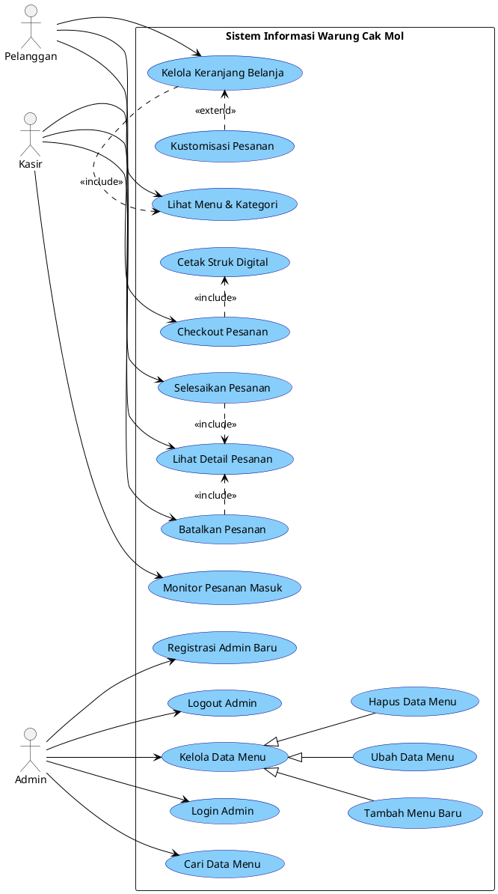

**TUGAS REKAYASA PERANGKAT LUNAK**

**Sistem Informasi Warung Nasi Goreng Cak Mol**

Disusun Oleh:
**Bagus Ramadhan**
**2491051003**

**Program Studi Rekayasa Perangkat Lunak**
Institut Bisnis Nusantara (IBN)
2024 / 2025

---

### **1. Studi Kasus: Sistem Informasi Warung Nasi Goreng Cak Mol**

Warung Nasi Goreng Cak Mol adalah UMKM kuliner yang membutuhkan digitalisasi dalam operasional pemesanan *dine-in* (makan di tempat). Sebelumnya, pencatatan pesanan dilakukan secara manual, yang sering menyebabkan human error pada rekap pesanan dan antrean panjang di meja kasir. 

Untuk mengatasi hal tersebut, dikembangkan sebuah **Sistem Informasi Pemesanan Berbasis Web** yang memiliki fitur utama:
1. **Dine-In Self-Ordering System:** Pelanggan dapat melihat menu, melakukan kustomisasi (level pedas, catatan khusus), dan memesan langsung melalui perangkat masing-masing (tanpa bantuan kasir).
2. **Cashier Monitoring System:** Kasir memantau pesanan masuk secara real-time melalui sistem *polling* dan mengelola status pesanan (Pending, Selesai, Batal).
3. **Admin Management Dashboard:** Pemilik atau admin dapat mengelola data menu (CRUD), melihat daftar pesanan secara utuh, serta mendaftarkan admin baru.

Sistem dirancang mandiri secara *native* tanpa dependensi layanan pihak ketiga yang kompleks, menggunakan mekanisme *Auto-Refresh Long-Polling* untuk menjaga sinkronisasi data pesanan antara pelanggan dan kasir secara efisien.

---

### **2. Analisa Kebutuhan**

#### **A. Aktor yang Terlibat**

| **No** | **Aktor** | **Peran dalam Sistem** |
|---|---|---|
| 1 | **Pelanggan** | Pengguna akhir yang berinteraksi dengan halaman utama untuk melihat menu, memilih pesanan, melakukan kustomisasi, dan finalisasi pesanan (*checkout*). |
| 2 | **Kasir** | Staf yang bertugas memantau dashboard antrean pesanan, meracik pesanan dari dapur, dan menyelesaikan atau membatalkan pesanan. |
| 3 | **Admin** | Pihak manajerial yang mengelola master data (katalog menu), dan mengatur akses pengguna admin. |

#### **B. Kebutuhan Fungsional**

| **Kode** | **Kebutuhan Fungsional** |
|---|---|
| **Modul Pelanggan (User)** | |
| **F-01** | Sistem menyediakan fitur filter kategori menu (Nasi Goreng, Mie, Minuman, dll). |
| **F-02** | Sistem memungkinkan pelanggan melakukan kustomisasi item (level kepedasan 0-4 dan catatan teks). |
| **F-03** | Sistem menyediakan fitur keranjang belanja (tambah, edit kuantitas, hapus item). |
| **F-04** | Sistem dapat mengkalkulasi total harga pesanan secara otomatis secara real-time. |
| **F-05** | Sistem memproses pesanan ke *database* dan menerbitkan struk digital secara otomatis. |
| **Modul Kasir** | |
| **F-06** | Sistem dapat melakukan sinkronisasi pesanan baru secara real-time (*polling system*) setiap 8 detik. |
| **F-07** | Kasir dapat melihat rincian pesanan (nomor antrean/Order ID, detail kustomisasi, waktu pesan). |
| **F-08** | Kasir dapat mengubah status pesanan menjadi "Selesai" atau "Batal". |
| **Modul Admin** | |
| **F-09** | Admin harus melakukan autentikasi (login) sebelum mengakses *dashboard*. |
| **F-10** | Sistem menyediakan fitur manajemen menu (Tambah, Ubah, Hapus) lengkap dengan upload gambar. |
| **F-11** | Sistem menyediakan fitur pencarian menu berdasarkan kata kunci. |
| **F-12** | Sistem menyediakan fitur registrasi akun admin baru dengan keamanan validasi. |

#### **C. Kebutuhan Non-Fungsional**

| **Kode** | **Kategori** | **Kebutuhan Non-Fungsional** |
|---|---|---|
| **NF-01** | **Keamanan** | Password admin harus dienkripsi menggunakan *Bcrypt* sebelum disimpan di basis data. |
| **NF-02** | **Keamanan** | Sistem menggunakan sesi (*Session/Cookies*) ter-hash untuk "Remember Me" pada panel admin. |
| **NF-03** | **Performa** | Polling *endpoint* ke server untuk kasir dibuat sangat ringan (~30 byte JSON) untuk menjaga stabilitas database. |
| **NF-04** | **Usability** | Antarmuka halaman pelanggan dibuat sangat responsif, adaptif (Mobile First), dan interaktif dengan animasi mikro. |
| **NF-05** | **Keandalan** | Validasi input (*Sanitize Input/HTML Special Chars*) di *backend* untuk mencegah serangan SQL Injection dan XSS. |

---

### **3. Perancangan Sistem**

#### **A. Use Case Diagram**

#### **B. Deskripsi Use Case**

| **No** | **Nama Use Case** | **Aktor** | **Deskripsi** | **Relasi** |
|---|---|---|---|---|
| **UC-01** | Lihat Menu & Kategori | Pelanggan | Pelanggan melihat daftar menu yang tersedia serta menggunakan filter kategori. | - |
| **UC-02** | Kustomisasi Pesanan | Pelanggan | Pelanggan menentukan tingkat kepedasan dan menambahkan catatan opsional pada suatu menu. | `«extend»` ke UC-03 |
| **UC-03** | Kelola Keranjang Belanja | Pelanggan | Pelanggan dapat menambah, mengurangi kuantitas, atau menghapus menu dari keranjang belanja. | `«include»` ke UC-01 |
| **UC-04** | Checkout Pesanan | Pelanggan | Pelanggan memfinalisasi pesanan untuk dikirimkan ke server dan dapur (basis data). | `«include»` ke UC-05 |
| **UC-05** | Cetak Struk Digital | Pelanggan | Sistem menerbitkan rincian struk (receipt) visual setelah pesanan berhasil masuk ke sistem. | - |
| **UC-06** | Monitor Pesanan Masuk | Kasir | Kasir melihat antrean pesanan baru yang secara otomatis diperbarui dengan *polling system*. | - |
| **UC-07** | Selesaikan Pesanan | Kasir | Kasir menandai pesanan telah selesai diproses dan disajikan kepada pelanggan. | `«include»` ke UC-09 |
| **UC-08** | Batalkan Pesanan | Kasir | Kasir membatalkan pesanan (misalnya jika stok bahan habis atau ada kesalahan). | `«include»` ke UC-09 |
| **UC-09** | Lihat Detail Pesanan | Kasir | Kasir melihat rincian item, level pedas, dan catatan pada suatu pesanan yang terdaftar. | - |
| **UC-10** | Login Admin | Admin | Admin melakukan autentikasi kredensial untuk masuk ke dashboard manajemen yang terlindungi. | - |
| **UC-11** | Kelola Data Menu | Admin | Use case induk untuk operasi CRUD (Create, Read, Update, Delete) pada katalog data menu. | - |
| **UC-12** | Tambah Menu Baru | Admin | Admin menginput menu baru beserta proses pengunggahan file gambar fisik menu ke server. | Generalisasi dari UC-11 |
| **UC-13** | Ubah Data Menu | Admin | Admin memperbarui atribut menu yang sudah ada, termasuk opsi pergantian file gambar. | Generalisasi dari UC-11 |
| **UC-14** | Hapus Data Menu | Admin | Admin menghapus data menu beserta berkas fisik gambarnya agar tidak membebani server. | Generalisasi dari UC-11 |
| **UC-15** | Cari Data Menu | Admin | Admin mencari data menu spesifik berdasarkan kata kunci pada nama, kategori, atau harga. | - |
| **UC-16** | Registrasi Admin Baru | Admin | Admin utama membuat akun baru bagi staf pengelola lain dengan verifikasi password. | - |
| **UC-17** | Logout Admin | Admin | Admin keluar dari sesi, menghapus riwayat sesi, dan dikembalikan ke halaman login. | - |

---

#### **C. Skenario Use Case**

**Nama Use Case : Lihat Menu & Kategori (UC-01)**
Skenario:
| **Aksi Aktor** | **Reaksi Sistem** |
|---|---|
| **Skenario Normal** | |
| 1. Membuka halaman utama (*Dine-in*) | |
| | 2. Melakukan *query* ke basis data untuk mengambil daftar seluruh menu |
| | 3. Menampilkan daftar menu beserta gambar, harga, dan tab kategori |
| 4. Memilih tab kategori spesifik (contoh: "Nasi Goreng") | |
| | 5. Menyembunyikan menu di luar kategori dan menampilkan animasi transisi menu yang relevan |
| **Skenario Alternatif** | |
| 1. Membuka halaman utama (*Dine-in*) | |
| | 2. Melakukan *query* ke basis data untuk mengambil daftar seluruh menu |
| | 3. Sistem tidak menemukan data menu (tabel kosong) |
| | 4. Menampilkan status *fallback* / kerangka kosong |

 

**Nama Use Case : Kustomisasi Pesanan (UC-02)**
Skenario:
| **Aksi Aktor** | **Reaksi Sistem** |
|---|---|
| **Skenario Normal** | |
| 1. Mengklik tombol "Tambah" pada kartu menu makanan | |
| | 2. Menampilkan modal (*popup*) kustomisasi tingkat pedas dan teks catatan |
| 3. Memilih level kepedasan dan mengetik catatan khusus | |
| 4. Menyimpan kustomisasi untuk dimasukkan ke keranjang | |
| **Skenario Alternatif** | |
| 1. Mengklik tombol "Tambah" pada kartu menu minuman | |
| | 2. Menampilkan modal kustomisasi **tanpa** opsi tingkat kepedasan (disembunyikan otomatis) |
| 3. Mengetik catatan khusus (contoh: "Sedikit gula") | |

 

**Nama Use Case : Kelola Keranjang Belanja (UC-03)**
Skenario:
| **Aksi Aktor** | **Reaksi Sistem** |
|---|---|
| **Skenario Normal** | |
| 1. Membuka keranjang belanja (*Drawer*) | |
| | 2. Menampilkan daftar item, rincian kustomisasi, kuantitas, dan kalkulasi subtotal harga |
| 3. Mengklik tombol tambah (+) atau kurang (-) kuantitas | |
| | 4. Mengkalkulasi dan memperbarui total harga di *footer* keranjang secara real-time |
| **Skenario Alternatif** | |
| 1. Mengklik tombol kurang (-) hingga kuantitas menjadi 0 atau menekan ikon hapus (X) | |
| | 2. Menghapus data item tersebut dari *array* keranjang belanja |
| | 3. Memeriksa keranjang, jika menjadi kosong, menampilkan antarmuka keranjang kosong (Empty State) |

 

**Nama Use Case : Checkout Pesanan (UC-04)**
Skenario:
| **Aksi Aktor** | **Reaksi Sistem** |
|---|---|
| **Skenario Normal** | |
| 1. Memastikan item sudah benar dan mengklik "Konfirmasi Pesanan" | |
| | 2. Mengubah antarmuka menjadi mode muat (*loading*) dan mengunci layar |
| | 3. Mengirim payload *JSON* data pesanan ke endpoint `process_order.php` |
| | 4. Menyimpan data utama ke tabel `pesanan` dan per-item ke tabel `detail_pesanan` |
| | 5. Menampilkan animasi transisi "Sedang Memasak" di layar pengguna |
| **Skenario Alternatif** | |
| 1. Mengklik "Konfirmasi Pesanan" | |
| | 2. Mengirim data ke server |
| | 3. Koneksi server terputus atau gagal proses query |
| | 4. Menampilkan peringatan "*alert*": Terjadi kesalahan koneksi ke server dan membatalkan pesanan |

 

**Nama Use Case : Cetak Struk Digital (UC-05)**
Skenario:
| **Aksi Aktor** | **Reaksi Sistem** |
|---|---|
| **Skenario Normal** | |
| | 1. Mendeteksi pesanan telah berhasil disimpan (dari UC-04) |
| | 2. Menunggu animasi "Sedang Memasak" selesai (3 detik) |
| | 3. Meng-generate struk digital yang berisi Order ID unik, waktu pesan, dan rincian transaksi |
| | 4. Menampilkan struk digital ke layar pengguna |
| 5. Mengklik tombol "Selesai & Pesan Lagi" pada struk | |
| | 6. Mengosongkan memori keranjang dan me-refresh halaman ke kondisi awal |

 

**Nama Use Case : Monitor Pesanan Masuk (UC-06)**
Skenario:
| **Aksi Aktor** | **Reaksi Sistem** |
|---|---|
| **Skenario Normal** | |
| 1. Mengakses halaman `kasir.php` | |
| | 2. Menampilkan daftar pesanan dan menginisialisasi timer *long-polling* |
| | 3. Setiap 8 detik mengirim *request* latar belakang untuk mengecek status pesanan |
| | 4. Mendeteksi ada pesanan baru dari pelanggan (jumlah status *Pending* berubah) |
| | 5. Melakukan auto-refresh halaman untuk memunculkan tiket pesanan terbaru |
| **Skenario Alternatif** | |
| 1. Berada di halaman `kasir.php` | |
| | 2. Mengirim request *polling* ke server |
| | 3. Server tidak merespon / koneksi terputus |
| | 4. Mengubah indikator status dari hijau menjadi kuning ("Mencoba Ulang...") |

 

**Nama Use Case : Selesaikan Pesanan (UC-07)**
Skenario:
| **Aksi Aktor** | **Reaksi Sistem** |
|---|---|
| **Skenario Normal** | |
| 1. Memeriksa tiket pesanan fisik dan mengklik "Selesai" | |
| | 2. Melakukan *update query* pada basis data mengubah status menjadi 'Selesai' |
| | 3. Memuat ulang halaman, sehingga pesanan tersebut hilang dari antrean aktif (*Pending*) |
| **Skenario Alternatif** | |
| 1. Mengklik "Selesai" | |
| | 2. Sistem database mengalami galat |
| | 3. Menampilkan pesan gagal memperbarui status |

 

**Nama Use Case : Batalkan Pesanan (UC-08)**
Skenario:
| **Aksi Aktor** | **Reaksi Sistem** |
|---|---|
| **Skenario Normal** | |
| 1. Mengklik tombol "Batal" (ikon peringatan) pada pesanan | |
| | 2. Menampilkan *prompt* konfirmasi persetujuan membatalkan pesanan |
| 3. Mengkonfirmasi pembatalan (OK) | |
| | 4. Mengubah status pesanan menjadi 'Dibatalkan' di basis data |
| | 5. Memuat ulang halaman kasir agar pesanan hilang dari antrean |
| **Skenario Alternatif** | |
| 1. Mengklik tombol "Batal" pada pesanan | |
| | 2. Menampilkan *prompt* konfirmasi persetujuan |
| 3. Menekan tombol batal membatalkan pesanan (Cancel) | |
| | 4. Menghentikan proses (tidak terjadi perubahan data) |

 

**Nama Use Case : Lihat Detail Pesanan (UC-09)**
Skenario:
| **Aksi Aktor** | **Reaksi Sistem** |
|---|---|
| **Skenario Normal** | |
| 1. Membaca tampilan kartu pesanan di *dashboard* | |
| | 2. Menampilkan Order ID, Tanggal, dan Total Harga |
| | 3. Mengambil dari tabel `detail_pesanan` untuk melampirkan *badge* level pedas dan teks catatan per-item menu |

 

**Nama Use Case : Login Admin (UC-10)**
Skenario:
| **Aksi Aktor** | **Reaksi Sistem** |
|---|---|
| **Skenario Normal** | |
| 1. Memasukkan *username* dan *password* di halaman login | |
| 2. Mencentang opsi "Ingat Saya" (Opsional) dan menekan "Masuk"| |
| | 3. Memeriksa kecocokan data dengan tabel pengguna (verifikasi *Bcrypt Hash*) |
| | 4. Membuat sesi (session) yang sah dan kuki (cookie) jika opsi dicentang |
| | 5. Mengalihkan admin ke halaman utama *dashboard* (`index.php`) |
| **Skenario Alternatif** | |
| 1. Memasukkan *username* dan *password* yang salah | |
| | 2. Memeriksa kecocokan data pengguna |
| | 3. Data tidak valid, mengembalikan ke form login dengan pesan error visual warna merah |

 

**Nama Use Case : Tambah Menu Baru (UC-12)**
Skenario:
| **Aksi Aktor** | **Reaksi Sistem** |
|---|---|
| **Skenario Normal** | |
| 1. Memilih tombol "Tambah Menu" | |
| | 2. Menampilkan formulir penambahan (Nama, Harga, Kategori, Deskripsi, Foto) |
| 3. Mengisi *form* dan melampirkan berkas foto berformat `.jpg` lalu klik "Simpan" | |
| | 4. Memeriksa validitas form dan ekstensi serta ukuran berkas foto |
| | 5. Mengganti nama foto dengan ID Unik, memindahkan file fisik ke folder `img/` |
| | 6. Mengeksekusi *Query Insert* ke tabel `menu` |
| | 7. Mengembalikan ke daftar menu dengan *alert* kesuksesan |
| **Skenario Alternatif** | |
| 1. Mengisi *form* namun melampirkan berkas berformat `.pdf` atau ukuran > 2MB | |
| | 2. Memeriksa validitas berkas foto |
| | 3. Menolak proses, menampilkan peringatan JS ("Yang diunggah bukan gambar" / "Ukuran terlalu besar") |

 

**Nama Use Case : Ubah Data Menu (UC-13)**
Skenario:
| **Aksi Aktor** | **Reaksi Sistem** |
|---|---|
| **Skenario Normal** | |
| 1. Mengklik ikon pensil (Ubah) pada salah satu data menu | |
| | 2. Mengambil data terkait berdasarkan ID dari basis data dan menampilkannya di form |
| 3. Mengubah kolom harga atau teks, tanpa mengganti unggahan foto, menekan "Ubah" | |
| | 4. Membaca bahwa file foto kosong (Error 4) |
| | 5. Menggunakan nama foto lama dari *hidden input* |
| | 6. Mengeksekusi *Query Update* dan mengalihkan halaman |
| **Skenario Alternatif** | |
| 1. Mengklik ikon pensil (Ubah) pada salah satu data menu | |
| | 2. Menampilkan *form* |
| 3. Melampirkan foto baru pengganti dan menekan "Ubah" | |
| | 4. Memproses validasi upload foto baru |
| | 5. Memperbarui record di database dengan tautan foto yang baru |

 

**Nama Use Case : Hapus Data Menu (UC-14)**
Skenario:
| **Aksi Aktor** | **Reaksi Sistem** |
|---|---|
| **Skenario Normal** | |
| 1. Mengklik ikon tempat sampah (Hapus) pada satu data menu | |
| | 2. Menampilkan JavaScript konfirmasi `confirm()`: "Yakin ingin menghapus data ini?" |
| 3. Menekan tombol "OK" | |
| | 4. Membaca letak *path* file gambar yang berafiliasi di sistem |
| | 5. Menggunakan fungsi `unlink()` untuk menghapus fisik gambar dari server |
| | 6. Mengeksekusi *Query Delete* dari tabel `menu` |
| | 7. Me-refresh halaman data menu |

 

**Nama Use Case : Cari Data Menu (UC-15)**
Skenario:
| **Aksi Aktor** | **Reaksi Sistem** |
|---|---|
| **Skenario Normal** | |
| 1. Mengetikkan kata sandi, misal "Nasi" di *Search Bar* dan menekan Cari | |
| | 2. Mengeksekusi *Query* menggunakan fungsi `LIKE %...%` untuk kolom nama, kategori, harga, dan deskripsi |
| | 3. Merender ulang tabel di layar berisi hasil pencarian relevan |
| **Skenario Alternatif** | |
| 1. Mengetikkan huruf *random* "xyz123" dan menekan Cari | |
| | 2. Mengeksekusi pencarian *Query* ke basis data |
| | 3. Mengembalikan tabel kosong tanpa ada baris data |

 

**Nama Use Case : Registrasi Admin Baru (UC-16)**
Skenario:
| **Aksi Aktor** | **Reaksi Sistem** |
|---|---|
| **Skenario Normal** | |
| 1. Mengisi Nama Lengkap, Username unik, Password, dan Konfirmasi Password | |
| 2. Menekan tombol "Registrasi" | |
| | 3. Melakukan seleksi ke tabel `user` untuk memeriksa eksistensi username |
| | 4. Memeriksa kesamaan kolom Password dan Konfirmasi Password |
| | 5. Melakukan enkripsi dengan fungsi `password_hash()` |
| | 6. Menyimpan admin baru ke database |
| | 7. Mengarahkan admin ke halaman login |
| **Skenario Alternatif** | |
| 1. Mengisi Username yang persis sama dengan yang sudah terdaftar | |
| 2. Menekan tombol "Registrasi" | |
| | 3. Menemukan duplikasi username di database |
| | 4. Mengembalikan peringatan: "Username sudah terdaftar! Pilih yang lain." |

 

**Nama Use Case : Logout Admin (UC-17)**
Skenario:
| **Aksi Aktor** | **Reaksi Sistem** |
|---|---|
| **Skenario Normal** | |
| 1. Mengklik opsi "Keluar" atau "Logout" di antarmuka navigasi | |
| | 2. Memutus *$_SESSION* dengan perintah `session_unset()` dan `session_destroy()` |
| | 3. Menghapus identitas kuki autentikasi (*setcookie* dengan nilai waktu *minus*) |
| | 4. Menutup koneksi dan mengalihkan pengguna kembali ke `login.php` |

---
**Dokumentasi Diperbarui secara Otomatis**
*(Tugas Mata Kuliah Pratikum Pemrograman UML - Institut Bisnis Nusantara)*
